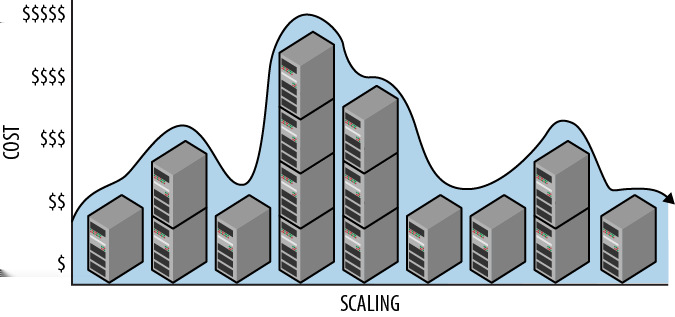

# 第二章 &emsp; 水平扩展计算模式

这种基本模式专注于计算节点的水平扩展。其主要关注点是云资源的有效利用和运维效率。

高效利用资源的关键在于无状态的自治计算节点。无状态节点并不意味着应用程序也是无状态的。重要的状态可以存储在节点外部的云缓存或存储服务中，对于 Web 层来说，这通常借助 Cookie 来实现。服务层中的服务通常不使用会话状态，因此实现起来更加简单：所有必需的状态都由调用者在每次调用中提供。

运维管理的关键在于利用云服务实现自动化，从而降低部署和管理同构节点的复杂性。

## 背景

水平扩展计算模式有效地应对了以下挑战：

- 需要经济高效地扩展计算节点，例如在 Web 层或服务层。
- 应用程序的容量需求超过（或在增长后可能超过）最大可用计算节点的容量。
- 应用程序的容量需求会随季节、月份、周或日期而变化，或者会受到不可预测的使用量峰值的影响。
- 应用计算节点需要尽可能减少停机时间，包括在硬件故障、系统升级以及因扩展而导致的资源变更时保持弹性。

此模式通常与节点终止模式（涵盖释放计算节点时的相关问题）和自动缩放模式（涵盖自动化）结合使用。

### 云平台的重要性

公有云平台针对横向扩展进行了优化。实例化单个计算节点（虚拟机）与实例化 100 个节点一样简单。部署 100 个节点后，我们只需向云平台发出一个简单的请求，即可轻松释放其中 50 个。该平台确保所有节点都使用相同的虚拟机镜像进行部署，提供节点管理服务，并提供负载均衡即服务。

## 影响

可用性、成本优化、可扩展性、用户体验

## 机制

当云原生应用准备通过添加或释放计算节点进行横向扩展时，可以通过云平台管理用户界面、扩展工具或直接通过云平台管理服务来实现。（管理用户界面和任何扩展工具最终也都使用云平台管理服务。）

管理服务要求指定特定的配置（一个或多个虚拟机镜像或应用程序镜像）以及每个配置所需的节点数量。如果所需的计算节点数量大于当前数量，则会添加节点。如果所需的计算节点数量小于当前数量，则会释放节点。如图 2-1 所示，正在使用的节点数量（以及相应的成本）会根据需求随时间变化。

该过程非常简单。但是，由于节点会不断添加和移除，因此必须谨慎管理用户会话状态并保持运行效率。

此外，了解为什么我们需要一个资源动态变化而非固定资源的应用也很重要。这是因为可逆扩展性可以帮我们省钱。

### 云扩展是可逆的

从历史上看，扩展性一直意味着*增加*容量。虽然从技术上讲，减少容量一直都是可行的，但在实践中却如同独角兽出现一样罕见。我们很少听到有人说：“嘿，公司的时间报告应用程序运行良好——我们这周末来把它迁移到性能较低的硬件上，看看会发生什么。” 这主要有两个原因。

确定应用程序所需的最大资源需求既困难又耗时。过度配置资源更为稳妥。此外，一旦硬件完成付款、购置、安装和使用，组织就很少有动力去调整它。例如，如果公司的时间报告应用程序在一周的大部分时间里只需要很少的容量，但在周五却需要20倍的容量，那么没有人会去思考如何更好地利用这6天“额外”可用的容量。

使用云原生应用，利用额外容量的风险要低得多，也简单得多；我们只需将资源归还给云平台（并停止付费），直到再次需要为止。而且这一切都无需动用任何工具。

 

*图 2-1。 云扩展很容易逆转。成本与规模成正比，而规模也会随时间变化。*

 

云资源以虚拟机和服务的形式按需短期租赁。这种模式既是一项技术创新，也是一项商业创新，它使可逆扩展成为一种切实可行的成本最小化工具。我们称可逆扩展具有弹性，因为它可以在资源扩展后轻松收缩。

<table>
    <tr>
        <td>
            
        </td>
        <td>
            切实可行的可逆扩展有助于优化运营成本。
        </td>
    </tr>
</table>

如果分配的资源超过了需求，我们可以移除部分资源。同样，如果分配的资源不足以满足需求，我们可以添加资源以满足需求。我们可以根据当前的资源需求进行横向或纵向扩展。这最大限度地降低了成本，因为释放资源后，我们无需在当前租赁期结束后继续支付费用。

 

> <h3 align="center">考虑所有租赁选项</h3>
>
> “超出当前租赁期”这一注意事项非常重要。云端租赁期限各不相同，从即时（删除一个字节即可立即停止支付存储费用）到按实际使用时间递增（类似于虚拟机租赁），再到批量（或长期）购买可能提供的更长期限。批量购买是本书未涵盖的额外成本优化方案，但您不应忽视它。

 

假设有一个业务线应用，预计仅在某个时区的正常工作时间内可用。每周只需 50 小时的可用时间。由于一周有 168 小时，我们可以通过在剩余的 118 小时内移除多余的计算节点来节省成本。对于某些应用程序，在特定时间段内移除所有计算节点是可以接受的，并且可以最大限度地节省成本。不常用的应用程序可以按需部署。

一个应用程序可能大部分时间只有少数用户轻度使用，但在每月最后三个工作日却有数万用户大量使用。我们可以相应地调整容量，使成本与使用模式相匹配：在一个月的大部分时间里部署两个节点，但在每月最后三个工作日增加到十个节点。

调整已部署容量的最简单方法是通过云供应商的 Web 托管管理工具。例如，在 Windows Azure 门户和 Amazon Web Services 控制面板中，只需点击几下鼠标即可轻松管理已部署的节点数量。在[*自动缩放模式*（第 4 章）](04_第四章_自动缩放模式.md)中，我们将探讨使此过程更加自动化和动态的其他方法。

#### **云扩展术语**

本书前面提到过，*垂直扩展*和*向上扩展*是同义词，*水平扩展*和*向外扩展*也是如此。云环境中的可逆扩展非常便捷，因此比传统环境中更受欢迎。在众多同义词中，选择更合适的术语至关重要。由于“向上扩展”和“向外扩展”这两个术语倾向于*增加*容量，而无法体现云原生应用所展现的灵活性，因此本书更倾向于使用“垂直扩展”和“水平扩展”这两个术语。

<table>
    <tr>
        <td>
            
        </td>
        <td>
            术语<i>垂直扩展</i>比<i>向上扩展</i>更中性，<i>水平扩展</i>比<i>向外扩展</i>更中性。更中性的术语不暗示增加或减少，只表示变化。这更准确地描述了云原生扩展。
        </td>
    </tr>
</table>

为了在描述特定扩展场景时强调，有时会使用*垂直向上扩展*、*垂直向下扩展*、*水平向内扩展*和*水平向外扩展*等术语。

### 管理会话状态

假设有一个应用程序，它有两个 Web 服务器节点，支持用户通过 Web 浏览器进行交互。一位首次访问者将一件商品添加到购物车。购物车数据存储在哪里？这个简单问题的答案就在于我们如何管理会话状态。

当用户与 Web 应用程序交互时，无论他们是在页面之间导航还是与单页应用程序交互，上下文都会被维护。这种上下文被称为*会话状态*。存储在会话状态中的值示例包括安全访问令牌、用户名和购物车内容。

根据应用程序层级的不同，会话状态的管理方式也会有所不同。

#### **会话状态因应用程序层级而异**

Web 应用程序通常分为多个层级，通常包括 Web 层、服务层和数据层。每一层可以包含一个或多个节点。*Web 层*运行 Web 服务器，供最终用户访问，并为浏览器和移动设备提供内容。如果 Web 层有多个节点，用户通过 Web 浏览器访问我们的应用程序，哪个节点会处理他们的请求？我们需要一种方法来引导访问用户访问不同的节点。这通常使用*负载均衡器*来实现。对于新用户会话的第一个页面请求，典型的负载均衡器会使用轮询算法将该用户定向到一个节点，以均衡负载。如何处理同一用户会话中的后续页面请求？这与我们如何管理会话状态密切相关，将在以下章节中讨论。

*Web 服务*（简称*服务*）使用标准网络协议（例如 HTTP）通过网络提供功能。常见的服务风格包括 SOAP 和 REST，其中 SOAP 在大型企业中更流行，而 REST 更适用于公开的服务。公共云平台更倾向于 REST 风格。

应用程序中的*服务层*托管实现业务逻辑并提供业务处理的服务。Web 层和其他服务层服务可以访问此层，但用户无法直接访问。此层中的节点是无状态的。

*数据层*将业务数据存储在一种或多种持久存储类型中，例如关系数据库、NoSQL 数据库和文件存储（我们稍后会学习到，文件存储也称为*blob 存储*）。有时，Web 浏览器会被授予对数据层中某些类型存储（例如文件（blob））的只读访问权限，但这种访问权限通常不包括数据库。对数据层的任何更新要么在服务层内完成，要么通过服务层进行管理，如[*代客密钥模式*（第 13 章）](13_第十三章_代客密钥模式.md)中所述。

#### **Web 层中的粘性会话**

一些 Web 应用程序使用*粘性会话*，它会在用户首次访问时将每个用户分配到一个特定的 Web 服务器节点。分配后，该节点会在用户访问期间满足其所有页面请求。粘性会话由两部分提供支持：负载均衡器确保每个用户都被定向到其分配的节点，而 Web 服务器节点则在页面请求之间存储用户的会话状态。

粘性会话的优点是简单便捷：易于编码，并且方便地将用户的会话状态存储在内存中。但是，当用户的会话状态维护在特定节点上时，该节点就不再是无状态的。该节点是一个*有状态*节点。

<table>
    <tr>
        <td>
            
        </td>
        <td>
            Amazon Web Services 弹性负载均衡器支持粘性会话，但 Windows Azure 负载均衡器不支持。在 Windows Azure 中，可以使用 Internet 信息服务 (IIS) 上的应用程序请求路由 (ARR) 来实现粘性会话。  云原生应用程序不需要粘性会话支持。
        </td>
    </tr>
</table>

#### **有状态节点的挑战**

当有状态节点持有用户会话状态的唯一副本时，用户体验会面临挑战。如果管理用户粘性会话状态的节点宕机，该用户的会话状态也会随之丢失。这可能迫使用户重新登录，或者导致购物车中的商品消失。

<table>
    <tr>
        <td>
            
        </td>
        <td>
            持有用户会话状态唯一副本的节点是单点故障。如果该节点发生故障，数据将会丢失。
        </td>
    </tr>
</table>

由于节点实例的频繁加入和退出，会话的分布也可能不均匀。假设您的 Web 层有两个 Web 服务器节点，每个节点都有 1000 个活跃会话。您添加了第三个节点来处理午餐时间的预期流量高峰。典型的负载均衡器会将新请求随机分配到所有节点。只有当新添加的节点也拥有 1000 个活跃会话时，负载均衡器才能获得足够的信息将新会话发送到该节点。实际上，它正在“追赶”轮换中的其他节点。接下来的 1000 个新会话中，这 3 个节点每个将获得大约三分之一，从而导致负载不平衡。只要节点数量保持稳定，随着旧会话的完成，这种不平衡就会得到解决。节点过载可能会导致用户体验下降，而节点利用率不足则会导致运行效率低下。那么，应该如何解决呢？

#### **无状态节点的会话状态**

云原生方法的核心在于实现无状态节点的会话状态。要保持节点的无状态性，只需避免将用户会话状态存储在本地（节点上），而是将其存储在外部即可。尽管会话状态不会存储在单个节点上，但它仍然需要存储在某个地方。

对于会话状态量非常小的应用程序，可以将所有会话状态存储在 Web Cookie 中。这样就避免了在本地存储会话状态，因为所有本地会话状态都会被消除；会话状态包含在 Cookie 中，并随页面请求一起由用户的 Web 浏览器发送。

当 Cookie 太小（或效率太低）而无法存储会话状态时，情况就变得有趣了。Cookie 仍然可以使用，但它不再存储所有会话状态，而是存储一个应用程序生成的会话标识符，该标识符链接到服务器端的会话状态；利用该会话标识符，可以在每次请求开始时检索并重新加载会话数据，并在请求结束时再次保存。云端提供了多种即用型数据存储方案，例如 NoSQL 数据存储、云存储和分布式缓存。

这些会话状态管理方法使各个 Web 节点保持独立运行，避免了有状态节点带来的挑战。使用简单的轮询负载均衡方案就足够了（这意味着负载均衡器甚至不需要了解会话状态）。当然，部分可扩展性责任现在转移到了所使用的存储机制上。这些服务通常能够胜任这项任务。

例如，分布式缓存服务可用于将会话状态外部化。主流的公有云平台提供用于创建分布式缓存的托管服务。只需几分钟，您就可以配置一个分布式缓存并使其准备就绪。您无需管理、升级、监控或配置它；只需启用它即可开始使用（并付费）。

会话状态的存在是为了在用户从一个网页导航到另一个网页时提供连续性。这种需求也适用于依赖会话状态进行身份验证和其他上下文信息的面向公众的 Web 服务。例如，单页Web应用程序可能使用AJAX调用REST服务来获取一些JSON数据。由于这些服务对用户可见，因此它们也位于Web层。所有其他服务都在服务层运行。

#### **服务层中的无状态服务节点**

服务层中的 Web 服务没有公共端点，因为它们的存在是为了支持应用程序的其他内部组件。通常，它们不依赖任何会话信息，而是完全无状态的：所有必需的状态都由调用者在每次调用中提供，包括必要的安全信息。有时，内部 Web 服务不会对调用者进行身份验证，因为云平台的安全机制会阻止外部调用者访问它们，因此它们可以假定只有应用程序内部受信任的子系统才能访问它们。

服务层中的其他服务不能直接调用。这些是[*以队列为中心的工作流程模式*（第 3 章）](03_第三章_以队列为中心的工作流程模式.md)中描述的处理服务。这些服务直接从队列中获取工作。

使用无状态服务节点不会引入新的与状态相关的问题。

### 管理多个节点

在任何非简单的云应用程序中，都会有多种节点类型，并且每种节点类型都有多个实例。实例的数量会随时间波动。如果应用程序升级采用滚动升级的方式，每次升级几个节点，那么混合部署将会很常见。

随着计算节点的增减，我们如何跟踪和管理它们？

#### **高效管理助力横向扩展**

面向云的开发意味着我们需要为每种节点类型创建一个节点镜像，​​并定义应该运行的应用程序代码。这其实就是我们所说的应用程序代码：例如，PHP 网站代码可能是一种需要创建镜像的节点类型，而 Java 发票处理服务则可能是另一种。

要使用 IaaS 创建镜像，我们需要构建虚拟机镜像；而使用 PaaS，我们需要构建 Web 应用程序（更具体地说，是 Windows Azure 上的云服务）。节点镜像创建完成后，云平台会负责将其部署到我们指定的节点数量，确保所有节点基本相同。

<table>
    <tr>
        <td>
            
        </td>
        <td>
            部署 2 个相同的节点与部署 200 个相同的节点一样简单。
        </td>
    </tr>
</table>

您选择的云平台通常会提供一个基于 Web 的管理工具，方便您查看已部署应用程序的当前规模和运行状况。

虽然您最初使用的是一组基本相同的节点，但之后可以更改单个节点。建议避免这样做，因为这会使大规模运维变得复杂。为了排查问题，您的云平台会提供一种方法，让您在进行诊断时将某个节点从负载均衡器轮换中移除；如果您进行了更改，请考虑使用此功能，并在完成后重新映像该节点。保持环境的同质性至关重要。

#### **大规模容量规划**

云环境下的容量规划也与传统方式有所不同。大型企业在非云环境下可能需要数月时间完成硬件采购，导致容量不足的风险极大。而在云环境中，容量按需可用，因此容量规划的风险状况截然不同，也无需如此精确。事实上，云环境通常会基于运营成本预测，而非僵化的资本投资和漫长的规划周期。

云服务提供商承担了过度配置带来的财务负担，以及配置不足造成的声誉风险，后者会打破“无限容量”的假象。这对客户而言是一项重要的简化；即使您计算有误，实际需要的容量超出*或低于*计划，云平台也能满足您的需求。这有助于客户灵活应对，并保护其资本。

 

> <h3 align="center">云资源真的无限吗？</h3>
>
> 我们经常听到公有云平台提供*无限资源的假象*。显然，资源并非*真正*无限（无限意味着资源非常庞大），但您可以预期，无论何时需要更多资源，它们都会可用（尽管并非总是立即到位）。这并不意味着*每个*资源都拥有无限的容量，而是指您可以请求*任意*个所需类型的资源*实例*。
>
> 这就是为什么垂直扩展存在局限性，在云环境中更是如此：单个虚拟机或数据库实例的容量存在上限，超过上限后无法继续扩展。而水平扩展则不同，如果您需要突破最大容量限制，可以通过分配额外的虚拟机或数据库实例来实现。当然，这本身也会引入复杂性，但本书中的许多模式有助于简化这种复杂性。

 

#### **虚拟机容量规划**

横向扩展方法支持通过添加所需数量的节点实例来增加资源。云计算节点本质上是虚拟机。但并非所有虚拟机都相同。云平台提供多种虚拟机配置选项，其功能在 CPU 核心数、内存容量、磁盘空间和可用网络带宽等方面各不相同。最佳虚拟机配置取决于应用程序。

确定适合您应用程序的虚拟机配置是横向扩展的重要环节。如果虚拟机容量不足，应用程序性能将不佳，甚至可能出现故障。如果虚拟机容量过大，由于大型虚拟机成本更高，应用程序的运行效率可能会降低。

通常，对于给定的应用程序节点类型，最佳虚拟机容量是能够正常运行的最小虚拟机容量。当然，对于所有应用程序而言，“正常运行”并没有一个简单的定义。例如，用于转码大型视频的节点的最佳虚拟机容量可能比用于发送账单的节点更大。那么，如何为您的应用程序确定最佳容量呢？答案是：测试。 （而且没有任何借口！云计算让使用多种虚拟机规模进行测试变得前所未有的便捷。）

应用程序中每种计算节点类型的资源使用方式不同，因此需要独立进行规模调整。

#### **故障是局部性的**

拥有多个节点的 Web 层即使某个节点发生故障，也能继续正常运行。与单节点垂直扩展不同，Web 服务器并非单点故障。（当然，要实现这一点，至少需要运行两个节点实例。）相关故障场景将在[*多租户和通用硬件入门*（第 8 章）](08_第八章_多租户和通用硬件入门.md)和[*节点故障模式*（第 10 章）](10_第十章_节点故障模式.md)中进一步讨论。

#### **运行数据收集**

应用程序中的每个运行节点都会生成运行数据。将信息直接记录到本地节点是一种高效的数据收集方式，但这还不够。为了利用已记录的数据，需要从各个节点收集数据并进行聚合。

在水平扩展环境中，由于节点数量会随时间变化，因此收集运行数据可能具有挑战性。任何自动从各个节点收集日志文件的系统都需要考虑到这一点，并且必须确保在节点释放之前捕获日志。

存在一个包含相关产品和开源项目的第三方生态系统来满足这些需求（以及更多需求），您的云平台也可能提供服务。一些 Windows Azure 平台服务在*示例*部分中进行了描述。

## 示例：在 Windows Azure 上构建 PoP

照片页​​面 (PoP) 应用程序（在前言中已介绍，并将贯穿全书作为示例）旨在实现横向扩展。此处将讨论该应用程序的 Web 层。数据存储和其他方面将在其他章节中讨论。

<table>
    <tr>
        <td>
            
        </td>
        <td>
            <i>计算节点</i> 和 <i>虚拟机</i> 是通用的行业术语。Windows Azure 中对应的节点术语是 <i>角色实例</i>，如果需要更精确的描述，可以使用 <i>Web 角色实例</i> 或 <i>工作角色实例</i>。Windows Azure 角色实例运行在虚拟机上，因此将角色实例称为虚拟机是多余的。本节的其余部分将使用 Windows Azure 术语。
        </td>
    </tr>
</table>

### Web 层

PoP 的 Web 层使用 ASP.NET MVC 实现。使用 Web 角色是支持此功能的最佳方式。Web 角色是 Windows Azure 的一项服务，用于提供运行 Windows Server 和 Internet 信息服务 (IIS) 的自动化托管虚拟机。Windows Azure 会自动创建所有请求的角色实例，并将您的应用程序部署到这些实例上；您只需提供应用程序和一些配置设置。Windows Azure 还会管理正在运行的角色实例，监控硬件和软件的运行状况（并在必要时启动恢复操作），根据需要修补角色实例上的操作系统，以及提供其他实用服务。

您的应用程序和配置设置实际上构成了一个模板，可以应用于所需的任意数量的 Web 角色实例。无论您部署 2 个角色实例还是 20 个，所需的工作量都相同；Windows Azure 会完成所有工作。

值得注意的是，使用 Web 角色后，我们不再需要担心基础架构管理：配置路由器和负载均衡器；安装和修补操作系统；升级到更新的操作系统；监控硬件故障（并进行恢复）等等。

 

> <h3 align="center">云服务依然灵活</h3>
>
> Windows Azure 云服务旨在让您摆脱基础架构管理的繁琐，专注于应用程序的构建，同时，您仍然可以根据需要进行高级配置。例如，您可以使用*启动任务*安装其他 Windows 服务、配置 IIS 或 Windows，以及运行自定义安装脚本。大多数情况下，管理员在 Windows 上可以执行的操作，在 Windows Azure 上也同样可以执行。不过，您的应用程序越接近云原生，就越有可能无需复杂的自定义配置即可“开箱即用”。一种高级配置方法是在 IIS 中启用应用程序请求路由 (ARR)，以支持会话保持。

 

### 无状态角色实例（或节点）

截至本文撰写之时，Windows Azure 负载均衡器支持将 Web 请求轮询分发到 Web 角色实例；不支持会话保持。当然，这完全没问题，因为我们正在演示云原生模式，并且我们希望水平可扩展的 Web 层由无状态的自治节点组成，以实现最大的灵活性。由于应用程序的所有 Web 角色实例都是可互换的，因此负载均衡器也可以是无状态的，就像 Windows Azure 中的情况一样。

如前所述，浏览器 Cookie 可用于存储与会话数据关联的会话标识符。在 Windows Azure 中，一些存储选项包括 SQL Azure（关系数据库）、Windows Azure 表存储（宽列 NoSQL 数据存储）、Windows Azure Blob 存储（文件/对象存储）和 Windows Azure 分布式缓存服务。由于 PoP 是一个 ASP.NET 应用程序，我们选择使用 Windows Azure 缓存的会话状态提供程序，并采用既使用熟悉的会话对象抽象，又具有云原生特性（无状态、自治节点）的编程模型。这使得 PoP 能够受益于 Windows Azure 提供的可扩展且可靠的缓存解决方案。

### 服务层

PoP 采用独立的服务层，以便 Web 层能够专注于页面渲染和用户交互。PoP 的服务层包含在后台处理用户输入的服务。

 

> <h3 align="center">是否需要独立的服务层</h3>
>
> 为了使 PoP 的架构设计与其目前取得的成功相匹配，服务层是合理的。不要忘记我们在云之外使用的所有成功实践，例如面向服务的架构 (SOA) 技术。本书重点介绍对云原生应用程序具有独特影响的架构模式，但许多其他极具价值的实践并未直接讨论，尽管 SOA 在开发云应用程序时可能非常有用。

 

PoP 服务层将托管在*工作角色*中，这些角色类似于 Web 角色，但侧重点不同。工作角色实例不会启动 IIS 服务，并且默认情况下不会添加到负载均衡器。工作角色非常适合那些没有外部接口的应用层。水平扩展与服务层配合良好；有关其内部工作原理的详细信息，请参阅[*以队列为中心的工作流程模式*（第 3 章）](03_第三章_以队列为中心的工作流程模式.md)。

 

> <h3 align="center">松耦合增加了实现的灵活性</h3>
>
> Web 层和服务层可以使用不同的技术来实现。Web 层可以使用 PHP、ASP.NET MVC 或其他前端解决方案。服务层可以使用 Java、Python、Node.js、F#、C#、C++ 等等。当不同应用层的团队成员技能各异时，这种灵活性就显得尤为重要。

 

### 运行日志和指标

横向扩展至多个角色实例时，管理运行数据是另一项挑战。运行数据在应用程序运行过程中生成，但通常不被视为应用程序本身收集的业务数据的一部分。

运行数据源示例：

- 来自 IIS 或其他 Web 服务器的日志
- Windows 事件日志
- 性能计数器
- 应用程序输出的调试消息
- 应用程序生成的自定义日志

从如此多的实例收集日志数据可能非常繁琐。Windows Azure 诊断 (WAD) 监视器是一项平台服务，可用于从所有角色实例收集数据，并将其集中存储在单个 Windows Azure 存储帐户中。数据收集完成后，即可进行分析和报告。

另一个运行数据源是 Windows Azure 存储分析功能，其中包含来自 Windows Azure 存储 Blob、表和队列的指标和访问日志。

分析数据示例：

- 特定 Blob 或 Blob 容器的访问次数
- 访问频率最高的 Blob 容器
- 来自给定 IP 地址范围的匿名请求数量
- 请求持续时间
- 每小时访问 Blob、表或队列服务的请求数量
- Blob 占用的空间大小

WAD 不会收集分析数据，因此不会自动合并，但可用于分析。例如，应用程序可以将 Blob 存储访问日志与 IIS 日志合并，以更全面地了解用户活动。

<table>
    <tr>
        <td>
            
        </td>
        <td>
            Windows Azure Diagnostics 和 Windows Azure Storage Analytics 都支持应用程序定义的数据保留策略。这使得应用程序可以轻松限制运行数据的大小和保存时间，因为云平台会处理数据清除的细节。
        </td>
    </tr>
</table>

Windows Azure 平台中提供了一些通用报告工具，可用于分析日志和指标数据。Azure 上的 Hadoop 服务在[*MapReduce 模式*（第 6 章）](06_第六章_MapReduce模式.md)中有详细介绍。Windows Azure SQL 报告服务也可能很有用。

 

> <h3 align="center">相关章节</h3>
>
> - [*以队列为中心的工作流程模式*（第3章）](03_第三章_以队列为中心的工作流程模式.md)
>
> - [*自动缩放模式*（第4章）](04_第四章_自动缩放模式.md)
>
> - [*MapReduce 模式*（第6章）](06_第六章_MapReduce模式.md)
>
> - [*数据库分片模式*（第7章）](07_第七章_数据库分片模式.md)
>
> - [*多租户和通用硬件入门*（第8章）](08_第八章_多租户和通用硬件入门.md)
>
> - [*节点故障模式*（第10章）](10_第十章_节点故障模式.md)

 

## 总结

水平扩展计算模式在架构上使应用程序与最符合云原生理念的资源分配方法保持一致。它为应用程序带来了诸多潜在优势，包括高可扩展性、高可用性和成本优化，同时还能保持良好的用户体验。用户状态管理应在Web层中处理，无需使用粘性会话。保持节点无状态使其可互换，这样我们就可以随时添加节点而不会使工作负载失衡，并且可以丢失节点而不会丢失客户状态。

