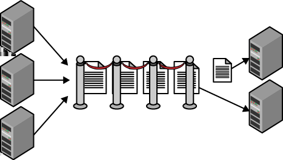

# 第三章 &emsp; 以队列为中心的工作流程模式

<div align="justify">

这种松耦合的基本模式专注于异步传递从用户界面发送到后端服务的命令请求，以便进行处理。该模式是 CQRS 模式的子集。

该模式允许交互式用户通过 Web 层进行更新，而不会降低 Web 服务器的速度。它尤其适用于处理耗时、资源密集或依赖于可能并非始终可用的远程服务的更新。例如，社交媒体网站在处理状态更新、照片上传、视频上传或发送电子邮件时，可以受益于此模式。

该模式用于响应来自交互式用户的更新请求。首先，用户界面代码（位于 Web 层）会创建一个消息，描述满足更新请求需要完成的工作。该消息会被添加到队列中。在某个时间点，另一个节点（运行在服务层）上的服务会从队列中移除消息并执行所需的工作。消息流向是单向的，从 Web 层流向队列，最终到达服务层。此模式并未指定如何（或是否）告知用户进度。

这是一个异步模型，因为发送方不会等待响应。实际上，不会直接返回任何响应。（在编程术语中，返回值为 void。）它有助于用户界面保持始终如一的快速响应时间。

<table>
    <tr>
        <td>
            
        </td>
        <td>
            Web 层不会将此模式用于只读页面浏览请求；此模式用于执行更新操作。
        </td>
    </tr>
</table>


## 背景

以队列为中心的工作流模式能够有效应对以下挑战：

- 应用程序在各层之间解耦，但各层仍需协作
- 应用程序需要保证消息在各层*至少被处理一次*
- 即使依赖性处理发生在其他层，用户界面层也应始终保持响应迅速的用户体验
- 即使处理过程中访问了第三方服务，用户界面层也应始终保持响应迅速的用户体验

此模式同样适用于通过 Web 服务访问相同功能的 Web 应用程序和移动应用程序。任何面向交互式用户的应用程序都适用。


### 云的重要性

通过使用云服务，此模式的基础架构实现通常非常简单。在云之外，这些方面可能会复杂得多。可靠的队列可以作为云服务使用。

使用云服务还可以简化中间数据的存储。云服务可用于存储、NoSQL 数据库和关系数据库。


## 影响

可用性、可靠性、可扩展性、用户体验


## 机制

队列中心工作流模式用于 Web 应用程序中，旨在解耦 Web 层（实现用户界面）和服务层（执行业务处理）之间的通信。

不使用此类模式的应用程序通常会通过用户界面代码直接调用服务层来响应网页请求。这种方法虽然简单，但在分布式系统中却面临诸多挑战。其中一个挑战是，所有服务调用必须在 Web 请求完成之前完成。此外，该模型还要求服务层的可扩展性和可用性达到或超过 Web 层，而使用第三方服务时，这一点可能难以保证。服务层如果运行不可靠或速度缓慢，会严重影响 Web 层的用户体验，并对可扩展性产生负面影响。

解决方案是采用异步通信。Web 层向服务层发送*命令*，其中*命令*是指执行某些操作的请求。命令示例包括：创建新用户帐户、添加照片、更新状态（例如在 Twitter 或 Facebook 上）、预订酒店房间和取消订单。

<table>
    <tr>
        <td>
            
        </td>
        <td>
            异步一词可以应用于应用程序实现的各个方面。运行在 Web 层的用户界面代码可以异步调用服务。这使得工作可以并行执行，从而有可能加快用户请求的处理速度。一旦所有异步服务调用完成，用户请求即可得到满足。这种便捷的编码技巧不应与以下模式混淆。
        </td>
    </tr>
</table>

命令以消息的形式通过队列发送。队列是一种简单的数据结构，它包含两个基本操作：*添加* 和 *删除*。队列的特性在于，删除操作会返回队列中存在时间最长的消息。这有时被称为先进先出 (FIFO) 顺序。执行添加操作通常称为入队，执行删除操作称为*出队 (dequeuing)*。

在最简单（也是最常见）的场景中，模式非常简单：发送方将命令消息添加到队列中（*入队 (enqueues messages*），接收方从队列中移除这些命令消息（*出队 (dequeues messages)*）并进行处理。如图 3-1 所示。 （稍后我们将看到，从队列中移除消息的编程模型比简单的出队操作要复杂得多。）

发送方和接收方被称为*松耦合*。它们仅通过队列中的消息进行通信。这种模式允许发送方和接收方以不同的速度或时间表运行；当发送方向队列添加消息时，接收方甚至不需要运行。双方都不知道对方的具体实现，但双方需要就使用哪个队列实例以及从发送方传递到接收方的命令消息的结构达成一致。

<div align="center">



*图 3-1。 Web 层将消息添加到队列中。服务层从队列中移除并处理消息。队列中的命令消息数量会波动，从而形成一个缓冲，使 Web 层能够快速卸载工作，同时又不会使服务层不堪重负。服务层可以有充足的时间处理新消息，仅在资源可用时才进行处理。*

</div>

发送方不必是 Web 用户界面；例如，它也可以是原生移动应用程序，通过 Web 服务（例如 REST API）进行通信。也可以有多个发送方和多个接收方。这种模式仍然有效。

本模式描述的其余部分主要关注如何防范故障场景以及处理用户体验问题。


### 队列的可靠性

工作流程中，发送方将消息添加到队列，接收方会在某个时间点将其移除。我们能确定消息一定会到达接收方吗？

需要强调的是，云队列服务提供的是一个*可靠的队列*。“可靠”主要源于两个方面：数据的持久性和高吞吐量（每秒至少数百次交互）。

<table>
    <tr>
        <td>
            
        </td>
        <td>
            队列实现数据持久性的方式与其他云存储服务相同：将委托给服务的每个字节存储三份（分布在三个磁盘节点上），以克服硬件故障带来的风险。
        </td>
    </tr>
</table>

队列本身是可靠的，不会丢失我们的数据，但这种模式并非旨在保护我们的应用程序免受所有故障的影响。相反，这种模式要求我们的应用程序实现特定的行为，以便成功应对故障场景。


### 接收器的编程模型

在实现接收器时，使用可靠队列服务的编程模型有时会让开发者感到意外，因为它比基本队列略微复杂一些：

1. 从队列中获取下一条可用消息
2. 处理消息
3. 从队列中删除消息

实现过程首先将消息*出队*，然后再*删除*消息。为什么要分两步删除呢？这是为了确保*至少处理一次*。


#### **不可见窗口和至少一次处理**

处理命令请求包括从队列中获取消息、理解消息内容并相应地执行请求的命令。具体细节取决于应用程序。如果一切按计划进行，从队列中删除消息是最后一步。只有到那时，命令才算完全处理完毕。

但并非一切都总是按计划进行。例如，可能会出现应用程序代码无法控制的故障。这类故障可能由多种原因引起，但最容易理解的是硬件故障。如果您使用的硬件发生故障，无论进程处于生命周期的哪个阶段，都会停止运行。如果云平台因为自动扩缩容逻辑认为某个正在运行的节点不再需要而将其关闭，也可能发生故障。或者，您的节点可能被重启。

<table>
    <tr>
        <td>
            
        </td>
        <td>
            有关利用此模式从中断中恢复的更多场景，请参阅<a href="10_第十章_节点故障模式.md"><i>节点故障模式</i>（第 10 章）</a>。
        </td>
    </tr>
</table>

无论故障原因是什么，您的处理过程都已中断，需要恢复。它是如何恢复的呢？

当消息出队时，它并不会从队列中完全移除，而是被隐藏起来。消息会被隐藏一段指定的时间（该时间在出队操作期间指定，之后可以增加）。我们将这段时间称为“不可见窗口”。当消息处于不可见窗口内时，它无法被出队。

> <h3 align="center">不可见窗口的细微差别</h3>
>
> 在消息的不可见窗口期间，通常只有一个消息副本正在处理。但也有一些特殊情况，情况可能并非如此。一种特殊情况是，处理消息的代码尚未完成，但不可见窗口已过，导致同一消息的另一个副本被出队。此时，有两个正在处理的该消息副本。如果发生这种情况，可能是由于代码中的错误造成的。你应该通知队列你仍在处理该消息，并增加其不可见窗口，以便有足够的独占访问时间，而不是让不可见窗口超时。（另请参阅下文关于毒消息的讨论。）然而，正如你将在 [*最终一致性入门*（第 5 章）](05_第五章_最终一致性入门.md)的 CAP 定理讨论中了解到的那样，由于分区，在分布式系统中，这并非总是可行。虽然这种情况很少见，但仍应考虑在内。
>
> 即使是*最终一致性*的可靠队列，也可能出现这种极端情况（更多上下文请参阅第 5 章）。简而言之，如果几乎同时发生两个对下一个队列项的请求，在极少数情况下，队列系统可能会对这两个请求发出相同的消息。亚马逊的可扩展存储服务 (S3) 是最终一致性的，其文档也对此可能性进行了警告。Windows Azure 存储队列和 Windows Azure 服务总线队列都是*立即一致性*的，因此不会出现这种极端情况。

只有当处理时间超过允许的时间时，不可见窗口才会生效。消息在队列中的自动重现是克服故障的关键之一，也是*至少一次处理*模型中*至少一次*部分的基础。任何第一次出队时未完全处理的消息都会有第二次机会。代码会不断尝试，直到处理完成（或者我们放弃，这将在后面的“毒消息处理”部分中解释）。

任何第二次出队的消息可能在第一次出队时已被部分处理。如果不加以防范，这可能会导致问题。


#### **重复消息的幂等处理**

*幂等*操作是指可以重复执行的操作，其任意次数的成功操作与一次成功的操作没有区别。例如，根据 HTTP 规范，HTTP 动词 PUT、GET 和 DELETE 都是幂等操作：我们可以对特定资源执行一次 DELETE 操作，也可以执行 100 次，最终结果都相同；（假设操作成功）资源已被删除。

有些操作被认为是*天然幂等*的，例如 HTTP DELETE 操作，其幂等性几乎是与生俱来的。涉及从一个账户取款并存入另一个账户的多步骤金融交易可以实现幂等，但它绝对不是天然幂等的。有些情况比其他情况更复杂。

> <h3 align="center">幂等性即业务等效</h3>
>
> 无论幂等进程部分或完全完成多少次，只要最后一次实例成功完成，其结果都是等效的。请注意，等效结果指的是*业务等效*，而非*技术等效*。例如，应用程序日志包含多次尝试的残留信息是可以接受的，只要对业务用户而言结果无法区分即可。

云队列服务会跟踪消息的出队次数。每次消息出队时，队列服务都会将此值与消息一起提供。我们称之为*出队计数*。消息首次出队时，此值为 1。通过检查此值，应用程序代码可以判断这是首次处理尝试还是重复尝试。

首次处理时，应用程序逻辑可以进行简化；但对于重复尝试，可能需要一些额外的逻辑来支持幂等性。

> <h3 align="center">长时间处理任务</h3>
>
> 一些云队列服务支持更新队列中的消息。对于多步骤流程，每完成一个步骤，更新队列中的消息并添加最后一个完成步骤的指示符会非常方便。例如，您可以设计一个消息对象，使其包含一个 ```LastCompletedStep``` 字段，供应用程序跟踪进度。如果处理过程中断，下次消息出队时将返回更新后的 ```LastCompletedStep``` 字段；消息处理可以从 ```LastCompletedStep``` 步骤继续，而无需从头开始。

例如，假设有一个命令，用于根据用户提供的电子邮件地址创建新用户帐户，并且消息出队计数为 2。正确的处理方式需要考虑部分（或全部）处理工作可能已完成的情况，因此需要采取更智能的处理方式。“智能处理”的具体方法会因应用程序而异。

更简单的场景可能不需要任何特定的幂等性支持。例如，发送确认电子邮件。由于失败事件很少发生，而且偶尔重复发送电子邮件的影响也很小，因此每次都发送电子邮件可能就足够了。

> <h3 align="center">幂等处理选项</h3>
>
> 幂等处理易于定义，但实现起来却并非总是易事。对于更复杂的幂等场景，例如多步骤金融交易或跨多个数据存储的操作，需要更高级的幂等处理方法。
>
> *数据库事务*在云环境中有时非常有用：所有操作要么全部成功，要么全部失败。然而，数据库事务在云应用中通常并不实用，原因可能是支持的事务范围太窄（例如，事务无法跨越NoSQL数据库或分片关系数据库中的分区（或分片）），或者数据被写入多个存储，而分布式事务根本不受支持（例如，无法将跨越关系数据库和Blob存储的更改封装在事务中）。
>
> *补偿事务*，即撤销先前尝试的净影响，是我们幂等工具箱中的一种工具。另一种方法是*事件溯源*，本章在 CQRS 的背景下简要提及了它，它有时可以为处理复杂案例提供强大的模型。

幂等性处理是处理重复消息的正确第一步。如果消息重复次数过多，超过应用程序定义的阈值，则应将其视为有害消息。


#### **处理重复次数过多的“毒消息”**

有些消息由于其内容而无法成功处理。这些消息被称为“毒消息”。

例如，假设有一条消息包含一个命令，要求根据用户提供的电子邮件地址创建新的用户帐户。如果该电子邮件地址已被使用，应用程序仍然应该成功处理该消息，但不会创建新的用户帐户。这并非“毒消息”。

但是，如果电子邮件地址字段包含一个长达 10,000 个字符的字符串，而这种情况在应用程序代码中是未预料到的，则可能会导致程序崩溃。这就是“毒消息”。

如果应用程序在处理消息时崩溃，消息的“不可见窗口”最终会过期，该消息将再次出现在队列中，等待下一次尝试。上一节解释了在这种情况下需要幂等处理的原因。处理“毒消息”时，幂等处理将永远不会终止。

<table>
    <tr>
        <td>
            
        </td>
        <td>
            关于恶意信息，需要做出两个决定：如何检测恶意信息，以及如何处理恶意信息。
        </td>
    </tr>
</table>

当消息出队时，云队列服务会提供一个出队计数，可用于判断这是否是首次处理尝试。该计数与用于检测重复消息以实现幂等处理的值相同。您的毒消息检测逻辑必须包含一条规则，将任何反复出现的消息在*第 N 次*出现时视为毒消息。选择 *N* 的值是一个业务决策，需要在浪费资源处理毒消息的成本和未处理有效消息的风险之间进行权衡。实际上，执行中断通常不频繁，因此在设置毒消息策略时应考虑这一点。如果处理过程资源密集，例如需要 60 分钟，您可能不希望重试任何失败的进程；因此，对于 *N > 1* 的情况，该消息将被视为毒消息。但是，根据具体情况，通常会重试一次到几次。

<table>
    <tr>
        <td>
            
        </td>
        <td>
            正确检测毒消息有一些细微差别。例如，如果选择 <i>N=3</i> 来触发毒消息处理，应用程序代码需要检查出队计数是否至少为 3，而不是正好为 3。在检测到出队计数为 3 之后，但在从主队列中移除消息之前，可能发生了系统中断。
        </td>
    </tr>
</table>

一旦识别出毒消息，如何处理它也是另一个业务决策。如果需要人工审核毒消息以改进处理方式，一种方法是使用所谓的 *死信队列*，即用于存储无法正常处理的消息。一些队列系统内置了对死信队列的支持，但自己实现一个也并不难。对于低优先级消息，甚至可以考虑直接删除它们。关键在于，一旦应用程序检测到毒消息，就应立即将其从主处理队列中移除。

<table>
    <tr>
        <td>
            
        </td>
        <td>
            如果我们不防范毒消息，毒消息就会长时间滞留在队列中，浪费处理资源。在极端情况下，如果存在大量活跃的毒消息，所有处理资源最终都可能被用于处理毒消息！
        </td>
    </tr>
</table>

出队计数大于 1 并不一定意味着存在毒消息。该值是出队计数，而不是毒消息计数。


### 用户体验影响

这种模式涉及异步处理、重复处理和请求失败。所有这些都会对用户体验产生影响。

在用户界面中处理异步处理可能比较棘手，并且与应用程序密切相关。我们希望面向用户的界面能够快速响应，因此，与其在用户等待期间执行耗时的操作，不如将执行该操作的命令请求放入队列。这样，用户界面就能尽快返回给用户（改善用户体验），同时使 Web 服务器层能够专注于网页服务（增强可扩展性）。

另一方面，您现在需要让用户理解，即使系统已确认他们的操作（并已发出命令），该操作的处理也并非立即完成。对此，有多种方法。

在某些情况下，用户无法轻易判断操作是否已完成，因此无需采取特殊措施。

如果用户希望在操作完成后收到通知，则在操作完成后发送电子邮件可能是一个不错的选择。在电子商务场景中，“您的订单已发货”等进度通知十分常见。

有时用户希望等待任务完成。这就需要用户界面层轮询服务层直至任务完成，或者服务层主动通知用户界面层。主动通知可以通过*长轮询*来实现。在长轮询中，Web 客户端会与服务器建立 HTTP 连接，但服务器会故意不响应，直到收到响应为止。

<table>
    <tr>
        <td>
            
        </td>
        <td>
            长轮询（也称为 Comet）技术已有现成的实现方案。例如：ASP.NET 的 SignalR 和 Node.js 的 Socket.IO。这些库会在 HTML5 Web Socket 可用时加以利用。
        </td>
    </tr>
</table>

使用长轮询技术与在 Web 层“内联”执行原始（耗时）操作有所不同。在 Web 层阻塞直到操作完成会影响可扩展性。而这种方法仍然允许在服务层执行耗时的工作。

> <h3 align="center">这与 CQRS 相同吗？</h3>
>
> 熟悉命令查询职责分离 (CQRS) 模式的读者可能会疑惑，队列中心工作流 (QCW) 模式是否真的与 CQRS 相同。虽然两者相似，但并不相同。CQW 只是通往 CQRS 的垫脚石。了解它们之间的一些差异和重叠之处将有助于您避免混淆。
>
> CQRS 的主要特征是使用两种不同的模型：一种用于写入（*写入模型*），另一种用于读取（*读取模型*）。两个关键术语是 *命令* 和 *查询*。命令是通过写入模型发出的更新请求。查询是从读取模型发出的信息请求。处理命令和查询是不同的活动（“职责分离”）；您永远不会发出命令并期望返回数据结果。即使读取模型和写入模型可能基于相同的底层数据，它们也展现出不同的数据模型。
>
> QCW 侧重于命令流向写入模型，而对读取模型仅略有提及，例如支持从用户界面进行长轮询。在这方面，它与 CQRS 一致，但并不完整，因为 QCW 没有完全阐述读取模型。QCW 中的命令与 CQRS 中的命令相同。
>
> 完整的 CQRS 方案还会考虑*事件溯源*和领域驱动设计 (DDD)。通过事件溯源，由于命令会导致系统状态改变，因此产生的变更事件会被单独捕获和存储，而不是仅仅反映主数据的变化。例如，*地址已更改* 事件会保存新的地址信息，而不仅仅是覆盖数据库中的单个地址字段。最终形成一个按时间顺序排列的历史记录，可以重放以达到当前状态（或沿途的任何状态）。使用事件溯源可以简化幂等操作的处理。领域驱动设计（DDD）是一种与技术无关的理解业务上下文的方法论。CQRS 不需要事件溯源或 DDD，但它们经常一起使用。


### 独立扩展各层

队列长度和消息在队列中停留的时间是自动扩展的重要环境信号。云队列服务可以轻松获取这些关键指标。例如，不断增长的队列可能表明需要增加服务层的容量。请注意，这些信号可能仅表明需要扩展一个层或一个特定的处理服务。这种独立于关注点的扩展有助于优化成本和效率。

在高规模下，队列本身可能会成为瓶颈，需要多个队列实例。但这不会改变核心模式。


## 示例：在 Windows Azure 上构建 PoP

照片页​​面 (PoP) 应用程序（在前言中已介绍，并将贯穿本书作为示例）使用第 3 章来处理新照片导入系统。

PoP 中的两个应用程序层协同工作。Web 层的用户界面负责为已登录用户提供照片上传功能，并将命令消息加入队列。服务层负责从队列中取出命令消息并进行处理。


### 用户界面层

运行在 Web 层的 PoP 用户界面由运行在可变数量 Web 角色实例上的 ASP.NET MVC 代码组成。用户身份验证（登录）在此层处理，已验证用户可以上传照片。

待处理照片的位置、照片的纯文本描述以及 PoP 用户的帐户标识符存储在一个消息对象中，然后该消息对象会被加入队列。在 PoP 中，待处理的照片被假定已上传到 Blob 存储（尽可能使用 [*代客密钥模式*（第 13 章）](13_第十三章_代客密钥模式)），并以 Blob 的形式存储在 Windows Azure 存储中；只有对该 Blob 的引用（URL）才会存储在加入队列的消息对象中。虽然此特定过程操作的是外部资源（存储为 Blob 的照片），但这并不意味着此模式必须依赖外部资源才能发挥作用。通常情况下，所有必需的数据都完全包含在消息对象中。

无论运行多少个 Web 角色实例，它们都会将消息提交到同一个 Windows Azure 队列。

<table>
    <tr>
        <td>
            
        </td>
        <td>
            PoP 使用 Windows Azure 存储队列服务，但 Windows Azure 也提供服务总线队列服务。这两个服务有很多共同之处，两者都是 PoP 的绝佳选择。
        </td>
    </tr>
</table>

发送方和接收方使用同一个消息队列：

- 消息队列名称示例：*http://popuploads.queue.core.windows.net*

进入队列的消息中包含的字段类似于以下内容：

- 上传照片的位置（位于 Blob 存储中）：*http://popuploads.blob.core.windows.net/publicphotos/william.jpg*
- 来自 *emailaddress 声明* 的已验证帐户标识符，如 [*多站点部署模式*（第 15 章）](15_第十五章_多站点部署模式.md)中所述：*kd1hn@example.com*
- ```LastCompletedStep```: 0

请注意，图像并非进入队列的消息的一部分，而是对图像的引用。这样做的实际原因是队列不允许消息大于特定大小（截至撰写本文时为 64 KB）。从更深层次的哲学角度来看，Blob 存储是存储 Windows Azure 上上传图像的“正确”位置。


### 服务层

PoP 服务运行在服务层中数量不定的工作角色实例上。这些服务中的 C# 代码会持续检查队列中是否有新消息。一旦队列中有消息可用，就会将其移除并进行处理。

有时队列中可能没有消息可用。在这种情况下，任何出队尝试都会立即返回。务必避免代码在紧密的循环中频繁调用队列服务，因为每次队列操作都会消耗少量资源。请务必添加适当的延迟。

> <h3 align="center">小心资金泄漏！</h3>
>
> 截至撰写本文时，一千万次 Windows Azure 存储操作的费用为 1 美元。考虑到即使队列中没有消息等待，出队请求也会收取此费用，这笔费用究竟有多高？假设以每秒 500 次请求的速度尝试从空队列中出队，每 200 秒就要花费 1 美分，每天累计将花费 4.32 美元。当然，您肯定不会想这样做。
>
> 请务必在每次出队失败后添加至少几秒钟的延迟，以防止出现 *资金泄漏*。资金泄漏是指云平台本身的支出，它不会带来任何业务价值。就像内存泄漏如果不加以控制会导致应用程序崩溃一样，资金泄漏也会降低云应用程序的成本效益。此外，还可以考虑可变延迟技术，类似于 [*忙音模式*（第 9 章）](09_第九章_忙音模式.md)中描述的技术，它提供了一种更复杂的方法来对抗资金泄漏，同时也进一步解释了如果您过于活跃，可能会被排队服务限制。

每条消息代表一张等待集成到 PoP 站点其他部分的新照片上传。集成过程包含几个步骤：创建缩略图、提取地理标记数据，然后更新用户帐户数据，将新照片添加到其公共页面。每个步骤完成后，消息都会更新回 Blob 存储，并更新 ```LastCompletedStep``` 的值。

PoP 缩略图的创建是幂等的。这一点至关重要，因为如果我们疏忽大意，最终可能会导致大量孤立图像文件散落在我们的 Blob 存储账户中。为了处理幂等缩略图的创建，PoP 选择通过从完整尺寸照片的文件名派生来确保缩略图文件名的确定性。所有上传的照片都会被分配一个唯一的系统生成名称，例如 *william.jpg*。缩略图的名称是通过在根文件名后附加“_thumb”而生成的，结果为 *william_thumb.jpg*。这种简单的方法可以确保 Blob 存储中始终只有一个缩略图。请注意，虽然结果与首次成功生成缩略图并*不完全相同*——例如，文件的时间戳会有所不同——但我们可以得出结论，结果是*等效的*。

PoP 有一条业务规则，规定任何来自 *popuploads* 队列且出队计数为 3 或以上的消息都被视为有害消息。当检测到恶意信息时，PoP 会发送电子邮件通知提交照片的用户，该照片已被拒绝并删除。

<table>
    <tr>
        <td>
            
        </td>
        <td>
            如果应用程序不主动处理恶意消息，Windows Azure 队列服务将在七天后将其从队列中删除。
        </td>
    </tr>
</table>


### 照片页面系统变更概要

为了处理新上传的照片：

- 照片存储在为此目的创建的公共 Blob 容器中。
- 包含新创建照片相关数据的消息被加入队列。此操作由 Web 层（Web 角色）完成。
- 服务层中的工作角色监控队列中待处理的消息，并在消息可用时进行处理。

消息处理完成后，PoP 的静态状态包括：

- 原始照片以 Blob 形式存储。
- 生成的缩略图以 Blob 形式存储。
- 照片的元数据存储在 Windows Azure SQL 数据库中（详见 [*数据库分片模式*（第 7 章）](07_第七章_数据库分片模式.md)）。

> <h3 align="center">相关章节</h3>
>
> - [*可扩展性入门*（第 1 章）](01_第一章_可扩展性入门.md)
>
> - [*水平扩展计算模式*（第 2 章）](02_第二章_水平扩展计算模式.md)
>
> - [*自动缩放模式*（第 4 章）](04_第四章_自动缩放模式.md)
>
> - [*最终一致性入门*（第 5 章）](05_第五章_最终一致性入门.md)
>
> - [*节点故障模式*（第 10 章）](10_第十章_节点故障模式.md)
>
> - [*共定位模式*（第 12 章）](12_第十二章_共定位模式.md)
>
> - [*代客密钥模式*（第 13 章）](13_第十三章_代客密钥模式.md)


## 总结

此模式用于解耦应用程序的各个层，特别是 Web（用户界面）层和执行业务处理的服务层。它不适用于例行的只读页面请求。通信是单向的，从 Web 层到服务层，并通过将消息添加到队列来处理。可靠的云队列服务简化了部署。解耦的 Web 层可以实现更高的响应速度和可靠性，从而提供更佳的用户体验。独立于关注点的扩展也允许为每个层配置最适合该层的资源。

</div>