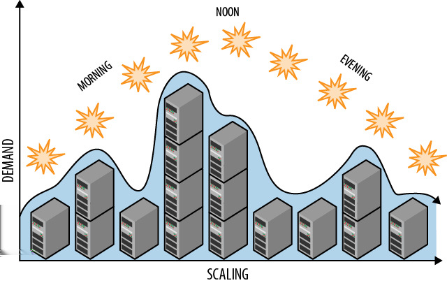

# 第四章 &emsp; 自动缩放模式

这种自动化运维的关键模式使横向扩展更加实用且经济高效。

通过云供应商提供的 Web 管理工具手动扩展有助于降低每月云账单，但自动化可以更好地优化成本，减少日常扩展任务所需的人工投入。此外，自动化也更加动态。它可以响应云服务本身的信号，并根据实际需求进行动态扩展。

自动扩展的两大目标是优化云应用程序使用的资源（从而节省成本）以及最大限度地减少人为干预（从而节省时间并减少错误）。

## 背景

自动扩展模式能够有效应对以下挑战：

- 以经济高效的方式扩展计算资源，例如 Web 层或服务层。
- 需要持续监控资源波动情况，以最大限度地节省成本并避免延迟。
- 频繁的扩展需求涉及云资源，例如计算节点、数据存储、队列或其他弹性组件。

这种模式假定采用水平扩展架构，并支持可逆扩展。虽然垂直扩展（通过更改虚拟机大小）也是可行的，但本模式并未考虑。

### 云的重要性

云平台支持全方位的资源管理，并为客户提供丰富的自动化功能。这些功能支持可逆扩展，并且与云原生应用程序结合使用时，能够高效地适应动态资源管理和扩展。这种模式充分利用了云环境中开发和运维活动重叠度不断提高的固有特性。这种重叠被称为*DevOps*，它是“开发”（development）和“运维”（operations）的组合词。

## 影响

成本优化、可扩展性

<table>
    <tr>
        <td>
            
        </td>
        <td>
            这种模式本身并不影响应用程序的可扩展性。无论是否自动化，应用程序要么可以扩展，要么不能扩展。其影响体现在大规模部署时的运营效率上。运营效率的提升有助于降低支付给云服务提供商的直接成本，同时减少员工在日常手动操作上花费的时间。
        </td>
    </tr>
</table>

## 机制

计算节点是最常需要扩展的资源，以确保拥有合适数量的 Web 服务器或服务节点。自动扩展可以维护*当前所需的资源*，并且可以应用于任何可能受益于自动扩展的资源，例如数据存储和队列。本模式重点关注计算节点的自动扩展。其他场景遵循相同的基本思路，但通常更为复杂。

要实现尽可能减少人工干预的自动扩展，需要针对已知事件（例如超级碗比赛中场休息或工作时间与非工作时间）进行调度，并创建能够响应环境信号（例如使用量的突然激增或下降）的规则。一个精心调校的自动扩展方法类似于图 4-1，其中资源根据需求进行调整。预期需求可以通过调度来驱动，而不太可预测的情况则根据环境信号进行响应。

*图 4-1。 例如，可以预先制定自动扩缩容规则，按计划在一天内添加和释放资源。*

### 基于规则和信号的自动化

云平台可以实现自动化，包括用于配置和释放各种类型资源的编程接口。虽然可以直接使用云平台管理服务编写自动扩展解决方案，但使用现成的解决方案更为常见。Amazon Web Services 和 Windows Azure 都有多种解决方案，一些来自云供应商，一些来自第三方。

<table>
    <tr>
        <td>
            
        </td>
        <td>
            请注意，自动扩展本身也会产生一些成本。使用软件即服务 (SaaS) 产品可能会产生直接成本，探测运行时环境信号、使用程序化配置服务（无论是通过代码还是 SaaS 解决方案）以及自行托管自动扩展工具也会产生成本。这些成本通常相对较小。
        </td>
    </tr>
</table>

现成解决方案的复杂性和完整性各不相同。请查阅您考虑使用的任何工具的文档。其功能应允许为在正常工作时间内频繁使用但在非工作时间偶尔使用的业务线应用程序表达以下规则：

- 晚上 7:00（当地时间），将 Web 服务器节点数减少到 2 个。
- 早上 7:00，将 Web 服务器节点数增加到 10 个。
- 周五晚上 7:00，将 Web 服务器节点数减少到 1 个。

列出的各项规则虽然并不复杂，但仍然有助于降低成本。请注意，最后一条规则与第一条规则有所重叠。您选择的自动扩展工具应该允许您设置优先级，以便优先执行周五晚上的规则。此外，规则可以进行调度；在上面列出的规则集中，前两条规则可以限制在周末不运行。您的想象力和自动扩展解决方案的灵活性是唯一的限制。

以下是一些基于环境中不太可预测的信号的更动态的规则：

- 如果过去一小时的平均队列长度小于 25，则将发票处理节点的数量增加 1 个。
- 如果过去一小时的平均队列长度小于 5，则将发票处理节点的数量减少 1 个。

这些规则会对环境条件做出反应。有关基于队列长度的规则示例，请参阅[*以队列为中心的工作流程模式*（第 3 章）](03_第三章_以队列为中心的工作流程模式.md)。

还可以编写规则来响应机器性能，例如内存使用情况、CPU 利用率等。通常情况下，您可以自定义对应用程序有意义的条件，例如：

- 如果过去一小时内确认客户订单的平均时间超过十分钟，则将订单处理节点的数量增加一个。

某些信号（例如计算节点的响应时间）可能会在节点故障时触发，因为响应时间会降至零。请注意，云平台也会介入以替换故障节点或不再响应的节点。

您的自动扩展解决方案可能还支持能够理解总体成本并帮助您控制预算的规则。

### 独立关注点

第一组示例规则应用于 Web 服务器节点，第二组应用于发票处理节点。两组规则可以应用于同一个应用程序。

<table>
    <tr>
        <td>
            
        </td>
        <td>
            扩展应用程序的<i>部分</i>并不意味着扩展应用程序的<i>全部</i>。
        </td>
    </tr>
</table>

事实上，在架构中独立扩展各个关注点的能力是成本优化的一项重要特性。

当定义的扩展单元要求资源同步分配时，可以在自动扩展规则中将它们合并。

### 积极响应横向扩展

云资源配置并非瞬时完成。部署和启动新的计算节点需要时间（可能需要十分钟或更长时间）。如果流畅的用户体验至关重要，则应优先采用能够及早响应趋势的规则，确保容量能够及时满足需求。

某些应用程序会选择遵循[*节点故障模式*（第 10 章）](10_第十章_节点故障模式.md)中描述的 *N+1* 规则，即即使当前活动实际只需要 N 个节点，也会部署 N+1 个节点。这为应对突发的活动高峰提供了缓冲，同时也为节点发生意外硬件故障提供了额外的保障。如果没有此缓冲，则存在这样的风险：传入的请求可能会使剩余节点过载，降低其性能，甚至导致用户请求超时或失败。过载的节点无法提供良好的用户体验。

### 不要过度响应横向扩展

您的自动扩展工具应该内置一些与您的云平台相关的智能机制，以防止其过度活跃。例如，在 Amazon Web Services 和 Windows Azure 上，计算节点的租用以小时为单位：租用 1:00-1:30 的费用与租用 1:00-2:00 的费用相同。更重要的是，租用 1:50-2:10 跨越了两个小时，因此您将被收取这两个小时的费用。

<table>
    <tr>
        <td>
            
        </td>
        <td>
            如果您请求在 1:59 释放一个节点，而该节点需要两分钟才能完成正在处理的工作才能释放，您是否会被收费？请查看您的云供应商的文档，了解他们如何严格执行这些特殊情况下的小时规则；可能会有一个短暂的宽限期。
        </td>
    </tr>
</table>

请谨慎设置下限。如果允许节点数量减少到单个节点，请意识到云平台基于通用硬件构建，偶尔会出现故障。对于服务于交互式用户的节点而言，这通常不是最佳实践，但在某些情况下可能是合适的，例如周末偶尔需要维护。对于不涉及交互式用户的节点（例如，发票生成节点），减少到单个节点通常是可以接受的。

### 设置限制，必要时进行覆盖

实施自动伸缩并不意味着放弃完全控制权。我们可以添加伸缩上限和下限来限制允许的自动伸缩范围（例如，我们可能希望在低端始终保持一定的冗余，并且可能需要在高端控制在预算范围内）。自动伸缩规则可以根据需求的变化进行修改，并在需要人工干预时禁用。对于无法完全自动化的复杂情况，自动伸缩解决方案通常可以发出警报，通知用户任何需要特别关注的情况。

<table>
    <tr>
        <td>
            
        </td>
        <td>
            您的云平台很可能提供服务级别协议 (SLA)，其中声明您的虚拟机实例在任何给定月份中都将有一定百分比的时间处于运行状态并可从 Internet 访问。 Windows Azure 和 Amazon Web Services 都提供 99.95% 的可用性 SLA。但是，需要注意的是：它们都要求至少运行两个任意类型的节点实例，SLA 才能生效。  这项要求完全合理：如果只运行单个节点，该节点的任何中断都会导致服务中断。
        </td>
    </tr>
</table>

### 注意平台强制的扩展限制

公有云平台通常会为新账户设置默认的扩展限制。这旨在保护新账户所有者免受自身操作失误（例如，避免意外扩展到 10,000 个节点），并降低公有云供应商的风险敞口。由于按需付费账户的账单通常在每月月底结算，试想一下，如果有人心怀不轨地使用盗窃的信用卡注册账户，将很难追究其责任。为此，平台已采取应对措施，例如，需要提交一次性支持请求才能解除账户的软性限制，例如账户可配置的核心数。

## 示例：在 Windows Azure 上构建 PoP

“照片页面”（PoP）应用程序（在前言中已介绍）将受益于自动缩放。Windows Azure 提供了多种自动缩放选项。PoP 使用的是 Microsoft Patterns & Practices 团队开发的一款工具，正式名称为 Windows Azure 自动缩放应用程序块，简称 WASABi（值得庆幸的是）。

与其他一些选项不同，WASABi 不是软件即服务 (SaaS)，而是我们自行运行的软件。我们选择在单个工作节点上运行它，并使用最小的可用实例（超小型实例，截至撰写本文时，费用为每小时 0.02 美元）。

<table>
    <tr>
        <td>
            
        </td>
        <td>
            云应用通常会使用单一角色的“管理员”角色实例来处理各种杂务。WASABi 非常适合这种角色。
        </td>
    </tr>
</table>

WASABi 可以处理本章中提到的所有规则。WASABi 区分两种类型的规则：

- 主动规则，也称为 *约束规则*，用于处理计划变更、最小和最大实例数，并且可以设置优先级。
- “被动规则”，用于响应环境中的信号。

应用程序规则的选择旨在与预算、历史活动、计划事件和当前趋势保持一致。PoP 使用以下约束规则：

- Web 角色实例的最小/最大数量 = 2 / 6
- 图像处理工作角色实例（处理新上传的图像）的最小/最大数量 = 1 / 3

PoP 会根据环境中的以下信号执行相应的规则和操作：

- 如果 ASP.NET 请求等待时间（性能计数器）> 500 毫秒，则添加一个 Web 角色实例。
- 如果 ASP.NET 请求等待时间（性能计数器）< 50 毫秒，则释放一个 Web 角色实例。
- 如果过去 15 分钟内 Windows Azure 存储队列的平均长度 > 20，则添加一个图像处理工作角色实例。
- 如果过去 15 分钟内 Windows Azure 存储队列的平均长度 < 5，则释放一个图像处理工作角色实例。

第三条规则的优先级最高（因此将优先于其他规则），其他规则的优先级顺序与上述规则相同。

<table>
    <tr>
        <td>
            
        </td>
        <td>
            WASABi 规则使用 XML 配置文件指定，并且可以使用 PowerShell cmdlet 进行管理（部署后）。
        </td>
    </tr>
</table>

为了实现 ASP.NET 请求等待时间，WASABi 需要访问正在运行的 Web 角色实例的性能计数器。这通过 Windows Azure 诊断来实现，该诊断分两个层面运行。

首先，每个正在运行的实例都配置为收集您指定的数据，例如日志文件、应用程序跟踪输出（“调试语句”）和性能计数器。

其次，有一个协调的流程，将来自每个节点的数据汇总并集中到 Azure 存储中的一个位置。WASABi 正是从这个中心位置查找驱动响应式规则所需的数据。

Windows Azure 存储队列长度数据由 WASABi 直接收集。WASABi 使用 Windows Azure 存储编程接口，因此可以轻松访问当前队列长度。这里提到的队列位于 Web 层和服务层之间，图像处理服务就运行在服务层；有关更多上下文，请参阅[*以队列为中心的工作流程模式*（第 3 章）](03_第三章_以队列为中心的工作流程模式.md)。

虽然未在文中详细描述，但PoP利用了WASABi的稳定规则，这些规则可以限制对可能代价高昂的规则的过度反应。这些规则有助于避免频繁的资源挤兑（例如分配一台新的虚拟机），在租期到期前将其释放，然后立即分配另一台；在某些情况下，只需延长第一台虚拟机的租期即可更经济地满足需求。

### 限流

WASABi 还区分了实例扩展（通常指增加或移除实例）和限流。实例扩展指的是根据环境信号选择性地启用或禁用某些特性或功能。限流是对实例扩展的补充。假设 PoP 图像处理实现了一种非常高级且资源密集型的照片增强技术。利用我们的限流规则，我们可以在图像处理服务过载时禁用这项高级功能，并等待自动扩展机制启动额外的节点。关键在于，限流可以快速生效，为额外的节点启动并开始接收工作争取时间。

除了为更多节点的启动争取时间外，当约束规则不允许添加更多节点时，限流也很有用。

WASABi 限流不应与[*忙音模式*（第 9 章）](09_第九章_忙音模式.md)中描述的限流混淆。

### 其他资源类型的自动扩展

本章几乎所有讨论都集中在虚拟机的自动扩展上，那么其他资源类型呢？让我们考虑几个更高级的场景。

Web 层通过 Windows Azure 队列将数据流向服务层。这在[*以队列为中心的工作流程模式*（第 3 章）](03_第三章_以队列为中心的工作流程模式.md)中有更详细的解释，但关键在于双方都依赖于对该队列的可靠且快速的访问。虽然大多数应用程序不会遇到这个问题，但单个队列的可扩展性是有限的。如果 PoP 非常繁忙，以至于它每秒必须处理大量的队列消息，单个队列就无法满足需求，会发生什么情况？当单个队列不足时，解决方案是横向扩展到两个队列，然后是三个队列，依此类推。反之，随着需求的下降，我们可以横向缩减（或*缩减*）队列。

对于数据库，考虑一下大型活动的在线售票场景。在门票开售前不久，票务数据会被分发（或分片；参见 [*数据库分片模式*（第 7 章）](07_第七章_数据库分片模式.md)）到多个 SQL 数据库实例上，以应对在几分钟内售出数万张门票所需的负载。由于数据库实例众多，用户流量能够轻松应对。门票售罄后，数据会被整合，多余的数据库实例将被释放。此示例的灵感来源于附录 A 中提到的 TicketDirect 案例研究。

> <h3 align="center">相关章节</h3>
>
> - [*水平扩展计算模式*（第 2 章）](02_第二章_水平扩展计算模式.md)
>
> - [*以队列为中心的工作流程模式*（第 3 章）](03_第三章_以队列为中心的工作流程模式.md)
>
> - [*数据库分片模式*（第 7 章）](07_第七章_数据库分片模式.md)

## 总结

自动扩展模式是实现云管理自动化的重要操作模式。通过自动化日常扩展活动，可以更高效地优化成本，同时减少工作量。云原生应用能够优雅地应对资源水平的动态变化。云平台使得接入云监控和扩展服务变得轻松便捷，同时还提供自托管选项。

