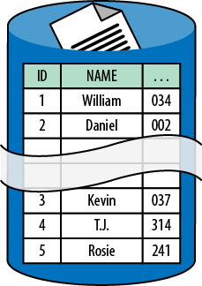

# 第七章 &emsp; 数据库分片模式

这种高级模式专注于通过分片实现数据的水平扩展。

数据库分片是指从一个数据库开始，将其数据分配到两个或多个数据库（分片）中。每个分片都与原始数据库具有相同的数据库模式。大多数数据的分布方式使得每一行数据都恰好出现在一个分片中。所有分片的数据组合起来与原始数据库中的数据相同。

尽管现在涉及多个物理数据库，但这些分片的集合仍然是一个逻辑数据库。

## 背景

数据库分片模式能够有效应对以下挑战：

- 应用程序数据库查询量超过单个数据库节点的查询能力，导致响应时间过长或超时。
- 应用程序数据库更新量超过单个数据库节点的事务处理能力，导致响应时间过长或超时。
- 应用程序数据库网络带宽需求超过单个数据库节点的可用带宽，导致响应时间过长或超时。
- 应用程序数据库存储需求超过单个数据库节点的容量。

本章假设分片是在提供集成分片支持的数据库服务中完成的。如果没有集成分片支持，分片将完全在应用层进行，这会复杂得多。

### 云的重要性

历史上，分片并非一种流行的模式，因为分片逻辑通常是作为应用程序的一部分进行定制开发的。这导致数据库管理以及与数据库交互的应用程序逻辑的成本和复杂性显著增加。云平台显著地掩盖了这种复杂性。

一些云数据库服务（包括关系型和 NoSQL 类型）提供集成的数据库分片支持。

<table>
    <tr>
        <td>
            
        </td>
        <td>
            集成的分片支持将复杂性下移：从应用程序代码转移到数据库服务。
        </td>
    </tr>
</table>

任何运行在单个节点上的数据库最终都会受到限制。云的容量限制比客户自有的高端硬件要低。因此，云端资源的极限将更快达到，这就需要更快地进行数据库分片。这可能会导致分片技术在云原生应用中得到更广泛的应用。

## 影响

可扩展性、用户体验

## 机制

传统的（非分片）数据库部署在单个数据库服务器节点上。任何运行在单个节点上的数据库都受限于该节点的容量。对 CPU、内存、磁盘速度、数据大小和网络带宽等资源的争用会削弱数据库处理活动的能力；过度争用甚至可能导致数据库过载。云数据库服务会加剧这种容量限制，因为数据库运行在通用硬件上，并且数据库服务器是多租户的。（多租户的详细描述请参见[*多租户和通用硬件入门*（第 8 章）](08_第八章_多租户和通用硬件入门.md)。）

当单个节点不再满足需求时，有很多方法可以扩展应用程序数据库。例如：将查询负载分配到*从节点*、根据数据类型拆分为多个数据库以及垂直扩展数据库服务器。为了处理查询负载（但不包括写入/更新操作），从节点会从主数据库复制数据；从节点是只读的，并且通常是*最终一致性*的。另一种选择是根据数据类型将数据拆分成多个数据库，例如一个数据库存储库存数据，另一个数据库存储员工数据。在云端，如果您愿意管理自己的数据库服务器（这是一个需要权衡的难题），则可以垂直扩展数据库，但仍然会受到可用虚拟机最大容量的限制。云原生方案是数据库分片。

数据库分片模式是一种水平扩展方法，它通过将数据库分布在多个数据库节点上来克服单个数据库节点的容量限制。每个节点包含数据的一个子集，称为一个*分片*。所有分片中的数据共同构成一个完整的逻辑数据库。在集成分片的数据库服务中，对于应用程序而言，这些分片的集合表现为一个单一的数据库，只需一个数据库连接字符串即可访问。这种抽象极大地简化了应用程序的编程模型。然而，正如我们将看到的，它也存在一些局限性。

> <h3 align="center">分片是自治的</h3>
>
> 分片是一种水平扩展策略，其中每个分片（或节点）的资源都为分片数据库的整体容量做出贡献。数据库分片实现了一种 *无共享* 架构，这意味着节点之间不共享资源；它们不共享磁盘、内存或其他资源。
>
> 为了提高效率，常见的业务操作必须一次只与一个分片交互。不支持跨分片事务。
>
> 简而言之，分片之间互不引用。每个分片都是自治的。

 

*图 7-1。 数据行分布在不同的分片中，但结构保持一致。图中展示了两个分片：一个分片包含 ID 为 1-2 的数据行，另一个分片包含 ID 为 3-5 的数据行。*

如图 7-1 所示的最简单模型中，所有分片都与原始数据库具有相同的数据库模式，因此它们在结构上完全相同，数据库行被分配到各个分片中。如果分片要发挥预期优势，那么这些行的具体分配方式至关重要。

### 分片识别

数据库中有一个特定的列，称为 *分片键 (shard key)*，它决定了哪个分片节点存储特定的数据库行。访问数据需要分片键。

举个简单易懂的例子，分片键是 *用户名* 列，首字母用于确定分片。以 A 到 J 开头的用户名位于第一个分片，以 K 到 Z 开头的用户名位于第二个分片。当客户使用用户名登录时，由于您拥有有效的分片键，因此可以立即访问他们的数据。

一个更复杂的例子是基于*客户 ID*列（GUID）进行分片。当客户使用用户名登录时，您没有有效的分片键。您可以维护一个映射表（例如，在分布式缓存中），通过用户名查找分片键（*客户 ID*）。然后您就可以访问他们的数据了。

### 分片分布

为什么要进行分片？回答这个问题是确定合理分片策略的良好开端。当分片是因为数据无法放入单个节点实例时，应将数据分割成大小相近的分片，使其能够放入单个节点。当分片是为了提升性能时，应将数据分配到各个分片节点，确保所有分片节点处理的数据库查询和更新量大致相同。

当分片是为了提高可扩展性或查询性能时，应在单个节点无法满足需求之前添加分片。运行时日志记录和分析对于理解分片数据库的行为至关重要。一些商业数据库会自动进行此类分析并自动分片。

重要的是，每次只能处理一个分片，并且该分片能够满足大多数常见的数据库操作。否则，分片将无法有效发挥作用。

诸如数据聚合之类的报表功能可能会很复杂，因为它们跨越多个分片。一些数据库服务器提供相应的服务来简化这一过程。例如，Couchbase 支持跨分片的 MapReduce 作业。如果数据库服务器不支持此功能，则必须在应用层处理此类场景，这会增加复杂性。

更高级的场景也可能发生。不同的表集可能使用不同的分片键，从而产生多组分片。例如，可以基于 *customer* 表和 *inventory* 表分别创建不同的分片。也可以通过组合来自不同数据库实体的键来创建复合分片键。

### 何时不宜分片

专为云原生应用设计的数据库模式支持分片。然而，不应想当然地认为任何数据库都能轻松更新以支持分片。对于历经多年演变的老旧数据库而言，尤其如此。虽然本章篇幅有限，无法进行详细分析，但建模不佳的数据库无疑是一个糟糕的选择。

值得强调的是，尽管数据库优化技术、正确的索引、查询调优和缓存并非本书的重点（因为它们在云端并无不同），但它们在云端仍然完全有效。仅仅因为云平台允许更轻松地进行分片，并不意味着它就能解决所有数据库扩展或性能问题。

> <h3 align="center">云原生适合您的应用吗？</h3>
>
> 为了最大化云的价值，我们构建云原生应用。构建云原生应用需要我们以不同的视角看待架构的某些重要方面。然而，构建云原生应用并不意味着我们要放弃所有的数据库调优技能，因为其中许多技能仍然非常有用。
>
> 此外，虽然本书介绍的是构建云原生应用的模式，但这并非适用于所有应用。数据库架构对许多现有应用至关重要，从垂直扩展方式转向水平扩展方式是一项重大变革。有时，正确的商业决策是托管自己的关系数据库实例，这样就可以在不改变数据库架构的情况下迁移到云端。当然，这样做会放弃许多云原生应用的优势，但至少可以通过在亚马逊或Windows Azure平台上运行的Linux或Windows虚拟机来实现。这也可以作为向完全云原生转型过程中的临时或过渡解决方案。

### 并非所有表都分片

有些表不进行分片，而是复制到每个分片中。这些表包含*参考*数据，这些数据不特定于任何业务实体，并且*主要用于读取*。例如，邮政编码列表就是参考数据；应用程序可以使用这些数据根据邮政编码确定城市。我们在每个分片中复制参考数据，以维护分片自治：查询所需的所有数据都必须位于该分片中。

其余表通常进行分片。与参考数据不同，分片表中的任何给定行都存储在唯一的分片节点上；不存在重复。

分片表通常包括那些占用大部分数据量和数据库流量的表。参考数据通常不会经常更改，并且比业务数据小得多。

### 云数据库实例

将多个数据库实例用作单个逻辑数据库可能会带来一些意想不到的问题。这是一个分布式系统，因此各个实例的内部时钟永远不会完全相同。在使用数据库时间建立时间顺序时，务必谨慎对待跨分片时间戳的假设。

此外，云数据库设置为协调世界时 (UTC)，而非本地时间。这意味着应用程序代码需要根据报告和用户界面显示的需要，负责将 UTC 时间转换为本地时间。

## 示例：在 Windows Azure 上构建 PoP

Page of Photos (PoP) 应用程序（在前言中已介绍）使用 Windows Azure SQL 数据库来管理用户生成的照片数据。基本帐户信息包括姓名、登录标识符（电子邮件地址）和文件夹名称；例如，文件夹 *kevin* 对应于照片页面 *http://pageofphotos.com/kevin*。照片数据包括描述、时间戳和地理位置。

<table>
    <tr>
        <td>
            
        </td>
        <td>
            2012 年 6 月，SQL Azure 服务更名为 Windows Azure SQL 数据库，或简称 SQL 数据库。由于 SQL Azure 这个名称沿用已久，许多人仍然使用旧名称，而且大多数现有的网络资料也是使用旧名称编写的。本书将使用新名称。
        </td>
    </tr>
</table>

此外，还有一些数据跨越照片和帐户。照片标签在照片之间共享，地理位置数据相互关联（“附近拍摄的其他照片”），用户之间的评论会创建指向其他帐户的交叉引用。用户可以关注其他用户的页面（这样当他们发布新照片时，您就可以收到提醒电子邮件），等等。这些数据本身就具有关系性，因此使用关系型数据库可能是一个不错的选择。

随着时间的推移，PoP 越来越受欢迎，最终活跃用户数量庞大，数据库活动量开始成为瓶颈。如[*忙音模式*（第9章）](09_第九章_忙音模式.md)中所述，偶尔出现限流是正常的，但使用量过高，单个数据库实例无法处理。为了解决这个问题，我们对 PoP 数据库进行了分片：将请求分散到多个分片上，以便每个分片都能轻松处理其应承担的数据量。

Windows Azure SQL 数据库通过名为“联合身份验证”的功能提供集成的分片支持。此功能可帮助应用程序灵活地管理多个分片，从而将复杂性从应用程序层剥离。PoP 使用联合身份验证功能来实现分片。

<table>
    <tr>
        <td>
            
        </td>
        <td>
            联合功能使用的术语与本章前面部分使用的术语有所不同。<i>federation</i> 等同于分片，<i>federation key</i> 等同于 <i>shard key</i>，而 <i>federation member</i> 是托管联合的数据库节点。本节的其余部分将使用 Windows Azure SQL 数据库特有的术语。
        </td>
    </tr>
</table>

PoP 通过用户的电子邮件地址识别用户，并将其用作联合身份验证密钥。借助联合身份验证，应用程序负责根据联合身份验证密钥指定每个联合身份验证中的数据范围。对于 PoP 而言，第一步是将工作负载分散到两个联合身份验证中。对于第一个联盟中以字母“a”到“g”开头的电子邮件地址数据，以及第二个联盟中的其余数据，此方法都能很好地工作。

启用联盟功能需要进行一次性配置，其中最重要的操作是建立联盟范围。这可以通过新的数据库更新命令 `ALTER FEDERATION` 来完​​成。应用程序定义联盟范围后，联盟功能便会将数据移动到相应的联盟成员。应用程序代码中需要少量样板代码（发出 `USE FEDERATION` 命令），但除此之外，应用程序逻辑与不使用联盟的 SQL 数据库基本相同。

<table>
    <tr>
        <td>
            
        </td>
        <td>
            ALTER FEDERATION 命令目前支持 SPLIT AT 指令，用于指定如何将数据分配到各个分片。其反向指令 MERGE AT 尚未发布。在 MERGE AT（或其等效指令）发布之前，减少 SQL 数据库中的分片数量会比最终实现的要繁琐得多。有关如何模拟 MERGE AT 操作，请参阅附录 A。
        </td>
    </tr>
</table>

### 重新平衡联盟

随着业务增长，PoP 最终需要重新平衡联盟。例如，下一步可能是将数据平均分配到三个联盟中。这是联盟最强大的特性之一：它将在后台处理所有重新平衡的细节，无需数据库停机，并保持所有 ACID 保证，而无需更改应用程序代码。

<table>
    <tr>
        <td>
            
        </td>
        <td>
            联盟将处理跨联盟的数据分布，包括重新分布，而无需数据库停机。这是应用层分片的两大区别之一。另一个主要区别是，无论有多少个联盟成员，联盟对应用程序来说都像一个单一的数据库。这种抽象使得应用程序只需处理一个数据库连接字符串，从而简化了缓存和数据库连接池。
        </td>
    </tr>
</table>

### 跨联盟的扇出查询

请记住，在数据库分片中，并非所有表都是联合的。为了保持自治性，参考数据会被复制到所有联盟成员。如果参考表没有复制到各个联盟成员，那么在数据库查询期间，如果不涉及多个联盟，就无法连接这些表。

PoP 包含一些参考数据，支持一项允许用户使用诸​​如 ***redsox***、***theater***、***heavy metal*** 或 ***manga*** 之类的词语标记照片的功能。为了提高用户间的一致性，这些标签存储在 Windows Azure SQL 数据库的一个共享表中，该表经常用于跨多个联盟的查询和更新。这是参考数据，因此我们会将其复制到每个联盟。

当我们需要添加新标签时会发生什么？我们会编写应用程序代码，将更改复制到所有联盟。我们使用扇出查询来实现这一点，该查询会访问每个联盟成员并应用更新。由于扇出查询是在应用程序代码中执行的，因此在扇出查询进行期间，不同的联盟成员将拥有不同的标签集。如果照片标签列表最终保持一致，那么对于 PoP 来说，这是一个可以接受的业务风险。

> <h3 align="center">扇出</h3>
>
> PoP 参考数据示例使用扇出查询将参考数据更改复制到所有联盟成员。之所以称为扇出查询，是因为它会“扇出”到每个联盟成员，但它实际上并不是一个查询，而是一个更新。虽然也可以进行查询，但请注意，所有连接操作都在应用程序代码中执行。也可以使用 Windows Azure SQL 数据同步来保持跨联盟的标签同步。
>
> 扇出查询的实现类似于 MapReduce：将查询应用于各个联盟成员（map），然后将中间数据合并并细化为最终结果（reduce）。
>
> 不出所料，Azure 上的 Hadoop 是另一个可用于处理跨联盟成员的大量数据的工具。 Hadoop 作业可用于数据整形，对大型数据集进行预处理，以便使用 Excel 或传统报表工具方便地分析生成的子集。如前所述，*Sqoop* 可用于使 Hadoop 连接到 Windows Azure SQL 数据库实例。

### NoSQL 替代方案

PoP 数据是关系型的，因此关系型数据库是进行数据管理的合适工具。然而，还有其他合理的选择，特别是 NoSQL 数据库。当然，两者各有优缺点。

> <h3 align="center">关系型数据库还是 NoSQL？</h3>
>
> PoP 应用程序旨在演示云架构模式的用例，这些用例反过来又启发人们使用 Windows Azure 服务和功能。对 PoP 数据需求进行合理的审查可能会发现，虽然数据包含一些关系，但这些关系并不复杂，无需使用功能齐全的关系型数据库。这是合理的。关于何时选择功能齐全的关系型数据库还是 NoSQL 数据库，并没有硬性规定，两种方法各有优缺点。

Windows Azure 提供了一种 NoSQL 数据库即服务。这就是 Windows Azure 存储中的表服务。

表服务是一个*键值存储*，这意味着应用程序代码指定一个*键*来设置或获取一个*值*。这是一个简单的编程模型。每个值可以包含多个*属性*（最多 252 个自定义属性和 3 个系统属性）。程序员可以为每个自定义属性选择一些标准数据类型，例如整数、字符串、二进制数据（最大 64 KB）、双精度浮点数、GUID 等等。三个系统属性分别是时间戳（用于乐观锁定）、分区键和行键。

分区键在概念上类似于联合（或分片）键，它定义了一组数据行（每行由行键标识），这些数据行保证存储在同一个存储节点上。联合的不同之处在于，每个联合成员只托管一个联合，而表服务则根据使用情况决定每个存储节点上有多少个分区键。表服务会自动在存储节点之间移动分区，以优化观察到的使用情况，这比联合更加自动化。

<table>
    <tr>
        <td>
            
        </td>
        <td>
            希望未来 Federations 功能能够超越“集成分片”，发展成为完全“自动分片”服务。在这种（假设的）场景下，Federations 会代表您监控数据库分析数据，并根据数据量、查询量和数据库事务量做出合理的决策来平衡各个 Federation 实例。
        </td>
    </tr>
</table>

Azure 表服务在管理关系方面不如 SQL 数据库。表服务不支持数据库架构，没有类似于关系数据库的引用完整性或表间约束，也没有外键。这意味着值之间的任何关系都由应用程序层处理。虽然支持事务，但仅限于单个分区内。位于不同分区中的两个相关值无法原子地更新，但它们可以*最终一致*。

总而言之，NoSQL 也能很好地工作，并且在某些方面比使用带有联合的 SQL 数据库更容易，但在其他方面则更具挑战性。

<table>
    <tr>
        <td>
            
        </td>
        <td>
            使用这些服务的成本也应该考虑在内。请使用 Windows Azure 定价计算器来模拟成本。
        </td>
    </tr>
</table>

> <h3 align="center">相关章节</h3>
>
> - [*水平扩展计算模式*（第 2 章）](02_第二章_水平扩展计算模式.md)
>
> - [*自动扩展模式*（第 4 章）](04_第四章_自动缩放模式.md)
>
> - [*最终一致性入门*（第 5 章）](05_第五章_最终一致性入门.md)
>
> - [*MapReduce 模式*（第 6 章）](06_第六章_MapReduce模式.md)

## 总结

使用数据库分片模式时，工作负载可以分布在多个数据库节点上，而不是集中在一个节点上。这有助于克服传统单节点数据库在规模、查询性能和事务吞吐量方面的限制。如果能够获得托管分片支持（例如某些云数据库服务提供的服务），数据库分片的经济效益将更加显著。

数据模型必须能够支持分片，这对于一些未针对分片进行设计的应用程序来说可能是一个障碍。跨分片操作可能会更加复杂。

