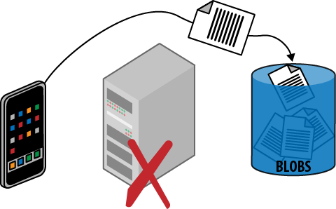

# 第十三章 &emsp; 代客密钥模式

此模式专注于如何高效地与不受信任的客户端一起使用云存储服务。

此模式大致模拟了现实世界中代客泊车钥匙的使用。当您愿意信任代客泊车员帮您停车，但又不希望他们访问车内其他非停车区域（例如手套箱）时，代客泊车钥匙就非常有用。此模式允许您指定应用程序用户在有限的时间内，拥有特定权限访问云存储帐户中的特定区域。您可以根据需要颁发任意数量的云存储代客泊车钥匙，并且每个钥匙都可以不同。

云存储服务简化了在不受信任的客户端之间直接安全地传输数据以及安全地存储数据的过程，无需数据通过受信任的中间层（在本例中为 Web 层）来实现安全保护。上传和下载均受支持。

直接将数据发送到最终存储位置，避免了数据不必要的中间环节，从而提高了操作速度，降低了延迟，并减轻了 Web 层的负载。由于这种模式避免了 Web 层的负载，因此所需的容量更少，进而可能减少所需的 Web 服务器节点数量（从而节省成本）。然而，需要注意的是，这种模式也需要能够安全地访问云存储，通常是通过发布临时访问 URL 来实现。根据具体实现方式，可能需要创建 Web 服务，而 Web 服务本身可能需要一些基础设施。但总的来说，这种模式在性能、可扩展性和成本节约方面都具有优势。

## 背景

Valet Key 模式能够有效应对以下挑战：

- 应用程序数据文件存储在云存储中，客户端需要访问这些文件
- 应用程序数据文件存储在云存储中，客户端需要根据具体情况访问这些文件
- 应用程序支持客户端上传最终会存储到云存储中的数据

此模式在从移动应用、桌面应用以及服务器间通信中读写数据时非常有用。从 Web 应用程序读取数据也是一种非常常见的用途，但由于 Web 浏览器的安全限制，从 Web 应用程序向 Blob 存储写入数据要复杂得多；不过，请参阅附录，因为在某些情况下，使用新兴的 HTML5 标准是可以实现的。尽管如此，目前许多 Web 浏览器仍然不支持这种场景。

实际应用示例有很多。付费视频或培训网站可以允许用户访问视频 24 小时。照片分享网站可以允许用户将新照片或视频直接上传到云存储。企业可以安全高效地与防火墙外的员工或合作伙伴共享资产。运行在消费者桌面上的备份服务可以高效地直接与云存储交互，并且始终只能访问该用户的文件。翻译服务允许客户上传文本、音频和视频文件；翻译后的文件可以通过相同的安全方式返回。

### 云的重要性

这种模式之所以可行，是因为云服务通过向应用程序提供易于使用的服务，掩盖了复杂的技术。此外，支持各种客户端的软件库进一步简化了客户端编码。

云平台数据存储服务针对大规模读写各种大小的文件进行了优化，从而避免了应用程序的 Web 层需要提供处理相同数据的带宽和计算能力。

一些应用程序使用“守门人模式”（Gatekeeper Pattern），该模式恰恰避免了这种做法：将所有数据通过中间层来控制访问。两种模式都可以安全地使用，但这种模式具有更高的效率和可扩展性。

## 影响

可扩展性、用户体验

## 机制

访问云存储服务是一项特权操作。通常情况下，您只会允许应用程序中的*受信任子系统*拥有对云存储账户的完全访问权限，这些受信任子系统完全在您的控制下运行于服务器上。

保护和管理数据访问始终是重中之重，但安全性和效率之间也存在着矛盾；我们希望保持安全，同时也希望以最高效的方式利用资源，从而提供优化的用户体验。这种模式专注于安全地使用 Blob 存储，同时最大限度地提高数据读写效率。图 13-1 展示了客户端和云存储服务之间的文件流，说明了这一点。数据流尽可能高效，尤其无需经过应用程序的 Web 层。

<table>
    <tr>
        <td>
            
        </td>
        <td>
            使用厂商中立的术语可能具有挑战性。<i>blob</i>指的是<i>二进制大对象</i>，这个概念在业界已经使用了多年，并且通常用于关系型数据库。简而言之，blob 就是一个文件。Windows Azure 存储也称这个概念为<i>blob</i>，亚马逊的简单存储服务 (S3) 称之为<i>对象</i>，Rackspace 称之为<i>云文件</i>，等等。在本章中，blob 仅指文件，而 blob 存储是一种云平台服务，允许您在云端存储文件。
        </td>
    </tr>
</table>

云平台会为每个存储帐户生成一个加密的*存储访问密钥*，应用程序需要使用此密钥来访问 Blob 存储。无论是桌面应用程序、移动设备还是 Web 应用程序，在客户端设备上安全地存储此密钥都并非易事。密钥一旦泄露，整个存储帐户都将面临风险。本文不会介绍任何在客户端设备上保护密钥的技术，而是重点关注另外两种方法：*公共访问*和*临时访问*。

 

*图 13-1。 数据上传高效便捷，直接从客户端上传到云存储，无需经过 Web 层。虽然未显示临时访问 URL（即代客密钥）的发放过程，但这是数据上传的必要条件。*

 

### 公开访问

从客户端的角度来看，这种模式包含两个方面：读取 Blob 数据和写入 Blob 数据。对于本来就打算公开访问的 Blob 数据，Blob 存储允许我们配置 Blob 以进行公开读取访问。由于每个 Blob 资源都可以通过 URL 寻址，这带来了诸多可能性。共享非常便捷：只需分发各个链接即可。Blob URL 引用可以像其他文件一样在 HTML 页面中引用，因此 Web 应用程序可以利用 Blob 存储的可扩展性，从而减轻 Web 层的负担，否则 Web 层将负责交付图像、视频、JavaScript 和文档等文件。

<table>
    <tr>
        <td>
            
        </td>
        <td>
            匿名公共读取权限功能强大。但是，不支持匿名公共写入权限。如果由应用程序管理，则可实现临时读取和写入权限。
        </td>
    </tr>
</table>

### 授予临时访问权限

公开读取权限允许任何知道 URL 的客户端随时无限次访问 Blob 资源。这可能并非您所期望的。如果您需要更精细的控制，可以使用存储密钥构建一个*临时访问 URL*，从而授予对特定资源的临时访问权限。该临时访问 URL 可以与客户端共享，客户端随后可以访问特定资源，但无法访问所有资源，就像使用代客密钥一样。

 

> <h3 align="center">代客泊车钥匙</h3>
>
> 有些汽车配备两种钥匙：普通钥匙可以打开车内所有锁，而代客泊车钥匙则只能提供有限的访问权限。如果您希望临时授予某些访问权限，但又不想授予完全访问权限，那么代客泊车钥匙就非常有用。最典型的例子就是代客泊车。使用代客泊车服务时，您需要将车交给陌生人代为停放。作为这项便利服务的交换，您需要给这位陌生人一把车钥匙。代客泊车钥匙非常适合这种情况，因为它只允许驾驶员解锁车门和启动汽车；它不会允许访问储物空间。在一些较新的车型中，它甚至可以限制车辆的行驶速度。
>
> 在云存储领域，临时访问 URL 就像一把灵活而强大的代客泊车钥匙，它既可以高效便捷地访问存储空间，又能将访问权限限制在特定资源和特定时间段内。

 

临时访问 URL 不仅限于读取，还可以扩展以允许其他权限，包括写入。因此，您可以创建一个临时访问 URL，允许客户端将文件直接上传到 Blob 存储中的预定位置。

临时访问 URL 的有效期由您的应用程序设置。有效期可以设置为刚好足以安全完成上传、观看电影或与预期登录会话持续时间相匹配；这取决于您的应用程序策略。

需要在服务器端生成临时访问 URL 并提供给客户端。合理的实现方式取决于您的应用程序，可能包括在登录时提供这些 URL，或者通过 Web 服务按需向已认证的调用者单独发放这些 URL。

<table>
    <tr>
        <td>
            
        </td>
        <td>
            上传数据块时，瞬态故障可能需要重试。请参阅<a href="09_第九章_忙音模式.md"><i>忙音模式</i>（第 9 章）</a>。
        </td>
    </tr>
</table>

### 安全注意事项

任何拥有存储访问密钥权限的代码（无论位于云端或其他位置）都可以创建临时访问 URL。

临时访问 URL 通过*哈希算法*进行保护。哈希算法是一种成熟的加密技术，需要访问存储密钥，并使用该密钥为任何字符串（在本例中为临时访问 URL）创建唯一签名。每次客户端尝试使用临时访问 URL 时，系统都会检查关联的哈希值；如果哈希值不正确，则访问将被拒绝。没有存储密钥权限的攻击者无法篡改现有的临时访问 URL、创建新的临时访问 URL 或猜测有效的临时访问 URL。

但是，与现实生活中的代客泊车钥匙一样，任何拥有临时访问 URL 的客户端都可以使用它。临时访问 URL 授予的任何权限都可用。与其他任何安全访问令牌一样，请遵循最小权限原则，仅授予必要的权限，并且仅在必要时授予。此外，传输临时访问 URL 时，请务必通过安全通道进行传输。由于云平台支持对 Blob 存储进行安全的 HTTPS 访问，因此云提供商数据中心之外的客户端可以安全地使用临时访问 URL。临时访问 URL 甚至可以安全地用于向普通 Web 浏览器提供页面；对浏览器而言，它只是通过 HTTPS 请求资源，因为安全密钥包含在 URL（查询字符串）中，HTTPS 在传输过程中保护查询字符串，而云存储服务则负责处理授权。

<table>
    <tr>
        <td>
            
        </td>
        <td>
            在现实世界中，丢失的代客泊车钥匙无法找回；唯一能让它失效的方法是更换锁。在云端，我们有其他工具，例如过期日期。Windows Azure 云平台更进一步，支持临时访问 URL，这些 URL 不直接包含权限或过期日期，而是引用一个策略（称为存储访问策略），该策略规定了权限和过期时间。此策略可以独立于引用它的 URL 进行更改。这使得可以颁发临时访问 URL，这些 URL 可以稍后被撤销、延长有效期或调整其权限。多个 URL 可以引用同一个策略。
        </td>
    </tr>
</table>

可以颁发的临时访问 URL 数量没有限制，并且所有 URL 彼此独立。

## 示例：在 Windows Azure 上构建 PoP

照片页​​面 (PoP) 应用程序（在前言中已介绍）支持直接从智能手机发布照片。由于智能手机现在可以常规地拍摄高分辨率照片和录制高清视频，因此文件可能很大（照片几兆字节，视频几十兆字节），这使得它成为此模式的绝佳用例。

从移动应用程序的角度来看，它并不关心是直接上传到云存储还是通过 Web 层中的封装 Web 服务上传；工作量相同。如果移动应用程序使用平台提供的移动库之一，则只需几行代码即可将 Blob 写入 Windows Azure。截至撰写本文时，已有适用于 Android、iOS（iPhone、iPad）和 Windows Phone 的移动客户端库。

Windows Azure Blob 提供了一些便捷的功能，可以帮助我们简化此过程：公共读取访问权限和共享访问签名。

### 公开读取权限

启用对 Blob 的公开读取权限非常简单。

Blob 存储容器（类似于目录或文件夹）可以标记为公开或私有访问。存储在 PoP 中的照片旨在供所有人公开查看，因此我们可以将它们全部标记为公开可见。标记后，任何知道 URL 的人都可以读取照片。这对于 PoP 上传的照片和视频、生成的缩略图以及任何其他尺寸或格式的变体都非常理想。

无法在 Windows Azure 存储中配置 Blob 以允许任何类型的匿名公开更新；更新始终需要安全凭据（将在下文中介绍）。

对 PoP 中照片的公开读取权限很可能会导致用户共享特定照片的 URL。这会将底层 URL 暴露给其他用户。默认情况下，URL 指向 Windows Azure 域，但在我们的示例中，我们希望它指向 *http://pageofphotos.com* 域；我们使用自定义域名来实现这一点。

 

> <h3 align="center">使用自定义域名</h3>
>
> 来自 Blob 存储的常规照片 URL 示例：
> *http://pageofphotos.blob.core.windows.net/photos/daniel.png*
>
> 配置自定义域名后，来自 Blob 存储的照片 URL 示例：
> *http://www.pageofphotos.com/photos/daniel.png*

 

### 共享访问签名

*共享访问签名 (SAS)* 是 Windows Azure 存储的一项功能，用于为具有临时读写权限的 Blob 构建临时访问 URL。

<table>
    <tr>
        <td>
            
        </td>
        <td>
            PoP 利用 SAS 进行 Blob 存储。Windows Azure 存储也为其 NoSQL 数据库、Windows Azure 表以及 Windows Azure 队列提供 SAS 支持。
        </td>
    </tr>
</table>

对于 PoP（隐私保护）而言，其目标是允许用户直接从移动应用程序将照片上传到 Blob 存储，同时防止他们上传照片到其他用户帐户。权限包含在特殊的 URL 中，可以防止一个用户干扰另一个用户的 Blob。这种级别的安全性足以满足 PoP 的需求。一旦构建了临时访问 URL 并将其传递给移动应用程序，移动应用程序就可以轻松地直接从移动设备将照片上传到 Blob 存储，例如使用前面提到的某个移动客户端库。

 

> <h3 align="center">SAS 用于选择性读取访问</h3>
>
> SAS 技术也可用于为读取非公开 blob 资源提供临时访问 URL。由于所有图像都是公开的，因此 PoP 不需要这样做。
>
> 如果 PoP 确实需要某些照片公开访问，而其他照片则不能，则可以使用私有容器来存放照片，并根据需要使用 SAS 技术为所有 URL 提供临时访问权限。或者，可以将私有照片移动到单独的 blob 容器中，从而允许原始 blob 容器中的公共照片保持开放权限。

 

生成临时访问 URL 后，应用程序需要负责将其安全地传递给相应的客户端。对于 PoP 移动应用，SAS 将通过安全 (HTTPS) 连接，在经过身份验证的 Web 服务调用后返回给移动应用。

Windows Azure 存储还支持*访问策略*的概念，访问策略是一组已命名的权限集合。创建 SAS 时可以使用访问策略。如果 SAS 是使用访问策略构建的，则可以稍后更改该访问策略。任何有效的 SAS 都会立即调整以使用新的权限。访问策略的一个常见用途是，在必要时保留撤销权限的能力。

 

> <h3 align="center">相关章节</h3>
>
> - [*最终一致性入门*（第5章）](05_第五章_最终一致性入门.md)
>
> - [*忙音模式*（第9章）](09_第九章_忙音模式.md)
>
> - [*网络延迟入门*（第11章）](11_第十一章_网络延迟入门.md)
>
> - [*共定位模式*（第12章）](12_第十二章_共定位模式.md)
>
> - [*CDN模式*（第14章）](14_第十四章_CDN模式.md)
>
> - [*多站点部署模式*（第15章）](15_第十五章_多站点部署模式.md)

 

## 总结

在任何可以安全应用此模式的地方，都应考虑使用它。由于能够管理读写临时访问权限，因此它是一种用途广泛的模式。最常见的棘手用例是直接从 Web 浏览器上传，但读取操作得到了很好的支持，从更灵活的客户端（例如移动应用）写入数据也得到了很好的支持。

当与支持此模式的存储容器一起使用时，应用程序可以避免使用网页或 Web 服务作为安全代理来读取或写入存储在安全容器中的数据。这降低了 Web 层的负载，因为它无需充当数据传输的中间人。此外，实现所有数据传输变体的代码被更简单的临时访问 URL 生成和颁发所取代，而上传代码则被卸载到客户端。客户端代码应尽可能利用现有的辅助库来降低复杂性。

最终结果是应用程序的可扩展性更好，用户体验也得到改善。

