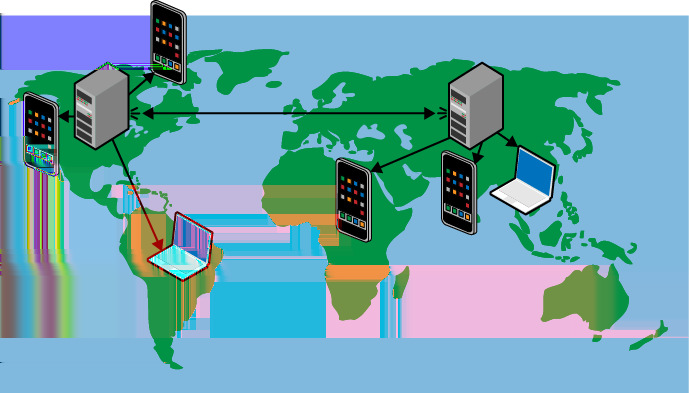

# 第十五章 &emsp; 多站点部署模式

这种高级模式专注于将单个应用程序部署到多个数据中心。

部署到多个数据中心有助于通过将客户端路由到最近的数据中心来降低网络延迟，从而改善用户体验。这也为跨数据中心故障转移和提高可用性提供了解决方案的基础。

如果多站点部署不能改善用户体验，并且您的应用程序不需要跨数据中心故障转移，则使用此模式可能过于复杂。

## 背景

多站点部署模式可以有效应对以下挑战：

- 用户并非集中在任何单个数据中心附近，而是围绕多个数据中心形成集群，或者地理位置分布广泛
- 法规限制了在特定数据中心存储数据的选项
- 某些情况下需要将公有云与本地资源结合使用
- 应用程序必须能够应对单个数据中心的故障

此模式有助于处理用户群体并非集中在同一地理区域的情况。造成这种情况的部分原因包括：用户在旅行途中可能在不可预测的地点使用应用程序、全球分布式移动应用程序以及公司办公室分布在多个地理位置。

这种模式在某些方面与[*CDN模式*（第14章）](14_第十四章_CDN模式.md)类似，因为我们都致力于让应用程序更靠近用户。CDN的重点在于让文件更靠近用户，它仅在向用户发送数据时起作用，而对用户向应用程序发送数据没有帮助。这种模式比CDN更强大，因为它能以更低的延迟将更多应用程序资源更靠近用户，即使是用户向应用程序发送数据时也是如此。这种模式的局限性在于：CDN节点的数量远多于完整的数据中心。因此，这两种模式通常会结合使用。

### 云的重要性

网络云服务可用于地理负载均衡和跨数据中心故障转移。面向数据的云服务也可用于数据库同步和云存储的异地复制。这些服务，加上对多个地理位置分散的数据中心的访问，简化了多站点部署中一些最复杂的方面。

## 影响

可用性、可靠性、可扩展性、用户体验

## 机制

如果应用程序的所有全球流量都由单个数据中心提供服务，那么在数据中心附近，响应速度会比在世界其他更远的地区更快。一般来说，距离越远，响应速度越慢。那么应该选择哪个数据中心呢？这种模式旨在选择多个数据中心，以便为全球用户提供最佳体验。

主流的公有云平台在多个大洲都设有数据中心。使用 Windows Azure 和 Amazon Web Services，您可以选择要部署到的特定数据中心。假设您在亚洲、欧洲和美国各选择一个数据中心，并将应用程序实例部署到每个数据中心。

应用程序部署到多个数据中心后，您需要决定如何将用户定向到合适的数据中心。在这种模式下，我们将努力使用户能够透明地了解此过程，从而提供最佳用户体验。在最基本的场景下，这需要智能路由和数据复制服务。

要将用户路由到最近的数据中心，请使用云平台提供的地理负载均衡服务，并将其配置为将用户定向到最近的数据中心。这些服务包括 Windows Azure Traffic Manager 和 Amazon Web Services 的 Elastic Load Balancing。

如果您希望用户无论路由到哪个数据中心都能看到相同的数据，则还需要在所有数据中心之间复制数据。本章后面的示例将对此进行更深入的探讨。最终结果如图 15-1 所示，其中数据中心根据需要复制数据。由于每个数据中心都拥有所需数据的本地副本，因此可以方便地将用户路由到离他们最近的数据中心，从而获得最佳性能。正如我们稍后将看到的，这种拓扑结构还可以用于处理某个数据中心不可用的罕见情况。

<table>
    <tr>
        <td>
            
        </td>
        <td>
            另一种可能性是将每个用户分配到单个数据中心，尽管这种方案尚未得到探讨。
        </td>
    </tr>
</table>

有了地理负载均衡和数据复制，您就拥有了多站点部署的基础。与始终必须直接从位于另一个大洲的数据中心访问数据和服务相比，用户将体验到更好的性能。

*图 15-1。 数据中心保持同步，以便用户可以访问最近的数据中心，或在发生故障时访问备用数据中心。跨越各大洲的连接线代表数据中心之间的同步。图中显示外部用户设备正在访问最近的数据中心。*

### 数据中心选择中的非技术考量

有时，非技术因素会迫使您将应用层级分布在不同的数据中心，或者选择某个数据中心而非其他数据中心。有时，选择数据中心位置是为了遵守政府法规、行业要求以及其他所谓的*数据主权*问题。例如，欧盟 (EU) 的一些国家/地区要求在欧盟境内运行的应用必须将个人身份信息存储在欧盟境内。再比如，信用卡行业对处理信用卡数据的应用有特定的要求。这些要求可能会进一步限制或影响数据中心的选择。

最后，考虑这样一种业务限制：客户尚未准备好将数据库从本地迁移到云端，但希望从云服务器访问该数据库。云平台服务可以通过虚拟专用网络 (VPN) 将公司的内部网络扩展到云端。它可以安全地处理这种情况，使运行在云资源上的应用能够轻松查询位于其他位置的数据库。这也是影响数据中心规模的另一个因素。

因此，业务考量可能会凌驾于纯粹基于性能的数据中心选择标准之上。虽然这些考量会影响云架构，但本文的重点并非探讨这一复杂议题。

### 成本影响

截至本文撰写之时，Windows Azure 和 Amazon 平台均会对离开数据中心的数据收取费用，但不会对进入数据中心的数据收取费用。因此，跨数据中心的流量会产生这些费用。当然，即使在单个数据中心内，情况也是如此，因为从数据中心外部远程访问云应用程序会导致数据离开数据中心。在本方案中，这也适用于跨数据中心保持数据库同步以及访问本地数据库。

跨多个数据中心部署应用程序会产生成本。应权衡这些成本与用户体验以及单个数据中心的稳健性限制。当然，如果需要多站点部署，则应考虑在不使用云服务的情况下实现此操作的成本和复杂性。

### 跨数据中心故障转移

*故障转移*是应用程序的一项功能，它使应用程序能够在主资源发生故障时使用备用资源继续运行。在此模式下，我们关注的是数据中心故障以及应用程序能否利用其他可用数据中心继续运行。我们可能需要由于自然灾害（例如飓风）或云提供商的故障（例如影响服务的软件错误或配置错误）而将应用程序从一个数据中心故障转移到另一个数据中心。

用于创建多站点部署的工具和技术也有助于提高应用程序的抗故障能力。用于地理负载均衡（将用户路由到最近的数据中心）的服务同样可以用于应对故障转移场景。具体来说，这些服务可以配置为监控其所引导用户的服务的运行状况，如果任何服务不可用，流量将被路由到运行状况良好的实例。

地理负载均衡器需要一些时间来检测服务是否无响应，然后才会故障转移到正常运行的副本。在此期间，应用程序访问可能会出现错误。客户端重试机制，例如[*忙音模式*（第 9 章）](09_第九章_忙音模式.md)，可以帮助用户避免这些错误。故障转移完成后，用户将被路由到数据中心；如果这些数据中心位于其他大洲，用户体验会受到影响，但服务仍然可用。这通常比完全无法访问要好，但这取决于具体的应用程序。

随着故障服务恢复正常，流量可以重新传输，系统响应速度将恢复到最佳水平。

<table>
    <tr>
        <td>
            
        </td>
        <td>
            此方案无法保证即时或无缝故障转移，仍会出现停机时间。
        </td>
    </tr>
</table>

一种故障转移方法是预先部署备用资源，以备不时之需。这种配置称为*主备模式*或*双活模式*，具体取决于备用资源是处于待命状态还是正在使用中（主数据中心是第一个“活动”资源）。另一种选择是不预先部署任何已运行的备用资源，而是根据故障转移的需要随时部署这些资源。显然，这种方法耗时更长，但成本也更低。我们将在*示例*部分对此主题进行更深入的探讨。

这是*更全面的灾难恢复 (DR)*计划的一部分。其中许多问题与非云应用程序类似，但超出了本章的讨论范围。

## 示例：在 Windows Azure 上构建 PoP

照片页​​面 (PoP) 应用程序（前言中已介绍）在全球范围内提供无缝用户体验面临以下几个挑战：

- 将用户路由到最近的数据中心，以获得最佳用户体验
- 复制帐户数据，使其在所有数据中心都可用，无论帐户所有者还是访问者
- 复制身份信息，以便我们可以在任何数据中心正确验证用户身份，并确保他们是同一用户
- 在全球范围内高效地提供照片服务

### 选择数据中心

截至撰写本文时，Windows Azure 提供八个地理位置分散的数据中心：

- 亚洲两个：东部（香港）和东南部（新加坡）
- 欧洲两个：北部（荷兰）和西部（爱尔兰）
- 美国四个：中北部（伊利诺伊州）、东部（弗吉尼亚州）、中南部（德克萨斯州）和西部（加利福尼亚州）

由于 PoP 用户遍布全球，我们将部署到亚洲的一个数据中心。 （新加坡）、欧洲（爱尔兰）和北美（弗吉尼亚州）各有一个数据中心。然而，PoP 用户无需了解这三个数据中心；无论用户身处何地，PoP 都应该能够正常工作。换句话说，用户只需记住 *http://www.pageofphotos.com* 这一个地址即可。

### 路由到最近的数据中心

Windows Azure 流量管理器是一种可扩展、高可用、易于配置的地理负载均衡服务，它会在后台持续监控所有应用程序部署的响应速度。它确保访问 *http://www.pageofphotos.com* 的用户会被透明地定向到能够提供最佳响应的数据中心。

> <h3 align="center">配置流量管理器</h3>
>
> 流量管理器配置包括指定用户看到的公共域名（*http://www.pageofphotos.com*）、列出各个实例（*http://pop-asia.cloudapp.net*、*http://pop-eur.cloudapp.net*、*http://pop-usa.cloudapp.net*）以及配置路由规则，以选择最近的实例。列出的终结点名称仅为示例，但展示了使用一致的命名模式，这有助于避免混淆和错误。

例如，从亚洲访问 *http://www.pageofphotos.com/timothy* 将会得到 *http://pop-asia.cloudapp.net* 实例的满足。

### 为提升性能复制用户数据

假设一位爱尔兰的 PoP 用户上传了一些新照片。这些照片可以整齐高效地存储在爱尔兰的数据中心，网络延迟极低。照片集可以分享给同样身在爱尔兰的朋友，他们也可以通过爱尔兰的数据中心访问这些照片。到目前为止，一切顺利。

现在假设有人将这组照片的链接通过电子邮件发送给了波士顿的朋友。来自波士顿的流量将被路由到弗吉尼亚州的数据中心。会发生什么呢？为了实现这一点，弗吉尼亚州的数据中心需要访问与爱尔兰数据中心相同的数据。我们采用的 PoP 方案分为两个互补的方案：一个用于上传的照片，另一个用于帐户中的其他数据。

照片会被上传到距离最近的数据中心的 Windows Azure 存储中的 Blob 存储。应用程序不会显式地将这些照片复制到其他数据中心。这些照片的缩略图在同一数据中心生成 [使用[*以队列为中心的工作流程模式*（第 3 章）](03_第三章_以队列为中心的工作流程模式.md)] ，并同样存储为 Blob 存储。照片不会复制到所有数据中心，因为我们计划依赖 [*CDN 模式*（第 14 章）](14_第十四章_CDN模式.md)以最高效的方式将其交付给用户。

除了照片本身，还有照片相关的元数据，例如：

- 负责上传照片的帐户
- 访问照片所需的 URL
- 照片的文本描述
- 等等。

这些数据存储在 Windows Azure SQL 数据库中。新照片会上传到最近的数据中心。元数据会保存到最近数据中心的 SQL 数据库中。但是，与照片 Blob 不同，SQL 数据库数据会使用 SQL 数据库数据同步服务在所有三个数据中心之间进行复制。

> <h3 align="center">配置数据同步</h3>
>
> SQL 数据同步服务配置会请求预配一个数据同步服务器，创建一个同步组来指定要保持同步的数据库实例，然后将要保持同步的三个实例的数据库名称添加到同步组中。它会选择所需的同步规则，并让其运行。同步按计划进行；支持的最快频率是同步作业之间间隔五分钟。

<table>
    <tr>
        <td>
            
        </td>
        <td>
            截至撰写本文时，SQL 数据库数据同步服务仍处于预览阶段，暂不支持生产环境使用。
        </td>
    </tr>
</table>

无论用户身处世界何地，访问照片页面时都会被定向到最近的数据中心。服务会返回照片的 HTML 页面；单个照片将从 24 个全球 CDN 节点之一提供。

请注意 SQL 数据库实例的最终一致性。请参考我们之前的示例：一位来自爱尔兰的 PoP 用户与波士顿的朋友共享了一页照片。在一段时间内，爱尔兰的 PoP 用户可以看到新照片，但美国（和亚洲）的 PoP 用户看不到；随着 SQL 数据库数据同步服务赶上进度，这个问题最终会得到解决。

### 复制账户所有者的身份信息

虽然任何匿名用户都可以查看任何照片页面，但所有上传的照片都属于 PoP 账户持有者。PoP 账户创建非常便捷，因为它不管理用户凭据，而是依赖于*联合身份验证*。PoP 配置为允许用户使用他们可能已经在使用的*身份提供商 (IdP)*登录。PoP 支持的 IdP 包括 Google、Yahoo! 和 Facebook。（PoP 可以支持许多其他身份提供商，但选择不使用它们。）用户首次登录其 IdP 时，即授予其 IdP 与 PoP 共享登录信息的权限。（实际上，IdP 是与访问控制服务 (ACS) 共享信息，而不是直接与 PoP 共享。PoP 从 ACS 获取信息。）对于 PoP 支持的任何 IdP，我们最需要的是经过验证的电子邮件地址。由于 PoP 信任的每个 IdP 都信誉良好，因此我们对其信任。然后，我们将电子邮件地址用作 SQL 数据库实例中的唯一帐户密钥。这样，我们就可以将上传的照片与特定用户帐户关联起来。

另请注意，PoP 本身并不知道或存储用户的密码。只有底层身份提供商 (IdP) 才会存储密码。IdP 使用加密技术，可以安全地向 PoP 验证用户的身份，并传递一个加密安全的*声明*，其中包含用户的电子邮件地址。这就是 PoP 所需要的全部信息。PoP 的开发工作可以专注于功能，而不是基础设施。

<table>
    <tr>
        <td>
            
        </td>
        <td>
            联合身份、声明和身份提供商是构建以云原生方式处理身份的应用程序的重要概念。要解释这些重要主题，可以写一整本书。 （事实上​​，附录 A 引用了这样一本书。）本章的关键在于，某个外部实体（身份提供商）会告知我们当前用户拥有某个特定的电子邮件地址（由声明指示），并且我们可以相信此信息的准确性。
        </td>
    </tr>
</table>

Windows Azure 访问控制服务 (ACS) 充当 PoP 和每个 IdP 之间的中介。事实证明，这对于 PoP 来说是一个极大的简化，因为 IdP 的行为方式千差万别。如果您的应用程序需要直接与 IdP 交互，情况可能会相当复杂。ACS 帮助应用程序管理与一个或多个身份提供商的关系，它抽象化了实现细节并对其进行规范化，从而确保声明在到达您的应用程序时保持一致。

> <h3 align="center">配置 ACS</h3>
>
> 访问控制服务的配置包括为每个受支持的提供商建立一组规则。基本流程主要通过向导式用户界面中的一系列明确步骤完成；由于此类配置属于常规操作，因此这种方式十分合适。Google 和 Yahoo! 的配置可以在 ACS 界面中完成，但 Facebook 则需要在 Facebook 网站上进行额外配置。ACS 也可以通过编程方式进行配置。PoP 的配置很简单：传递来自身份提供商 (IdP) 的所有声明（其中包括电子邮件地址声明），并为几个特殊电子邮件帐户（用于 PoP 站点管理员）注入“管理员”角色声明。

对 ACS 如何帮助 PoP 进行身份验证的描述对于理解多站点部署至关重要。简而言之，每个受支持的数据中心中的每个身份提供商都需要重复此配置。

### 数据中心故障转移

鉴于我们已采取措施在三个数据中心实现 PoP 连接，为了确保在其中一个数据中心发生故障时能够进行故障转移，我们还需要做些什么？

<table>
    <tr>
        <td>
            
        </td>
        <td>
            支持数据中心故障转移是一项重大决策，涉及诸多风险和权衡。本文概述的方法适用于PoP应用和业务。但这些风险和权衡是否适用于您的应用和业务，则需视具体情况而定。
        </td>
    </tr>
</table>

PoP 复制 Windows Azure SQL 数据库实例。如前所述，仍然存在数据丢失的风险。如果这还不够，那么克服这一风险可能非常困难。

PoP 在每个数据中心都配置了访问控制服务身份提供程序，以便无论使用哪个数据中心进行身份验证，PoP 都能识别该数据中心。

PoP 使用 Windows Azure 存储将照片和缩略图保存为 Blob。由于 Windows Azure 平台会自动为我们进行异地复制，因此我们没有采取任何措施来复制这些 Blob。（Windows Azure 存储表也进行了异地复制。）每个数据中心都与同一大洲的另一个数据中心配对。在上面的数据中心列表中，两个亚洲数据中心相互复制，两个欧洲数据中心相互复制，在美国，中北部数据中心与中南部数据中心相互复制，东部数据中心与西部数据中心相互复制。在极少数情况下，如果发生严重灾难导致某个数据中心丢失或长时间不可用，存储将故障转移到其复制对。您无需执行任何操作。Blob 请求会在一段时间内失败，但故障转移完成后，它们将恢复正常工作。但请注意，在此期间仍存在数据丢失的风险。

PoP 使用 CDN 将照片和缩略图分发到用户附近。由于所有八个 Windows Azure 数据中心都托管着 CDN 节点，因此数据中心故障也可能影响 CDN。此外，其他 CDN 节点也可能独立受到影响。内置的 CDN 路由逻辑会检测到 CDN 节点的故障，并更改流量路由。但仍存在一段时间内文件可能无法送达的情况。鉴于 CDN 的特性，由于许多照片已缓存在全球各地，因此在数据块不可用且正在故障转移期间，众多分布式 CDN 节点可能会在一定程度上保护用户。

最后一步是更新流量管理器中的配置。前面我们介绍了流量管理器如何将流量路由到最近（响应最快）的数据中心。流量管理器还可以处理故障转移场景。例如，如果飓风导致弗吉尼亚州数据中心不可用，流量管理器可以将用户路由到新加坡或爱尔兰（具体取决于它认为哪个数据中心对特定用户来说速度更快）。虽然用户体验相比直接访问北美数据中心有所下降，但总比完全无法访问要好。流量管理器仍然可以在一定时间内将流量路由到故障数据中心。

由于数据中心可以故障转移到已配置且正在使用的资源，因此这是一种*主动/主动故障转移配置*。

> <h3 align="center">考虑灾难恢复和用户体验</h3>
>
> 多站点部署应如何平衡灾难恢复 (DR) 和用户体验（主要是性能）的优势？没有唯一的正确答案，但通常将灾难恢复和用户体验视为两个独立的考量因素，它们恰好有重叠的解决方案，这样会很有帮助。两者都可能成为决定采用多站点部署的依据，或者需要综合考虑两者的价值才能证明多站点部署的合理性。

### 托管方案

如前所述，许多非技术性的业务因素可能会限制数据存储的位置选择。Windows Azure 提供了一些功能，可以帮助您最大限度地利用这些限制。简而言之，这些功能包括：

- Windows Azure 虚拟网络和 Windows Azure Connect 支持在您的 Windows Azure 服务与其他网络之间建立安全的虚拟专用网络 (VPN) 连接。这支持多种集成方案，例如允许在 Windows Azure 中运行的计算资源访问在私有数据中心运行的数据库。
- Windows Azure 服务总线支持多种安全方案，包括跨防火墙通信、发布/订阅到已连接设备以及发布/订阅到已断开连接的设备。这些功能支持跨应用程序进行安全高效的通信，而无需考虑防火墙或数据中心的配置。
- 前面已经介绍了 SQL 数据同步服务在云到云同步中的应用。此服务也可用于在云端和本地数据库之间进行同步。

这些服务有助于与位于本地或其他数据中心的数据库或服务进行集成。

> <h3 align="center">相关章节</h3>
>
> - [*水平扩展计算模式*（第 2 章）](02_第二章_水平扩展计算模式.md)
>
> - [*以队列为中心的工作流程模式*（第 3 章）](03_第三章_以队列为中心的工作流程模式.md)
>
> - [*最终一致性入门*（第 5 章）](05_第五章_最终一致性入门.md)
>
> - [*节点故障模式*（第 10 章）](10_第十章_节点故障模式.md)
>
> - [*网络延迟入门*（第 11 章）](11_第十一章_网络延迟入门.md)
>
> - [*共定位模式*（第 12 章）](12_第十二章_共定位模式.md)
>
> - [*代客密钥模式*（第 13 章）](13_第十三章_代客密钥模式.md)
>
> - [*CDN 模式*（第 14 章）](14_第十四章_CDN模式.md)

## 总结

多站点部署模式主要用于提升地理位置分散的用户群的用户体验。用户不必遍布全球，但至少需要分布在多个数据中心，以便在提升性能时获得足够的价值。

对于需要在某个数据中心不可用时进行故障转移的应用，此模式也十分有用。这是一个复杂的主题，但本章中的许多内容将帮助您入门。

由于使用此模式会导致应用比单数据中心解决方案更复杂、成本更高，因此需要评估其业务价值并与成本进行比较。

