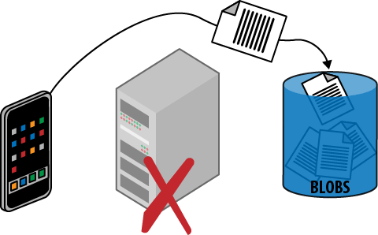

# CHAPTER 13 &emsp; Valet Key Pattern

This pattern focuses on efficiently using cloud storage services with untrusted clients.

This pattern loosely models the use of valet keys from the real world. Valet keys are useful when you are willing to trust a valet parking attendant to park your car, but don't want to also give them access to areas in the car not needed for this purpose, such as the glove compartment. This pattern enables specifying that a user of your application is allowed to access very specific areas within your cloud storage account, with specific permissions, and for a limited amount of time. You can issue as many cloud storage valet keys as you like and they can all be different.

Cloud storage services simplify securely transferring data directly between untrusted clients and to secure data storage, without the data needing to pass through a trusted intermediate layer (the web tier in this case) to implement security. Both uploads and downloads are supported.

Going directly to the final storage location eliminates the need for data to unnecessarily pass through an intermediary, so these operations will be faster with lower latency, while reducing the load on the web tier. Because this pattern avoids load on the web tier, it will result in needing less capacity, which may further result in needing fewer web server nodes (thus saving money). Realize, however, that this pattern also requires the ability to securely allow access to cloud storage, typically by issuing temporary access URLs. Depending on how this is done, it may necessitate the creation of a web service, which may require some infrastructure of its own. Generally, however, the performance, scalability, and cost savings favor the use of this pattern.

## Context

The Valet Key Pattern is effective in dealing with the following challenges:
 
- Application data files are stored in cloud storage, which clients need to access
- Application data files are stored in cloud storage, which clients need to access on a case-by-case basis
- Application supports clients uploading data that will end up in cloud storage

This pattern is useful when reading and writing data from mobile apps, desktop apps, and during server-to-server communication. Reading data from a web application is also a very common use, though due to security limitations imposed by web browsers it is much trickier to write data to blob storage from a web application; however, see the appendix as it is possible in some cases using emerging HTML5 standards. Still, many web browsers do not support this scenario today.

Example of practical uses are many. A for-pay video or training site can allow access to a video for 24 hours. A photo sharing site can allow a user to upload a new photo or video directly into cloud storage. An enterprise can securely and efficiently share assets with employees or partners who are outside the firewall. A backup service running on a consumer desktop can efficiently interact directly with cloud storage, while only ever having access to files for that single user. A translation service can allow customers to upload text, audio, and video files; translated can be delivered back through the same secure means.

### Cloud Significance

This pattern is possible because cloud services mask significant technical complexity by offering an easy-to-use service to applications. Additionally, software libraries supporting a broad range of clients further simplifies client coding.

The cloud platform data storage services are optimized for reading and writing files of all sizes at very high scale, shielding the application’s web tier from needing to provide the bandwidth and computational power to handle this same data.

Some applications use the Gatekeeper Pattern, which does exactly what this pattern avoids: move all data through an intermediary in order to control access. Both patterns can be used securely, though this pattern offers efficiency and scalability benefits.

## Impact

Scalability, User Experience

## Mechanics

Access to cloud storage services is a privileged operation. Typically, you will allow only *trusted subsystems* within your application to have unfettered access to your cloud storage accounts, where trusted subsystems are running entirely under your control on the server.

Securing and managing access to data is always a high priority, but there is also a tension between security and efficiency; we want to remain secure, but would like to do so with the most efficient use of resources that allows us to deliver an optimized user experience. This pattern focuses on securely using blob storage while also reading and writing data with maximum efficiency. This is illustrated in Figure 13-1, which shows the flow of files directly between the client and the cloud storage service. The data flow is as efficient as possible, and in particular does not need to flow through the web tier of the application.

<table>
    <tr>
        <td>
            
        </td>
        <td>
            Using vendor-neutral terms can be challenging. A <i>blob</i> is a <i>binary large object</i> in the sense that’s been used in the industry for many years and is commonly used with relational databases. Basically, a blob is a file. Windows Azure Storage happens to also call this concept a <i>blob</i>, while Amazon’s Simple Storage Service (S3) calls it an <i>object</i>, Rackspace has <i>cloud files</i>, and the list goes on. In this chapter, a blob is just a file, and blob storage is a cloud platform service that allows you to store files in the cloud.
        </td>
    </tr>
</table>

A *storage access key* is cryptographically generated by the cloud platform for each storage account, and applications are expected to use this key to access blob storage. It is not easy to safely store this key on client devices, whether for a desktop, mobile, or web application. A compromised key exposes the entire storage account. This pattern will not cover any techniques for protecting keys on client devices, but will instead focus on two other approaches: *public access* and *temporary access*.

*Figure 13-1. Data is uploaded efficiently, going directly from the client to cloud storage without passing through the web tier. The issuing of a temporary access URL—the valet key—is not shown, but is needed before the data can be uploaded.*

### Public Access

There are two sides to this pattern from the point of view of the client: reading blob data and writing blob data. For blob data that is intended to be publicly visible anyway, blob storage allows us to configure blobs for public read access. Because each blob resource is addressable as a URL, this opens up a considerable number of possibilities. Sharing is easy: just distribute the individual links. Blob URL references can be referenced just like other files from HTML pages so that web applications can benefit from the scalability features of blob storage, reducing the burden on the web tier that would otherwise be responsible for delivering files such as images, videos, JavaScript, and documents.

<table>
    <tr>
        <td>
            
        </td>
        <td>
            Anonymous public read access is very powerful. However, anonymous public write access is not supported. Temporary access for both read and write are possible if managed by the application.
        </td>
    </tr>
</table>

### Granting Temporary Access

Public read access allows any client knowing the URL to access the blob resource at any time without limit. This may not be what you want. If more control is desired, it is possible to grant temporary access to specific resources by constructing a *temporary access URL* using the storage key. The temporary access URL can be shared with clients who can then access the specific resource, but not all resources, just like with a valet key.

> <h3 align="center">The Valet Key</h3>
>
> Some cars come with two types of keys: regular keys that work on every lock in the car, and valet keys that provide only limited access. The valet key is useful when you wish to temporarily allow some access, but do not want to give full access. The classic case is valet parking. With valet parking, you turn over your car to a stranger who will park it for you. In exchange for this convenience, you need to give this stranger a key to your car. The valet key is ideal for this, as it will only allow the driver to unlock the doors and start the car; it will not allow access to storage areas. In some newer cars, it will even limit the speed at which the car can be driven.
>
> In the cloud storage world, the temporary access URL serves as a flexible and powerful valet key, allowing efficient and convenient access to storage while still being able to limit that access to only specific resources and during specific times.

Temporary access URLs are not limited to reading, but can be extended to allow other permissions, including writing. Thus is it possible to create one that would enable a client to upload a file directly into a predetermined location in blob storage.

The temporary access URLs are time-limited by your application-supplied expiration. The expiration time might be selected to be just long enough to safely finish an upload, watch a movie, or set to match the expected duration of the login session; this is a policy decision for your application.

Temporary access URLs need to be generated on the server and made available to the client. Reasonable approaches will depend on your application, but might include providing them during login, or separately issuing them on demand to authenticated callers via a web service.

<table>
    <tr>
        <td>
            
        </td>
        <td>
            When uploading blobs, transient failures may require retries. See <i>Busy Signal Pattern</i> (Chapter 9).
        </td>
    </tr>
</table>

### Security Considerations

Any code (in the cloud or elsewhere) with access to the storage access key will be able to create temporary access URLs.

Temporary access URLs are secured through *hashing*, a proven cryptographic technique that requires accesses to the storage key and uses it to create a unique signature for any string, in this case the temporary access URL. The associated hash is checked every time a client attempts to use the temporary access URL; without a correct one, access is denied. Adversaries without access to the storage key cannot tamper with an existing temporary access URL, create a new one, or guess a valid one.

However, as with a real-life valet key, any client in possession of a temporary access URL can use it. Any permissions granted by the temporary access URL are available. Like any other security access token, follow the principle of least privilege and provide only those rights necessary, and only for as long as necessary. Further, when transporting a temporary access URL, do so over a secure channel. Since the cloud platforms support secure HTTPS access to blob storage, clients outside the cloud provider's data center can safely use temporary access URLs. Temporary access URLs can even be used safely to serve pages to a regular web browser; as far as the browser is concerned, it is just requesting resources via HTTPS since the security key is part of the URL (the query string), HTTPS protects the query string during transport, and the cloud storage service handles authorization.

<table>
    <tr>
        <td>
            
        </td>
        <td>
            In the physical world, a lost valet key cannot be revoked; the only way to render it useless is by changing the locks. In the cloud, we have other tools such as expiration dates. The Windows Azure cloud platform goes further, supporting temporary access URLs that do not directly contain permissions or an expiration date, but rather reference a policy, known as a stored access policy, which dictates permissions and expiration. This policy can be changed independently of the URLs that reference it. This allows temporary access URLs to be issued that can later be revoked, extended, or have their permissions tweaked. Many URLs can reference the same policy.
        </td>
    </tr>
</table>

There is no limit on the number of temporary access URLs that can be issued and all are independent of one another.

## Example: Building PoP on Windows Azure

The Page of Photos (PoP) application (which was described in the Preface) supports publishing photos directly from a smart phone. Since smart phones can now routinely take high-resolution photos and capture HD video, the file may be large (multiple megabytes for a photo to tens of megabytes for a video), making this an especially good use case for this pattern.

From the point of view of the mobile application, it does not care whether it is uploading directly to cloud storage or uploading through a wrapper web service in the web tier; it is the same amount of work. To write a blob into Windows Azure, a mobile application only requires a few lines of code if it is using one of the mobile libraries provided as part of the platform. At the time of this writing, mobile client libraries were available for Android, iOS (iPhone, iPad), and Windows Phone.

Windows Azure Blobs offer a couple of handy features that allow us to streamline this process: public read access and Shared Access Signatures.

### Public Read Access

Enabling public read access to blobs is trivial.

Blob storage containers (which are like directories or folders) can be marked as available for either public or private access. Photos stored in PoP are intended to be publicly viewable by anyone, so we can go ahead and mark them all as publicly visible. Once marked, anyone who knows the URL can read it. This is ideal for PoP for uploaded photos and videos, generated thumbnails, and any other size or format variants.

It is not possible to configure blobs in Windows Azure Storage to allow anonymous public updates of any kind; updates always require security credentials (which are described next).

Public read access to photos in PoP will likely result in users sharing URLs to specific photos. This exposes the underlying URL to users. By default, the URL points to a Windows Azure domain, but in our case we would like it to point to a *http://pageofphotos.com* domain; we do this with a vanity domain.

> <h3 align="center">Using a Vanity Domain</h3>
>
> Example of a regular photo URL from blob storage:  
> *http://pageofphotos.blob.core.windows.net/photos/daniel.png*
>
> Example of a photo URL form blob storage after configuring our vanity domain:  
> *http://www.pageofphotos.com/photos/daniel.png*

### Shared Access Signatures

A *Shared Access Signature (SAS)* is the Windows Azure Storage feature used to construct temporary access URLs for blobs that have temporary permission for reading or writing blobs.

<table>
    <tr>
        <td>
            
        </td>
        <td>
            PoP takes advantage of SAS for blob storage. Windows Azure Storage also features SAS support for its NoSQL database, Windows Azure Tables, as well as Windows Azure Queues.
        </td>
    </tr>
</table>

For PoP, the goal is to permit users to upload photos from a mobile application directly into blob storage without allowing them to upload photos to other user accounts. Permissions are part of the special URL and will not allow one user to interfere with blobs belonging to another user. This level of security is sufficient for PoP. Once the temporary access URL is constructed and delivered to the mobile application, it is a simple matter for the mobile application to upload directly from the mobile device to blob storage, perhaps using one of the mobile client libraries mentioned previously.

> <h3 align="center">SAS for Selective Read Access</h3>
>
> The SAS technique can also be used to provide temporary access URLs for reading non-public blob resources. PoP does not require this since all images are public anyway.
>
> If PoP did require that some photos be publicly accessible while others were not, it could use a private container to hold photos and use the SAS technique to provide temporary access to all URLs as needed. Alternatively, private photos could be moved into a separate blob container, allowing public photos in the original blob container to maintain open permissions.

Once a temporary access URL is generated, it is up to your application to safely deliver it to the appropriate client. In the case of the PoP mobile app, the SAS will be returned to the mobile app in response to an authenticated web service call over a secure (HTTPS) connection.

Windows Azure Storage also supports the notion of an *access policy* which is a named collection of permissions. An access policy can be used when creating a SAS. If a SAS is constructed using an access policy, it is possible to later change that access policy. Any valid SAS will be immediately adjusted to use the new permissions. One common use of access policies is to maintain the ability to revoke permissions if it later becomes necessary.

> <h3 align="center">Related Chapters</h3>
>
> - *Eventual Consistency Primer* (Chapter 5)
>
> - *Busy Signal Pattern* (Chapter 9)
>
> - *Network Latency Primer* (Chapter 11)
>
> - *Colocate Pattern* (Chapter 12)
>
> - *CDN Pattern* (Chapter 14)
>
> - *Multisite Deployment Pattern* (Chapter 15)

## Summary

Use of this pattern should be considered anywhere it can be safely applied. The ability to manage temporary access for reading and writing makes this a broadly usable pattern. The most common troublesome use case will be an upload directly from a web browser, but reading is well supported, and writing from more flexible clients such as mobile apps is also well supported.

When used with storage containers that support this pattern, applications can avoid having a web page or web service act as a security proxy to read or write data stored in a secure container. This reduces load on the web tier because it is not acting as a middleman for data transfer. Also, the code for implementing all the variants of data passing through is replaced by the far simpler generation and issuing of temporary access URLs, while the upload code is offloaded to the client. The client code should utilize existing helper libraries where available to minimize complexity.

The end result is that applications scale better and the user experience is improved.

