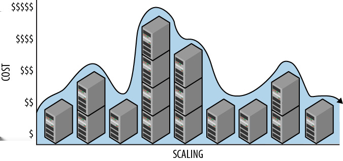

# CHAPTER 2 &emsp; Horizontally Scaling Compute Pattern

This fundamental pattern focuses on horizontally scaling compute nodes. Primary concerns are efficient utilization of cloud resources and operational efficiency.

The key to efficiently utilizing resources is stateless autonomous compute nodes. Stateless nodes do not imply a stateless application. Important state can be stored external to the nodes in a cloud cache or storage service, which for the web tier is usually done with the help of cookies. Services in the service tier typically do not use session state, so implementation is even easier: all required state is provided by the caller in each call.

The key to operations management is to lean on cloud services for automation to reduce complexity in deploying and managing homogeneous nodes.

## Context

The Horizontal Scaling Compute Pattern effectively deals with the following challenges:

- Cost-efficient scaling of compute nodes is required, such as in the web tier or service tier.
- Application capacity requirements exceed (or may exceed after growth) the capacity of the largest available compute node.
- Application capacity requirements vary seasonally, monthly, weekly, or daily, or are subject to unpredictable spikes in usage.
- Application compute nodes require minimal downtime, including resilience in the event of hardware failure, system upgrades, and resource changes due to scaling.

This pattern is typically used in combination with the Node Termination Pattern (which covers concerns when releasing compute nodes) and the Auto-Scaling Pattern (which covers automation).

 
### Cloud Significance

Public cloud platforms are optimized for horizontal scaling. Instantiating a single compute node (virtual machine) is as easy as instantiating 100. And with 100 nodes deployed, we can just as easily release 50 of them with a simple request to the cloud platform. The platform ensures that all nodes deploy with the same virtual machine image, offer services for node management, and provide load balancing as a service.

## Impact

Availability, Cost Optimization, Scalability, User Experience

## Mechanics

When a cloud-native application is ready to horizontally scale by adding or releasing compute nodes, this is achieved through the cloud platform management user interface, a scaling tool, or directly through the cloud platform management service. (The management user interface and any scaling tools ultimately also use cloud platform management service.)

The management service requires that a specific configuration is specified (one or more virtual machine images or an application image) and the number of desired nodes for each. If the number of desired compute nodes is larger than the current number, nodes are added. If the number of desired compute nodes is lower than the current number, nodes are released. The number of nodes in use (and commensurate costs) will vary over time according to needs, as shown in Figure 2-1.

The process is very simple. However, with nodes coming and going, care must be taken in managing user session state and maintaining operational efficiency.

It is also important to understand why we want an application with fluctuating resources rather than fixed resources. It is because reversible scaling saves us money.

### Cloud Scaling is Reversible

Historically, scalability has been about *adding* capacity. While it has always been technically possible to reduce capacity, in practice it has been as uncommon as unicorn sightings. Rarely do we hear “hey everyone, the company time-reporting application is running great – let’s come in this weekend and migrate it to less capable hardware and see what happens.” This is the case for a couple of reasons.

It is difficult and time-consuming to ascertain the precise maximum resource requirements needed for an application. It is safer to overprovision. Further, once the hardware is paid for, acquired, installed, and in use, there is little organizational pressure to fiddle with it. For example, if the company time-reporting application requires very little capacity during most of the week, but 20 times that capacity on Fridays, no one is trying to figure out a better use for the “extra” capacity that’s available 6 days a week.

With cloud-native applications, it is far less risky and much simpler to exploit extra capacity; we just give it back to our cloud platform (and stop paying for it) until we need it again. And we can do this without touching a screwdriver.

*Figure 2-1. Cloud scaling is easily reversed. Costs vary in proportion to scale as scale varies over time.*

Cloud resources are available on-demand for short-term rental as virtual machines and services. This model, which is as much a business innovation as a technical one, makes reversible scaling practical and important as a tool for cost minimization. We say reversible scaling is elastic because it can easily contract after being stretched.

<table>
    <tr>
        <td>
            
        </td>
        <td>
            Practical, reversible scaling helps optimize operational costs.
        </td>
    </tr>
</table>

If our allocated resources exceed our needs, we can remove some of those resources. Similarly, if our allocated resources fall short of our needs, we can add resources to match our needs. We horizontally scale in either direction depending on the current resource needs. This minimizes costs because after releasing a resource, we do not pay for it beyond the current rental period.

> <h3 align="center">Consider All Rental Options</h3>
>
> The caveat “beyond the current rental period” is important. Rental periods in the cloud vary from instantaneous (delete a byte and you stop paying for its storage immediately) to increments of the wall clock (as with virtual machine rentals) to longer periods that may come with bulk (or long-term) purchasing. Bulk purchasing is an additional cost optimization not covered in this book. You, however, should not ignore it.

Consider a line-of-business application that is expected to be available only during normal business hours, in one time zone. Only 50 hours of availability are needed per week. Because there are 168 hours in a calendar week, we could save money by removing any excess compute nodes during the other 118 hours. For some applications, removing all compute nodes for certain time periods is acceptable and will maximize cost savings. Rarely used applications can be deployed on demand.

An application may be lightly used by relatively few people most of the time, but heavily used by tens of thousands of people during the last three business days of the month. We can adjust capacity accordingly, aligning cost to usage patterns: during most of the month two nodes are deployed, but for the last three business days of the month this is increased to ten.

The simplest mechanism for adjusting deployed capacity is through the cloud vendor’s web-hosted management tool. For example, the number of deployed nodes is easily managed with a few clicks of the mouse in both the Windows Azure portal and the Amazon Web Services dashboard. In Auto-Scaling Pattern (Chapter 4) we examine additional approaches to making this more automated and dynamic.

#### **Cloud scaling terminology**

Previously in the book, we note that the terms *vertical scaling* and *scaling up* are synonyms, as are *horizontal scaling* and *scaling out*. Reversible scaling is so easy in the cloud that it is far more popular than in traditional environments. Among synonyms, it is valuable to prefer the more suitable terms. Because the terms scaling up and scaling out are biased towards *increasing* capacity, which does not reflect the flexibility that cloud-native applications exhibit, in this book the terms vertical and horizontal scaling are preferred.

<table>
    <tr>
        <td>
            
        </td>
        <td>
            The term <i>vertical scaling</i> is more neutral than <i>scaling up</i>, and <i>horizontal scaling</i> is more neutral than <i>scaling out</i>. The more neutral terms do not imply increase or decrease, just change. This is a more accurate depiction of cloud-native scaling.
        </td>
    </tr>
</table>

For emphasis when describing specific scaling scenarios, the terms *vertically scaling up*, *vertically scaling down*, *horizontally scaling in*, and *horizontally scaling out* are sometimes used.

### Managing Session State

Consider an application with two web server nodes supporting interactive users through a web browser. A first-time visitor adds an item to a shopping cart. Where is that shopping cart data stored? The answer to this simple question lies in how we manage session state.

When users interact with a web application, context is maintained as they navigate from page to page or interact with a single-page application. This context is known as *session state*. Examples of values stored in session state include security access tokens, the user’s name, and shopping cart contents.

Depending on the application tier, the approach for session state will vary.

#### **Session state varies by application tier**

A web application is often divided into tiers, usually a web tier, a service tier, and a data tier. Each tier can consist of one or many nodes. The *web tier* runs web servers, is accessible to end users, and provides content to browsers and mobile devices. If we have more than one node in the web tier and a user visits our application from a web browser, which node will serve their request? We need a way to direct visiting users to one node or another. This is usually done using a *load balancer*. For the first page request of a new user session, the typical load balancer directs that user to a node using a round-robin algorithm to evenly balance the load. How to handle subsequent page requests in that same user session? This is tightly related to how we manage session state and is discussed in the following sections.

A *web service*, or simply *service*, provides functionality over the network using a standard network protocol such as HTTP. Common service styles include SOAP and REST, with SOAP being more popular within large enterprises and REST being more popular for services exposed publicly. Public cloud platforms favor the REST style.

The *service tier* in an application hosts services that implement business logic and provide business processing. This tier is accessible to the web tier and other service tier services, but not to users directly. The nodes in this tier are stateless.

The *data tier* holds business data in one or more types of persistent storage such as relational databases, NoSQL databases, and file storage (which we will learn later is called *blob storage*). Sometimes web browsers are given read-only access to certain types of storage in the data tier such as files (blobs), though this access typically does not extend to databases. Any updates to the data tier are either done within the service tier or managed through the service tier as illustrated in *Valet Key Pattern* (Chapter 13).

#### **Sticky sessions in the web tier**

Some web applications use *sticky sessions*, which assign each user to a specific web server node when they first visit. Once assigned, that node satisfies all of that user’s page requests for the duration of the visit. This is supported in two places: the load balancer ensures that each user is directed to their assigned node, while the web server nodes store session state for users between page requests.

The benefits of sticky sessions are simplicity and convenience: it is easy to code and convenient to store users’ session state in memory. However, when a user’s session state is maintained on a specific node, that node is no longer stateless. That node is a *stateful* node.

<table>
    <tr>
        <td>
            
        </td>
        <td>
            The Amazon Web Services elastic load balancer supports sticky sessions, although the Windows Azure load balancer does not. It is possible to implement sticky sessions using Application Request Routing (ARR) on Internet Information Services (IIS) in Windows Azure.  Cloud-native application do not need sticky session support.
        </td>
    </tr>
</table>

#### **Stateful node challenges**

When stateful nodes hold the only copy of a user’s session state, there are user experience challenges. If the node that is managing the sticky session state for a user goes away, that user’s session state goes with it. This may force a user to log in again or cause the contents of a shopping cart to vanish.

<table>
    <tr>
        <td>
            
        </td>
        <td>
            A node holding the only copy of user session state is a single point of failure. If the node fails, that data is lost.
        </td>
    </tr>
</table>

Sessions may also be unevenly distributed as node instances come and go. Suppose your web tier has two web server nodes, each with 1,000 active sessions. You add a third node to handle the expected spike in traffic during lunchtime. The typical load balancer randomly distributes new requests across all nodes. It will not have enough information to send new sessions to the newly added node until it also has 1,000 active sessions. It is effectively “catching up” to the other nodes in the rotation. Each of the 3 nodes will get approximately one-third of the next 1,000 new sessions, resulting in an imbalance. This imbalance is resolved as older sessions complete, provided that the number of nodes remains stable. Overloaded nodes may result in a degraded user experience, while un-derutilized nodes are not operationally efficient. What to do?

#### **Session state without stateful nodes**

The cloud-native approach is to have session state without stateful nodes. A node can be kept stateless simply by avoiding storing user session state locally (on the node), but rather storing it externally. Even though session state will not be stored on individual nodes, session state does need to be stored somewhere.

Applications with a very small amount of session state may be able to store all of it in a web cookie. This avoids storing session state locally by eliminating all local session state; it is transmitted inside a cookie that is sent by the user’s web browser along with page requests.

It gets interesting when a cookie is too small (or too inefficient) to store the session state. The cookie can still be used, but rather than storing all session state inside it, the cookie holds an application-generated session identifier that links to server-side session state; using the session identifier, session data can be retrieved and rehydrated at the beginning of each request and saved again at the end. Several ready-to-go data storage options are available in the cloud, such as NoSQL data stores, cloud storage, and distributed caches.

These approaches to managing session state allow the individual web nodes to remain autonomous and avoid the challenges of stateful nodes. Using a simple round-robin load balancing solution is sufficient (meaning even the load balancer doesn’t need to know about session state). Of course, some of the responsibility for scalability is now shifted to the storage mechanism being used. These services are typically up for the task.

As an example, a distributed cache service can be used to externalize session state. The major public cloud platforms offer managed services for creating a distributed cache. In just a few minutes, you can provision a distributed cache and have it ready to use. You don’t need to manage it, upgrade it, monitor it, or configure it; you simply turn it on and start using (and paying for) it.

Session state exists to provide continuity as users navigate from one web page to another. This need extends to public-facing web services that rely on session state for authentication and other context information. For example, a single-page web application may use AJAX to call REST services to grab some JSON data. Because they are user-accessible, these services are also in the web tier. All other services run in the service tier.

#### **Stateless service nodes in the service tier**

Web services in the service tier do not have public endpoints because they exist to support other internal parts of the application. Typically, they do not rely on any session information, but rather are completely stateless: all required state is provided by the caller in each call, including security information if needed. Sometimes internal web services do not authenticate callers because the cloud platform security prevents external callers from reaching them, so they can assume they are only being accessed by trusted subsystems within the application.

Other services in the service tier cannot be directly invoked. These are the processing services described in *Queue-Centric Workflow Pattern* (Chapter 3). These services pull their work directly from a queue.

No new state-related problems are introduced when stateless service nodes are used.

### Managing Many Nodes

In any nontrivial cloud application, there will be multiple node types and multiple instances of each node type. The number of instances will fluctuate over time. Mixed deployments will be common if application upgrades are rolling upgrades, a few nodes at a time.

As compute nodes come and go, how do we keep track of them and manage them?

#### **Efficient management enables horizontal scaling**

Developing for the cloud means we need to establish a node image for each node type by defining what application code should be running. This is simply the code we think of as our application: PHP website code may be one node type for which we create an image, and a Java invoice processing service may be another.

To create an image with IaaS, we build a virtual machine image; with PaaS, we build a web application (or, more specifically, a Cloud Service on Windows Azure). Once a node image is established, the cloud platform will take care of deploying it to as many nodes as we specify, ensuring all of the nodes are essentially identical.

<table>
    <tr>
        <td>
            
        </td>
        <td>
            It is just as easy to deploy 2 identical nodes as is to deploy 200 identical nodes.
        </td>
    </tr>
</table>

Your cloud platform of choice will also have a web-hosted management tool that allows you to view the current size and health of your deployed application.

Though you start with a pool of essentially identical nodes, you can change individual nodes afterwards. Avoid doing this as it will complicate operations at scale. For investigating issues, your cloud platform will have a way to take a node out of the load balancer rotation while you do some diagnostics; consider using that feature, then reimaging the node when you are done if you made changes. Homogeneity is your friend.

#### **Capacity planning for large scale**

Capacity planning is also different in the cloud. Non-cloud scenarios in big companies might have a hardware acquisition process that takes months, which makes ending up with too little capacity a big risk. In the cloud, where capacity is available on demand, capacity planning takes on a very different risk profile, and need not be so exacting. In fact, it often gives way to projections of operational expenses, rather than rigid capital investments and long planning cycles.

Cloud providers assume both the financial burden of over-provisioning and the reputation risk of under-provisioning that would destroy the illusion of infinite capacity. This amounts to an important simplification for customers; if you calculate wrong, and need more *or less* capacity than you planned, the cloud has you covered. It supports customer agility and capital preservation.

> <h3 align="center">Are Cloud Resources Infinite?</h3>
>
> We often hear that public cloud platforms offer the *illusion of infinite resources*. Obviously, resources are not *literally* infinite (infinite is rather a lot), but you can expect that any time you need more resources, they will be available (though not always instantly). This does not mean *each* resource has infinite capacity, just that you can request *as* many *instances* of the type of resource that you need.
>
> This is why vertical scaling is limiting, and even more so in the cloud: an individual virtual machine or database instance has some maximum capacity, after which it cannot be in-creased. With horizontal scaling, if you need to go beyond that maximum capacity, you can do so by allocating an additional virtual machine or database instance. This, of course, introduces complexity of its own, but many of the patterns in this book help in taming that complexity.

#### **Sizing virtual machines**

A horizontal scaling approach supports increasing resources by adding as many node instances as we need. Cloud compute nodes are virtual machines. But not all virtual machines are the same. The cloud platforms offer many virtual machine configuration options with varying capabilities across the number of CPU cores, amount of memory, disk space, and available network bandwidth. The best virtual machine configuration depends on the application.
 
Determining the virtual machine configuration that is appropriate for your application is an important aspect of horizontal scaling. If the virtual machine is undersized, your application will not perform well and may experience failures. If the virtual machine is oversized, your application may not run cost-efficiently since larger virtual machines are more expensive.

Often, the optimal virtual machine size for a given application node type is the smallest virtual machine size that works well. Of course, there’s no simple way to define “works well” across all applications. The optimal virtual machine size for nodes transcoding large videos may be larger than nodes sending invoices. How do you decide for your application? Testing. (And no excuses! The cloud makes testing with multiple virtual machine sizes more convenient than it has ever been.)

Sizing is done independently for each compute node type in your application because each type uses resources differently.

#### **Failure is partial**

A web tier with many nodes can temporarily lose a node to failure and still continue to function correctly. Unlike with single-node vertical scaling, the web server is not a single point of failure. (Of course, for this to be the case, you need at least two node instances running.) Relevant failure scenarios are discussed further in *Multitenancy and Commodity Hardware Primer* (Chapter 8) and *Node Failure Pattern* (Chapter 10).

#### **Operational data collection**

Operational data is generated on every running node in an application. Logging information directly to the local node is an efficient way to gather data, but is not sufficient. To make use of the logged data, it needs to be collected from individual nodes to be aggregated.

Collecting operational data can be challenging in a horizontally scaling environment since the number of nodes varies over time. Any system that automates gathering of log files from individual nodes needs to account for this, and care needs to be taken to ensure that logs are captured before nodes are released.

A third-party ecosystem of related products and open source projects exists to address these needs (and more), and your cloud platform may also provide services. Some Windows Azure platform services are described in the *Example* section.

## Example: Building PoP on Windows Azure

The Page of Photos (PoP) application (which was described in the Preface and will be used as an example throughout the book) is designed to scale horizontally throughout. The web tier of this application is discussed here. Data storage and other facets will be discussed in other chapters.

<table>
    <tr>
        <td>
            
        </td>
        <td>
            <i>Compute node</i> and <i>virtual machine</i> are general industry terms. The equivalent Windows Azure-specific term for node is <i>role instance</i>, or <i>web role instance</i> or <i>worker role instance</i> if more precision is needed. Windows Azure role instances are running on virtual machines, so referring to role instances as virtual machines is redundant. Windows Azure terminology is used in the remainder of this section.
        </td>
    </tr>
</table>

### Web Tier

The web tier for PoP is implemented using ASP.NET MVC. Using a *web role* is the most natural way to support this. Web roles are a Windows Azure service for providing automated, managed virtual machines running Windows Server and Internet Information Services (IIS). Windows Azure automatically creates all the requested role instances and deploys your application to them; you only provide your application and some configuration settings. Windows Azure also manages your running role instances, monitors hardware and software health (and initiates recovery actions as warranted), patches the operating system on your role instances as needed, and other useful services.

Your application and configuration settings effectively form a template that can be applied to as many web role instances as required. Your effort is the same if you deploy 2 role instances or 20; Windows Azure does all the work.

It is instructive to consider the infrastructure management we no longer worry about with a web role: configuring routers and load balancers; installing and patching operating systems; upgrading to newer operating systems; monitoring hardware for failures (and recovering); and more.

> <h3 align="center">Cloud Services Are Still Flexible</h3>
>
> While Windows Azure Cloud Services are designed to shield you from infrastructure management so you can focus on simply building your application, you still have flexibility for advanced configuration if you need it. For example, using *Startup Tasks*, you can install additional Windows Services, configure IIS or Windows, and run custom installation scripts. For the most part, if an administrator can do it on Windows, you can do it on Windows Azure, though the more cloud-native your application is, the more likely things will “just work” without needing complex custom configuration. One advanced configu-ration possibility is to enable Application Request Routing (ARR) in IIS in order to support sticky sessions.

### Stateless Role Instances (or Nodes)

As of this writing, the Windows Azure load balancer supports round robin delivery of web requests to the web role instances; there is no support for sticky sessions. Of course, this is fine because we are demonstrating cloud-native patterns and we want our horizontally scalable web tier to consist of stateless, autonomous nodes for maximum flexibility. Because all web role instances for an application are interchangeable, the load balancer can also be stateless, as is the case in Windows Azure.

As described earlier, browser cookies can be used to store a session identifier linked to session data. In Windows Azure some of the storage options include SQL Azure (relational database), Windows Azure Table Storage (a wide-column NoSQL data store), Windows Azure Blob Storage (file/object store), and the Windows Azure distributed caching service. Because PoP is an ASP.NET application, we opt to use the Session State Provider for Windows Azure Caching, and the programming model that uses the familiar Session object abstraction while still being cloud-native with stateless, autonomous nodes. This allows PoP to benefit from a scalable and reliable caching solution provided by Windows Azure as a service.

### Service Tier

PoP features a separate service tier so that the web tier can focus on page rendering and user interaction. The service tier in PoP includes services that process user input in the background.

> <h3 align="center">Is a Separate Tier Necessary</h3>
>
> For PoP to be architected appropriately for its modest success, the service tier makes sense. Don’t forget all the successful practices we’ve been using outside of the cloud, such as Service Oriented Architecture (SOA) techniques. This book is focused on architecture patterns that have a unique impact on cloud-native applications, but so many other practices of great value are not discussed directly, though SOA can be extremely valuable when developing applications for the cloud.

The PoP service tier will be hosted in *worker roles*, which are similar to web roles, though with a different emphasis. The worker role instances do not start the IIS service and instances are not added to the load balancer by default. The worker role is ideal for application tiers that do not have interfaces to the outside world. Horizontal scaling works smoothly with the service tier; refer to *Queue-Centric Workflow Pattern* (Chapter 3) for details on its inner workings.

> <h3 align="center">Loose Coupling Adds Implementation Flexibility</h3>
>
> The web and service tiers can be implemented with different technologies. The web tier might use PHP, ASP.NET MVC, or other front-end solutions. The service tier might use Java, Python, Node.js, F#, C#, C++, and so forth. This adds flexibility when teams working on different application tiers have different skills.

### Operational Logs and Metrics

Managing operational data is another challenge encountered when horizontally scaling out to many role instances. Operational data is generated during the process of operating your application, but is not usually considered part of the business data collected by the application itself.

Examples of operational data sources:

- Logs from IIS or other web servers
- Windows Event Log
- Performance Counters
- Debug messages output from your application
- Custom logs generated from your application

Collecting log data from so many instances can be daunting. The Windows Azure Diagnostics (WAD) Monitor is a platform service that can be used to gather data from all of your role instances and store it centrally in a single Windows Azure Storage Account. Once the data is gathered, analysis and reporting becomes possible.

Another source of operational data is the Windows Azure Storage Analytics feature that includes metrics and access logs from Windows Azure Storage Blobs, Tables, and Queues.

Examples of analytics data:

- Number of times a specific blob or blob container was accessed
- The most frequently accessed blob containers
- Number of anonymous requests originating from a given IP Address range
- Request durations
- Requests per hour that are hitting blob, table, or queue services
- Amount of space blobs are consuming

Analytics data is not collected by the WAD, so not automatically combined, but is available for analysis. For example, an application could combine blob storage access logs with IIS logs to create a more comprehensive picture of user activity.

<table>
    <tr>
        <td>
            
        </td>
        <td>
            Both Windows Azure Diagnostics and Windows Azure Storage Ana-lytics support an application-defined data retention policy. This allows applications to easily limit the size and age of operational data because the cloud platform will handle purging details.
        </td>
    </tr>
</table>

There are general purpose reporting tools in the Windows Azure Platform that might be useful for analyzing log and metric data. The Hadoop on Azure service is described in *MapReduce Pattern* (Chapter 6). The Windows Azure SQL Reporting service may also be useful.

> <h3 align="center">Related Chapters</h3>
>
>- *Queue-Centric Workflow Pattern* (Chapter 3)
>
>- *Auto-Scaling Pattern* (Chapter 4)
>
>- *MapReduce Pattern* (Chapter 6)
>
>- *Database Sharding Pattern* (Chapter 7)
>
>- *Multitenancy and Commodity Hardware Primer* (Chapter 8)
>
>- *Node Failure Pattern* (Chapter 10)

## Summary

The Horizontal Scaling Compute Pattern architecturally aligns applications with the most cloud-native approach for resource allocation. There are many potential benefits for applications, including high scalability, high availability, and cost optimization, all while maintaining a robust user experience. User state management should be handled without sticky sessions in the web tier. Keeping nodes stateless makes them interchangeable so that we can add nodes at any time without getting the workloads out of balance and can lose nodes without losing customer state.

