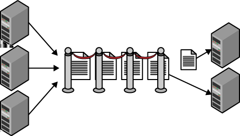

# CHAPTER 3 &emsp; Queue-Centric Workflow Pattern

<div align="justify">

This essential pattern for loose coupling focuses on asynchronous delivery of command requests sent from the user interface to a back-end service for processing. This pattern is a subset of the CQRS pattern.

The pattern is used to allow interactive users to make updates through the web tier without slowing down the web server. It is especially useful for processing updates that are time consuming, resource intensive, or depend on remote services that may not always be available. For example, a social media site may benefit from this pattern when handling status updates, photo uploads, video uploads, or sending email.

The pattern is used in response to an update request from an interactive user. This is first handled by user interface code (in the web tier) that creates a message describing work needing to be done to satisfy the update request. This message is added to a queue. At some future time, a service on another node (running in the service tier) removes messages from the queue and does the needed work. Messages flow only in one direction, from the web tier, onto the queue, and into the service tier. This pattern does not specify how (or if) the user is informed of progress.

This is an asynchronous model, as the sender does not wait around for a response. In fact, no response is directly available. (In programming parlance, the return value is void.) It helps the user interface maintain consistently fast response times.

<table>
    <tr>
        <td>
            
        </td>
        <td>
            The web tier does not use this pattern for read-only page view requests; this pattern is for making updates.
        </td>
    </tr>
</table>

 
## Context

The Queue-Centric Workflow Pattern is effective in dealing with the following challenges:

- Application is decoupled across tiers, though the tiers still need to collaborate
- Application needs to guarantee *at-least-once processing* of messages across tiers
- A consistently responsive user experience is expected in the user interface tier, even though dependent processing happens in other tiers
- A consistently responsive user experience is expected in the user interface tier, even though third-party services are accessed during processing

This pattern is equally applicable to web applications and mobile applications that access the same functionality through web services. Any application serving interactive users is a candidate.


### Cloud Significance

By using cloud services, the infrastructure aspects of this pattern are generally straightforward to implement. They can be far more complex outside the cloud. Reliable queues are available as a cloud service.

Storage of intermediate data is also simplified using cloud services. Cloud services are available for storage, NoSQL databases, and relational databases.


## Impact
Availability, Reliability, Scalability, User Experience


## Mechanics

The Queue-Centric Workflow Pattern is used in web applications to decouple communication between the web tier (which implements the user interface) and the service tier (where business processing happens).

Applications that do not use a pattern like this typically respond to a web page request by having user interface code call directly into the service tier. This approach is simple, but there are challenges in a distributed system. One challenge is that all service calls must complete before a web request is completed. This model also requires that the scalability and availability of the service tier meet or exceed that of the web tier, which can be tenuous with third-party services. A service tier that is unreliable or slow can ruin the user experience in the web tier and can negatively impact scalability.
 
The solution is to communicate asynchronously. The web tier sends *commands* to the service tier, where a *command* is a request to do something. Examples of commands include: create new user account, add photo, update status (such as on Twitter or Facebook), reserve hotel room, and cancel order.

<table>
    <tr>
        <td>
            
        </td>
        <td>
            The term asynchronous can apply to different aspects of application implementation. User interface code running in the web tier may invoke services asynchronously. This enables work to be done in parallel, potentially speeding up processing of that user request. Once all asynchronous services calls complete, the user request can be satisfied. This handy coding tactic should not be confused with this pattern.
        </td>
    </tr>
</table>

Commands are sent in the form of messages over a queue. A queue is a simple data structure with two fundamental operations: *add* and *remove*. The behavior that makes it a queue is that the remove operation returns the message that has been in the queue the longest. Sometimes this is referred to as FIFO ordering: first in, first out. Invoking the add operation is commonly referred to as enqueuing and invoking the delete operation is *dequeuing*.

In the simplest (and most common) scenarios, the pattern is trivial: the sender adds command messages to the queue (*enqueues messages*), and a receiver removes those command messages from the queue (*dequeues messages*) and processes them. This is illustrated in Figure 3-1. (We’ll see later that the programming model for removing messages from the queue is more involved than a simple dequeue.)

The sender and receiver are said to be *loosely coupled*. They communicate only through messages on a queue. This pattern allows the sender and receiver to operate at different paces or schedules; the receiver does not even need to be running when the sender adds a message to the queue. Neither one knows anything about the implementation of the other, though both sides do need to agree on which queue instance they will use, and on the structure of the command message that passes through the queue from sender to receiver.

<div align="center">



*Figure 3-1. The web tier adds messages to the queue. The service tier removes and processes messages from the queue. The number of command messages in the queue fluctuates, providing a buffer so that the web tier can offload work quickly, while never overwhelming the service tier. The service tier can take its time, only processing new messages when it has available resources.*

</div>

The sender need not be a web user interface; it could also be a native mobile application, for example, communicating through web services (as with a REST API). There could also be multiple senders and multiple receivers. The pattern still works.

The rest of this pattern description is concerned with guarding against failure scenarios and handling user experience concerns.


### Queues are Reliable

The workflow involves the sender adding a message to a queue that is removed at some point by the receiver. Are we sure it will get there?

It is important to emphasize that the cloud queue service provides a *reliable queue*. The “reliable” claim stems primarily from two sources: durability of the data, and high throughput (at least hundreds of interactions per second).

<table>
    <tr>
        <td>
            
        </td>
        <td>
            The queue achieves data durability the same way that other cloud storage services do: by storing each byte entrusted to the service in triplicate (across three disk nodes) to overcome risks from hardware failure.
        </td>
    </tr>
</table>

The queue itself is reliable and will not lose our data, but this pattern is not designed to shield our application from all failures. Rather, the pattern requires that our application implement specific behaviors to respond successfully to failure scenarios.

 
### Programming Model for Receiver

When implementing the receiver, the programming model for using the reliable queue service sometimes surprises developers, as it is slightly more complicated than for a basic queue:

1.	Get the next available message from the queue
2.	Process the message
3.	Delete the message from the queue

The implementation first *dequeues* the message, and then later *deletes* the message. Why the two-phase removal? This is to ensure *at-least-once processing*.


#### **Invisibility window and at-least-once processing**

Processing a command request involves getting a message from the queue, understanding the message contents, and carrying out the requested command accordingly. The details for this are specific to the application. If everything goes as planned, deleting the message from the queue is the last step. Only at that point is the command completely processed.

But everything does not always go as planned. For example, there might be a failure that is outside the control of your application code. These types of failures can happen for a number of reasons, but the easiest to understand is a hardware failure. If the hardware you are using fails out from under you, your process will be stopped, no matter where it is in its life cycle. Failure can occur if the cloud platform shuts down a running node because the auto-scaling logic decided it wasn’t needed. Or, your node may be rebooted.

<table>
    <tr>
        <td>
            
        </td>
        <td>
            Refer to <i>Node Failure Pattern</i> (Chapter 10) for more scenarios that make use of this pattern to recover from interruptions.
        </td>
    </tr>
</table>

Regardless of the reason for the failure, your processing has been interrupted and needs to recover. How does it do that?
 
When a message is dequeued, it is not removed entirely from the queue, but is instead hidden. The message is hidden for a specified amount of time (the duration is specified during the dequeue operation, and can be increased later). We call this period the *invisibility window*. When a message is within its invisibility window, it is not available for dequeuing.

> <h3 align="center">Invisibility Window Nuances</h3>
>
> During a message’s invisibility window, there is usually exactly one copy of the message being processed. There are a couple of edge cases where this might not be true. One edge case is when the code processing the message has not finished, but the invisibility window lapses, and another copy of the same message gets dequeued. At this point, there are two active copies of that message being processed. If this happens, it may be due to a bug in your code. Instead of exceeding the invisibility window, you should inform the queue that you are still working on this message and increase its invisibility window to allow sufficient time with exclusive access. (See also the discussion of poison messages below.) However, as you will learn from the CAP Theorem discussion in *Eventual Consistency Primer* (Chapter 5), this may not always be possible in a distributed system due to partitioning. Though rare, the possibility should be accounted for.
>
> An edge case can also occur with reliable queues that are *eventually consistent* (refer to Chapter 5 for more context). The bottom line here is that if two requests for the next queue item happen at nearly the same time, in rare cases, the queuing system may issue the same message in response to both requests. Amazon’s Scalable Storage Service (S3) is eventually consistent and the documentation warns of this possibility. Both Windows Azure Storage Queues and Windows Azure ServiceBus Queues are *immediately consistent*, so this edge case does not apply.

The invisibility window comes into play only when processing takes longer than is allowed. The automatic reappearance of messages on the queue is one key to overcoming failures and is responsible for the *at-least-once* part of this *at-least-once processing* model. Any message not fully processed the first time it is dequeued will have another chance. The code keeps trying until processing completes (or we give up, as explained in the poison message handling section later).

Any message that is dequeued a second time may have been partially processed the first time. This can cause problems if not guarded against.

 
#### **Idempotent processing for repeat messages**

An *idempotent* operation is one that can be repeated such that any number of successful operations is indistinguishable from a single successful operation. For example, according to the HTTP specification, the HTTP verbs PUT, GET, and DELETE are all idempotent operations: we can DELETE a specific resource once or 100 times and the end result is equivalent; (assuming success) the resource is gone.

Some operations are considered *naturally idempotent*, such as HTTP DELETE, where idempotency essentially comes for free. A multistep financial transaction involving withdrawing money from one account and depositing it into another can be made to be idempotent, but it is definitely not naturally idempotent. Some cases are more difficult than others.

> <h3 align="center">Idempotence Is Business Equivalent</h3>
>
> No matter how many times it partially or fully completes, an idempotent process has an equivalent outcome, as long as the last instance completes successfully. Note that equivalent outcome means *business equivalence*, not *technical equivalence*. It is fine that application logs contain remnants of multiple attempts, for example, as long as the result is indistinguishable to a business user.

Cloud queue services keep track of how many times a message has been dequeued. Any time a message is dequeued, the queue service provides this value along with the message. We call this the *dequeue count*. The first time a message is dequeued, this value is one. By checking this value, application code can tell whether this is the first processing attempt or a repeat attempt.

Application logic can be streamlined for first-time processing, but for repeat attempts some additional logic may be needed to support idempotency.

> <h3 align="center">Long Processing Tasks</h3>
>
> Some cloud queue services support updating a message on the queue. For multi-step processes, as each step is completed, it can be handy to update the message on the queue with an indicator of the last completed step. As a simple example, you can design the message object so that it includes a ```LastCompletedStep``` field, which your application can use to track progress. If processing is interrupted, the updated ```LastCompletedStep``` field will be returned the next time the message is dequeued; message processing can resume with the ```LastCompletedStep``` step rather than starting from the beginning.

Consider a command to create a new user account based on a user-provided email address and the message dequeue count is two. Proper processing needs to consider the possibility that some (or all) of the processing work has been done previously and so needs to act smartly. Exactly how to “act smartly” will vary from application to application.

Simpler scenarios may not require any specific idempotency support. Consider the sending of a confirmation email. Because failure events are rare, and there is little harm in the occasional duplicate email, just sending the email every time may be sufficient.

> <h3 align="center">Options for Idempotent Processing</h3>
>
> Idempotent handling is easy to prescribe but not always easy to implement. More advanced approaches to idempotency are required for more complex idempotency scenarios, such as a multi-step financial transaction or an operation that spans multiple data stores.
>
> A *database transaction* is sometimes very useful in the cloud: all operations succeed or they all fail. However, often a database transaction is not practical in a cloud application either because the supported transaction scope is too narrow (for example, a transaction cannot span partitions (or shards) in a NoSQL database or a sharded relational database) or the data is being written to multiple stores across which distributed transactions are simply not supported (for example, it is not possible to wrap a transaction around changes that span a relational database and blob storage).
>
> A *compensating transaction*, where we reverse the net effect of a prior attempt, is one tool in our idempotency toolbox. Another is *event sourcing*, which is briefly mentioned in the context of CQRS in this chapter, and can sometimes provide a robust model for dealing with complex cases.

Idempotent handling is the correct first step in dealing with repeat messages. If the message repeats excessively, beyond an application-defined threshold, it should be treated as a poison message.


#### **Poison messages handling for excessive repeats**

Some messages cannot be processed successfully due to the contents of the message. These are known as poison messages.

Consider a message containing a command to create a new user account based on a user-provided email address. If it turns out that the email address is already in use, your application should still process the message successfully, but not create a new user account. This is not a poison message.

But if the email address field contained a 10,000-character string and this is a scenario unanticipated in your application code, it may result in a crash. This is a poison message.
 
If our application crashes while processing a message, eventually its invisibility window will lapse, and the message will appear on the queue again for another attempt. The need for idempotent handling for that scenario is explained in the previous section. When dealing with a poison message, the idempotent handling will never terminate.

<table>
    <tr>
        <td>
            
        </td>
        <td>
            Two decisions need to be made around poison messages: how to detect one, and what to do with it.
        </td>
    </tr>
</table>

As a message is dequeued, cloud queuing services offer a dequeue count that can be examined to determine if this is the first attempt at processing. This is the same value used for detecting repeats for purposes of idempotent handling. Your poison message detection logic must include a rule that considers any message that keeps reappearing to be treated as a poison message when it shows up the *Nth* time. Choosing a value for *N* is a business decision that balances the cost of wastefully processing a poison message with the risk of not processing a valid message. In practice, interruptions to execution tend to be infrequent, so take that into account when setting up your poison message strategy. If processing is resource intensive, perhaps taking 60 minutes, you may not want to retry any failed processes; so for *N > 1*, the message is treated as a poison message. It is common, however, to retry from once to a few times, depending on circumstances.

<table>
    <tr>
        <td>
            
        </td>
        <td>
            Correct poison message detection has some nuances. For example, having selected <i>N=3</i> to trigger poison message handling, the application code needs to check for a dequeue count of at least 3, not exactly 3. A system interruption could have occurred during the time after detecting the dequeue count is 3, but before removing the message from the main queue.
        </td>
    </tr>
</table>

Once a poison message has been identified, deciding how to deal with it is another business decision. If it is desirable to have a human review the poison messages to consider how to improve handling, then one approach is to use what is known as a *dead letter queue*, a place for storing messages that cannot be processed normally. Some queuing systems have built-in support for a dead letter queue, but it is not hard to roll your own. For low importance messages, you may even consider deleting them outright. The key point is to remove poison messages from the main processing queue as soon as the application detects them.

<table>
    <tr>
        <td>
            
        </td>
        <td>
            Unless we guard against the poison message scenario, a poison message will last a long time on our queue and waste processing resources. In extreme cases, with many active poison messages, all processing resources could end up dedicated to poison message processing!
        </td>
    </tr>
</table>
 
A dequeue count greater than one does not necessarily mean a poison message is present. The value is a dequeue count, not a poison message count.


### User Experience Implications

This pattern deals with asynchronous processing, repeated processing, and failed requests. All of these have user experience implications.

Handling asynchronous processing in a user interface can be tricky and application specific. We want the human-facing user interface to be responsive, so instead of performing lengthy work while the user waits, we queue up a command request for that work. This allows the user interface to return as soon as possible to the user (improving user experience) and allows the web server tier to remain focused on serving web pages (enhancing scalability).

The flip side here is that you now need your users to understand that even though the system has acknowledged their action (and a command posted), processing of that action was not immediately completed. There are a number of approaches to this.

In some cases, users cannot readily tell if the action completed, so special action is not required.

In cases where the user wants to be notified when their action will be completed, an email upon completion might do the trick. This is common in ecommerce scenarios where “your order has shipped” and other notifications of progress are common.

Sometimes users will prefer to wait around while a task completes. This requires either that the user interface layer polls the service tier until the task completes or the service tier proactively notifies the user interface layer. The proactive notification can be implemented using *long polling*. In long polling, the web client creates an HTTP connection to the server, but the server intentionally does not respond until it has an answer.

<table>
    <tr>
        <td>
            
        </td>
        <td>
            Ready-made implementations of the long polling (also known as *Comet*) technique are available. Examples include: SignalR for ASP.NET and Socket.IO for Node.js. These libraries will take advantage of HTML5 Web Sockets if available.
        </td>
    </tr>
</table>
 
Using the long polling technique is different than having the original (time-consuming) action done “inline” from the web tier. Blocking at the web tier until the action is complete would hurt scalability. This approach still allows for the time-consuming work to be done in the service tier.

> <h3 align="center">Is This the Same as CQRS?</h3>
>
> Readers familiar with the Command Query Responsibility Segregation (CQRS) Pattern may wonder if the Queue-Centric Workflow (QCW) Pattern is really the same pattern. While similar, they are not the same. CQW is only a stepping-stone to CQRS. Understanding some of the differences and overlap will help you avoid confusing them.
>
> The defining characteristic of CQRS is the use of two distinct models: one for writing (the *write model*), and one for reading (the *read model*). Two key terms are *command* and *query*. A command is a request to make an update via the write model. A query is a request for information from the read model. Serving commands and queries are distinct activities (the “responsibility segregation”); you would never issue a command and expect data results as a return value. Even though the read model and write model may be based on the same underlying data, they surface different data models.
>
> QCW focuses on the flow of commands to the write model, while only alluding to the read model such as in support of long polling from the user interface. In this regard, it is consistent with CQRS, though not complete since QCW does not fully articulate the read model. A command in QCW is the same as a command in CQRS.
>
> A full CQRS treatment would also consider *event sourcing* and Domain Driven Design (DDD). With event sourcing, as commands result in system state changes, resulting change events are captured and stored individually rather than simply reflecting the change in the master data. For example, an *address changed* event would hold the new address information rather than just overwrite a single address field in a database. The result is a chronological history that can be replayed to arrive at current state (or any state along the way). Using event sourcing may simplify handling idempotent operations. DDD is a technology-agnostic methodology to understand business context. Neither event sourcing nor DDD are required with CQRS, but they are frequently used together.


### Scaling Tiers Independently

The queue length and the time messages spend in the queue are useful environmental signals for auto-scaling. The cloud queue services make these key metrics readily available. A growing queue may indicate the need to increase capacity in the service tier, for example. Note that the signals might indicate that only one tier or one specific processing service needs to be scaled. This concern-independent scaling helps to optimize for cost and efficiency.
 
At very high scale, the queue itself could become a bottleneck requiring multiple queue instances. This does not change the core pattern.


## Example: Building PoP on Windows Azure

The Page of Photos (PoP) application (which was described in the Preface and will be used as an example throughout the book) uses Chapter 3 to handle ingestion of new photos into the system.

Two application tiers within PoP collaborate. The user interface on the web tier is responsible for facilitating photo uploads for logged-in users and enqueuing command messages. The service tier is responsible for dequeuing and processing command messages.


### User Interface Tier

The PoP user interface running in the web tier consists of ASP.NET MVC code running on a variable number of web role instances. User authentication (logging in) is handled here, and authenticated users are allowed to upload photos.

The location of the photo being processed, a plain-text description of the photo, and the PoP user’s account identifier are stored in a message object, which is then enqueued. With PoP, the photo being processed is assumed to already have been uploaded to blob storage (using *Valet Key Pattern* (Chapter 13), when possible) and stored in Windows Azure Storage as a blob; only the reference to this blob (a URL) is stored in the message object that is enqueued. And while this particular process operates on an external resource (the photo stored as a blob), that does not imply that external resources are needed in order for this pattern to be of value. It is also common for all of the required data to be entirely contained within the message object.

Regardless of how many web role instances are running, they all submit their messages to the same Windows Azure Queue.

<table>
    <tr>
        <td>
            
        </td>
        <td>
            PoP uses the Windows Azure Storage Queue service, but Windows Azure also offers a ServiceBus Queue service. The two services share many characteristics and either is an excellent choice for PoP.
        </td>
    </tr>
</table>

The same message queue is used by both sender and receiver:

- Example message queue name: *http://popuploads.queue.core.windows.net*

Fields included in the message that goes in the queue are similar to the following:
 
- Location of uploaded photo (in blob storage): *http://popup loads.blob.core.windows.net/publicphotos/william.jpg*
- Authenticated account identifier from the *emailaddress claim*, as described in *Multisite Deployment Pattern* (Chapter 15): *kd1hn@example.com*
- ```LastCompletedStep```: 0

Note that the image is not part of the message that goes on the queue, but rather a reference to the image. The practical reason for this is the queue does not allow messages to be larger than a certain size (64 KB as of this writing). The more philosophical reason is that blob storage is the “right” place to store uploaded images on Windows Azure.


### Service Tier

PoP services are running on a variable number of worker role instances in the service tier. C# code in these services is written to constantly check the queue for new messages. Once a message becomes available on the queue, it is removed and processed.

There will be times when no messages are available on the queue. In such cases, any dequeue attempt returns immediately. It is important to avoid code hammering the queue service in a tight loop as every queue operation will cost a tiny amount of money. Be sure to add an appropriate delay.

> <h3 align="center">Watch Out for Money Leaks!</h3>
>
> As of this writing, ten million Windows Azure Storage operations will cost $1.00. Considering that this fee is charged for dequeue requests even if there is no message waiting, how expensive is that? Attempting to dequeue from an empty queue at the rate of 500 requests per second, every 200 seconds would cost one penny, and every day would add up to $4.32. Of course, you will never want to do this.
>
> Be sure to code in a delay of at least a few seconds after each unsuccessful dequeue attempt to prevent a *money leak*, a cloud platform expense that adds no business value. Just like memory leaks that, unchecked, can bring down your application, money leaks can degrade the cost efficiency of your cloud applications. Also consider variable delay techniques, similar to those described in *Busy Signal Pattern* (Chapter 9), which offer an even more sophisticated approach to battling money leaks, while also further explaining that you risk being throttled by the queue service for being hyperactive.

Each message represents a new photo upload waiting to be integrated with the rest of the PoP site. A few steps are involved: a thumbnail is created, any geotagging data is extracted, and then user account data is updated to include the new photo on their public page. After each step, the message is updated back in blob storage with an updated value for ```LastCompletedStep```.
 
PoP thumbnail creation is idempotent. This is important because if we are careless, we could end up with orphaned image files littering our blob storage account. To handle idempotent thumbnail creation, PoP chose to make the thumbnail filename deterministic by deriving it from the filename of the full-sized photo. All uploaded photos are issued a unique system-generated name such as *william.jpg*. The name of the thumbnail is derived from this by appending “_thumb” to the root filename resulting in *wil liam_thumb.jpg*. This simple approach will ensure that we always end up with a single thumbnail in blob storage. Note that while the results are not *identical* to having successfully generated the thumbnail the first time through—the time stamp on the file will be different, for example—we can safely conclude that the results are *equivalent*.

PoP has a business rule that states any message coming from the *popuploads* queue with a dequeue count of 3 or more is considered poison. When a poison message is detected, PoP sends an email informing the user who submitted the photo that it has been rejected as invalid and has been deleted.

<table>
    <tr>
        <td>
            
        </td>
        <td>
            If an application does not deal proactively with poison messages, the Windows Azure Queue service will delete them from the queue after seven days.
        </td>
    </tr>
</table>


### Synopsis of Changes to Page of Photos System

In order to process new photo uploads:

- The photo is stored in a public blob container created for that purpose.
- A message containing relevant data about the newly created photo is enqueued. This is done from the web tier (from a web role).
- A worker role in the service tier monitors the queue for messages available for processing, processing them as available.

After the message processing has completed, the at-rest state of PoP includes:

- Original photo is stored as a blob.
- Generated thumbnail is stored as a blob.
- Metadata about the photo is stored in a Windows Azure SQL Database (discussed in *Database Sharding Pattern* (Chapter 7)).

> <h3 align="center">Related Chapters</h3>
>
> - *Scalability Primer* (Chapter 1)
>
> - *Horizontally Scaling Compute Pattern* (Chapter 2)
>
> - *Auto-Scaling Pattern* (Chapter 4)
>
> - *Eventual Consistency Primer* (Chapter 5)
>
> - *Node Failure Pattern* (Chapter 10)
>
> - *Colocate Pattern* (Chapter 12)
>
> - *Valet Key Pattern* (Chapter 13)

 
## Summary

This pattern is for decoupling tiers of your application, especially between the web (user interface) tier and a service tier that does business processing. It is not useful for routine, read-only page requests. Communication is in one direction, from the web tier to the service tier, and is handled by adding messages onto a queue. Reliable cloud queue services simplify implementation. A decoupled web tier can be more responsive and reliable, providing a better user experience. Concern-independent scaling also allows each tier to be provisioned with the ideal level of resources for that tier.

</div>