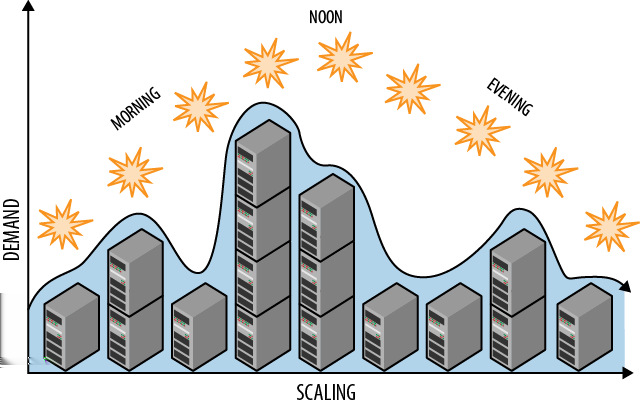

# CHAPTER 4 &emsp; Auto-Scaling Pattern

This essential pattern for automating operations makes horizontal scaling more practical and cost-efficient.

Scaling manually through your cloud vendor’s web-hosted management tool helps lower your monthly cloud bill, but automation can do a better job of cost optimization, with less manual effort spent on routine scaling tasks. It can also be more dynamic. Automation can respond to signals from the cloud service itself and scale reactively to actual need.

The two goals of auto-scaling are to optimize resources used by a cloud application (which saves money), and to minimize human intervention (which saves time and reduces errors).

## Context

The Auto-Scaling Pattern is effective in dealing with the following challenges:

- Cost-efficient scaling of computational resources, such as web tier or service tier.
- Continuous monitoring of fluctuating resources is needed to maximize cost savings and avoid delays.
- Frequent scaling requirements involve cloud resources such as compute nodes, data storage, queues, or other elastic components.

This pattern assumes a horizontally scaling architecture and an environment that is friendly to reversible scaling. Vertically scaling (by changing virtual machine size) is also possible, although is not considered in this pattern.

 
### Cloud Significance

Cloud platforms, supporting a full range of resource management, expose rich automation capabilities to customers. These capabilities allow reversible scaling and make it highly effective when used in combination with cloud-native applications that are built to gracefully adjust to dynamic resource management and scaling. This pattern embraces the inherent increase in overlap across the development and operations activities in the cloud. This overlap is known as *DevOps*, a portmanteau of “development” and “operations.”

## Impact

Cost Optimization, Scalability

<table>
    <tr>
        <td>
            
        </td>
        <td>
            This pattern does not impact scalability of the application, per se. It either scales or it does not, regardless of whether it is automated. The impact is felt on operational efficiency at scale. Operational efficiency helps to lower direct costs paid to the cloud provider, while reducing the time a staff devotes to routine manual operations.
        </td>
    </tr>
</table>

## Mechanics

Compute nodes are the most common resource to scale, to ensure the right number of web server or service nodes. Auto-scaling can maintain the *right resources for right now* and can do so across any resource that might benefit from auto-scaling, such as data storage and queues. This pattern focuses on auto-scaling compute nodes. Other scenarios follow the same basic ideas, but are generally more involved.

Auto-scaling with a minimum of human intervention requires that you schedule for known events (such as halftime during the Superbowl or business vs. non-business hours) and create rules that react to environmental signals (such as sudden surges or drops in usage). A well-tuned auto-scaling approach will resemble Figure 4-1, where resources vary according to need. Anticipated needs can be driven through a schedule, with less predictable scenarios handled in reaction to environmental signals.

*Figure 4-1. Proactive auto-scaling rules are planned, for example to add and release resources throughout the day on a schedule.*

### Automation Based on Rules and Signals

Cloud platforms can be automated, which includes programmatic interfaces for provisioning and releasing resources of all types. While it’s possible to directly program an auto-scaling solution using cloud platform management services, using an off-the-shelf solution is more common. Several are available for Amazon Web Services and Windows Azure, some are available from the cloud vendors, and some from third parties.

<table>
    <tr>
        <td>
            
        </td>
        <td>
            Be aware that auto-scaling has its own costs. Using a Software as a Service (SaaS) offering may have direct costs, as can the act of probing your runtime environment for signals, using programmatic provisioning services (whether from your code or the SaaS solution), and self-hosting an auto-scaling tool. These are often relatively small costs.
        </td>
    </tr>
</table>

Off-the-shelf solutions vary in complexity and completeness. Consult the documentation for any tools you consider. Functionality should allow expressing the following rules for a line-of-business application that is heavily used during normal business hours, but sporadically used outside of normal business hours:

- At 7:00 p.m. (local time), decrease the number of web server nodes to two.
- At 7:00 a.m., increase the number of web server nodes to ten.
- At 7:00 p.m. on Friday, decrease the number of web server nodes to one.

The individual rules listed are not very complicated, but still help drive down costs. Note that the last rule overlaps the first rule. Your auto-scaling tool of choice should allow you to express priorities, so that the Friday night rule takes precedent. Furthermore, rules can be scheduled; in the set listed above, the first two rules could be constrained to not run on weekends. You are limited only by your imagination and the flexibility of your auto-scaling solution.

Here are some more dynamic rules based on less predictable signals from the environment:

- If average queue length for past hour was less than 25, increase the number of invoice-processing nodes by 1.
- If average queue length for past hour was less than 5, decrease the number of invoice-processing nodes by 1.

These rules are reactive to environmental conditions. See *Queue-Centric Workflow Pattern* (Chapter 3) for an example where a rule based on queue length would be helpful.

Rules can also be written to respond to machine performance, such as memory used, CPU utilization, and so on. It is usually possible to express custom conditions that are meaningful to your application, for example:

- If average time to confirm a customer order for the past hour was more than ten minutes, increase the number of order processing nodes by one.

Some signals (such as response time from a compute node) may be triggered in the case of a node failure, as response time would drop to zero. Be aware that the cloud platform also intervenes to replace failed nodes or nodes that no longer respond.

Your auto-scaling solution may also support rules that understand overall cost and help you to stick to a budget.

### Separate Concerns

The first set of example rules is applied to web server nodes and the second is applied to invoice-processing nodes. Both sets of rules could apply to the same application.

<table>
    <tr>
        <td>
            
        </td>
        <td>
            Scaling <i>part</i> of an application does not imply scaling <i>all</i> of an application.
        </td>
    </tr>
</table>
 
In fact, the ability to independently scale the concerns within your architecture is an important property of cost-optimization.

When defined scale units require that resources be allocated in lockstep, they can be combined in the auto-scaling rules.

### Be Responsive to Horizontally Scaling Out

Cloud provisioning is not instantaneous. Deploying and booting up a new compute node takes time (ten or more minutes, perhaps). If a smooth user experience is important, favor rules that respond to trends early enough that capacity is available in time for demand.

Some applications will opt to follow the *N+1* rule, described in *Node Failure Pattern* (Chapter 10), where N+1 nodes are deployed even though only N nodes are really needed for current activity. This provides a buffer in case of a sudden spike in activity, while providing extra insurance in the event of an unexpected hardware failure on a node. Without this buffer, there is a risk that incoming requests can overburden the remaining nodes, reduce their performance, and even result in user requests that time out or fail. An overwhelmed node does not provide a favorable user experience.

### Don’t Be Too Responsive to Horizontally Scaling In

Your auto-scaling tool should have some built-in smarts relevant to your cloud platform that prevent it from being too active. For example, on Amazon Web Services and Windows Azure, compute node rentals happens in clock-hour increments: renting from 1:00-1:30 costs the same as renting from 1:00-2:00. More importantly, renting from 1:50-2:10 spans two clock hours, so you will be billed for both.

<table>
    <tr>
        <td>
            
        </td>
        <td>
            If you request that a node be released at 1:59 and it takes two minutes for it to drain in-process work before being released, will you be billed? Check the documentation for your cloud vendor on how strictly the clock-hour rules are enforced for these edge cases; there may be a small grace period.
        </td>
    </tr>
</table>

Set lower limits thoughtfully. If you allow reduction to a single node, realize that the cloud is built on commodity hardware with occasional failures. This is usually not a best practice for nodes servicing interactive users, but may be appropriate in some cases, such as rare/sporadic over-the-weekend availability. Being down to a single node is usually fine for nodes that do not have interactive users (e.g., an invoice generation node).

 
### Set Limits, Overriding as Needed

Implementing auto-scaling does not mean giving up full control. We can add upper and lower scaling boundaries to limit the range of permitted auto-scaling (for example, we may want to always have some redundancy on the low end, and we may need to stay within a financial budget on the high end). Auto-scaling rules can be modified as needs evolve and can be disabled whenever human intervention is needed. For tricky cases that cannot be fully automated, auto-scaling solutions can usually raise alerts, informing a human of any condition that needs special attention.

<table>
    <tr>
        <td>
            
        </td>
        <td>
            Your cloud platform most likely offers a Service Level Agreement (SLA) that asserts that your virtual machine instance will be running and accessible from the Internet some percent of time in any given month. Both Windows Azure and Amazon Web Services offer a 99.95% availability SLA. However, there is a caveat: they also require running at least two node instances of any given type in order for the SLA to be in effect.  This requirement makes perfect sense: when running with only a single node, any disruption to that node will result in downtime.
        </td>
    </tr>
</table>

### Take Note of Platform-Enforced Scaling Limits

Public cloud platforms usually have default scaling limits for new accounts. This serves to protect new account owners from themselves (by not accidentally scaling to 10,000 nodes), and limits exposure for the public cloud vendors. Because billing on pay-as-you-go accounts usually happens at the end of each month, consider the example of someone with nefarious intentions signing up with a stolen credit card; it would be hard to hold them accountable. Countermeasures are in place, including requiring a one-time support request in order to lift soft limits on your account, such as the number of cores your account can provision.

## Example: Building PoP on Windows Azure

The Page of Photos (PoP) application (which was described in the Preface) will benefit from auto-scaling. There are a number of options for auto-scaling on Windows Azure. PoP uses a tool from the Microsoft Patterns & Practices team known officially as the Windows Azure Autoscaling Application Block, or (thankfully) WASABi for short.

Unlike some of the other options, WASABi is not Software as a Service but rather software we run ourselves. We choose to run it on a single worker role node using the smallest available instance (Extra Small, which costs $0.02/hour as of this writing).

<table>
    <tr>
        <td>
            
        </td>
        <td>
            It is common for cloud applications to make use of a single-role “admin” role instance for handling miscellaneous duties. This is a good home for WASABi.
        </td>
    </tr>
</table>

WASABi can handle all the rules mentioned in this chapter. WASABi distinguishes two types of rules:

- Proactive rules, known as *constraint rules*, handle scheduled changes, minimum and maximum instance counts, and can be prioritized.
- *Reactive rules* respond to signals in the environment.

Rules for your application are chosen to align with budgets, historical activity, planned events, and current trends. PoP uses the following constraint rules:

- Minimum/Maximum number of web role instances = 2 / 6
- Minimum/Maximum number of image processing worker role instances (handling newly uploaded images) = 1 / 3

PoP has reactive rules and actions based on the following signals in the environment:

- If the ASP.NET Request Wait Time (performance counter) > 500ms, then add a web role instance.
- If the ASP.NET Request Wait Time (performance counter) < 50ms, then release a web role instance.
- If average Windows Azure Storage queue length for past 15 minutes > 20, then add an image processing worker role instance.
- If average Windows Azure Storage queue length for past 15 minutes < 5, then release an image processing worker role instance.

The third rule has the highest priority (so will take precedence over the others), while the other rule priorities are in the order listed.

<table>
    <tr>
        <td>
            
        </td>
        <td>
            WASABi rules are specified using an XML configuration file and can be managed (after deployment) using PowerShell cmdlets.
        </td>
    </tr>
</table>

To implement the ASP.NET Request Wait Time, WASABi needs access to the performance counters from the running web role instances. This is handled through Windows Azure Diagnostics, operating at two levels.
 
First, each running instance is configured to gather data that you specify such as log files, application trace output (“debug statements”), and performance counters.

Second, there is a coordinated process that rounds up the data from each node and consolidates them in a central location in Azure Storage. It is from the central location that WASABi looks for the data it needs to drive reactive rules.

The Windows Azure Storage queue length data is gathered directly by WASABi. WASABi uses the Windows Azure Storage programmatic interface, which makes it a simple matter to access the current queue length. The queue in question here lies between the web tier and the service tier, where the image processing service runs; please see *Queue-Centric Workflow Pattern* (Chapter 3) for further context.

Although not described, PoP takes advantage of WASABi stabilizing rules that limit an overreaction to rules that might be costly. These help avoid thrashing (such as allocating a new virtual machine), releasing it before its rental interval has expired, and then allocating another right away; in some cases, the need could be met less expensively by just keeping the first virtual machine longer.

### Throttling

WASABi also distinguishes between *instance scaling*, which is what we usually mean when scaling (adding or removing instances), and *throttling*. Throttling is selectively enabling or disabling features or functionality based on environmental signals. Throttling complements instance scaling. Suppose the PoP image processing implemented a really fancy photo enhancement technique that was also resource intensive. Using our throttling rules, we could disable this fancy feature when our image processing service was overloaded and wait for auto-scaling to bring up an additional node. The point is that the throttling can kick in very quickly, buying time for the additional node to spin up and start accepting work.

Beyond buying time while more nodes spin up, throttling is useful when constraint rules disallow adding any more nodes.

WASABi throttling should not be confused with throttling described in *Busy Signal Pattern* (Chapter 9).

### Auto-Scaling Other Resource Types

Virtually all the discussion in this chapter has focused on auto-scaling for virtual machines, so what about other resource types? Let’s consider a couple of more advanced scenarios.

The web tier funnels data to the service tier through a Windows Azure Queue. This is explained further in *Queue-Centric Workflow Pattern* (Chapter 3), but the key point is that both sides depend upon reliable and fast access to that queue. While most applications will not run into this problem, individual queues have scalability limits. What happens if PoP is so popular that it must process so many queue messages per second that one queue is no longer sufficient? When one queue isn’t sufficient, the solution is to horizontally scale out to two queues, then three queues, and so on. Conversely, we can horizontally scale back (or *scale in*) as the demand recedes.

For databases, consider an online ticket sales scenario for a major event. Shortly before tickets go on sale, ticketing data is distributed (or *sharded*; see *Database Sharding Pattern* (Chapter 7)) over many SQL Database instances to handle the load needed to sell tens of thousands of tickets within minutes. Due to the many database instances, user traffic is easily handled. Once all the tickets are sold, data is consolidated and the excess database instances are released. This example is inspired by the TicketDirect case study mentioned in Appendix A.

> <h3 align="center">Related Chapters</h3>
>
> - *Horizontally Scaling Compute Pattern* (Chapter 2)
>
> - *Queue-Centric Workflow Pattern* (Chapter 3)
>
> - *Database Sharding Pattern* (Chapter 7)

## Summary

The Auto-Scaling Pattern is an essential operations pattern for automating cloud administration. By automating routine scaling activities, cost optimization becomes more efficient with less effort. Cloud-native applications gracefully handle the dynamic increases or decreases in resource levels. The cloud makes it easy to plug into cloud monitoring and scaling services, with self-hosted options also available.

