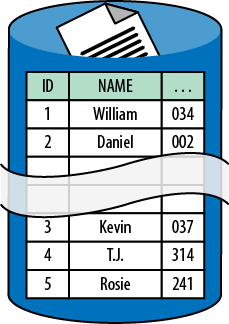

# CHAPTER 7 &emsp; Database Sharding Pattern

<div align="justify">

This advanced pattern focuses on horizontally scaling data through sharding.

To shard a database is to start with a single database and then divvy up its data across two or more databases (shards). Each shard has the same database schema as the original database. Most data is distributed such that each row appears in exactly one shard. The combined data from all shards is the same as the data from the original database.

The collection of shards is a single logical database, even though there are now multiple physical databases involved.


## Context

The Database Sharding Pattern is effective in dealing with the following challenges:

- Application database query volume exceeds the query capability of a single database node resulting in unacceptable response times or timeouts
- Application database update volume exceeds the transactional capability of a single database node resulting in unacceptable response times or timeouts
- Application database network bandwidth needs exceed the bandwidth available to a single database node resulting in unacceptable response times or timeouts
- Application database storage requirements exceed the capacity of a single database node

This chapter assumes sharding is done with a database service that offers integrated sharding support. Without integrated sharding support, sharding happens entirely in the application layer, which is substantially more complex.

 
### Cloud Significance

Historically, sharding has not been a popular pattern because sharding logic was usually custom-built as part of the application. The result was a significant increase in cost and complexity, both in database administration and in the application logic that interacts with the database. Cloud platforms significantly mask this complexity.

Integrated database sharding support is available with some cloud database services, in both relational and NoSQL varieties.

<table>
    <tr>
        <td>
            
        </td>
        <td>
            Integrated sharding support pushes complexity down the stack: out of the application code and into the database service.
        </td>
    </tr>
</table>

Any database running on a single node is ultimately limited. Capacity limits are lower in the cloud than they are with customer-owned high-end hardware. Therefore, limits in the cloud will be reached sooner, requiring that database sharding occur sooner. This may lead to an increase in sharding popularity for cloud-native applications.


## Impact

Scalability, User Experience


## Mechanics

Traditional (non-sharded) databases are deployed to a single database server node. Any database running on a single node is limited by the capacity of that node. Contention for resources such as CPU, memory, disk speed, data size, and network bandwidth can impair the database’s ability to handle database activity; excessive contention may overwhelm the database. This limited capacity is exacerbated with cloud database services because the database is running on commodity hardware and the database server is multitenant. (Multitenancy is described in *Multitenancy and Commodity Hardware Primer* (Chapter 8).)

There are many potential approaches for scaling an application database when a single node is no longer sufficient. Some examples include: distributing query load to *slave nodes*, splitting into multiple databases according to the type of data, and vertically scaling the database server. To handle query load (but not write/update), slave nodes are replicated from a master database; slave nodes are read-only and are typically *eventually consistent*. Another option is splitting into multiple databases according to the type of data, such as inventory data in one database and employee data in another. In the cloud, vertically scaling the database is possible if you are willing to manage your own database server—a painful tradeoff—while still constrained by maximum available virtual machine size. The cloud-native option is database sharding.

The Database Sharding Pattern is a horizontal scaling approach that overcomes the capacity limits of a single database node by distributing the database across multiple database nodes. Each node contains a subset of the data and is known as a *shard*. Collectively, the data in all the shards represents a complete logical database. In a database service with integrated sharding, the collection of shards appears to applications as a single database with a single database connection string. This abstraction is a great boon to simplifying the programming model for applications. However, as we shall see, there are also limitations.

> <h3 align="center">Shards Are Autonomous</h3>
>
> Sharding is a horizontal scaling strategy in which resources from each shard (or node) contribute to the overall capacity of the sharded database. Database shards are said to implement a *shared nothing* architecture that simply means that nodes do not share with other nodes; they do not share disk, memory, or other resources.
>
> For the approach to be efficient, common business operations must be satisfied by interacting with a single shard at a time. Cross-shard transactions are not supported.
>
> Basically, shards do not reference other shards. Each shard is autonomous.

<br>

<div align="center">



*Figure 7-1. Data rows are distributed across shards, while maintaining the same structure. Two shards are depicted: one shard holds rows with ID=1-2, the other holds rows with ID=3-5.*

</div>
 
In the most straightforward model as shown in Figure 7-1, all shards have the same database schema as the original database, so they are structurally identical, and the database rows are divvied up across the shards. The exact manner in which these rows are divvied up is critical if sharding is to provide the desired benefits.


### Shard Identification

A specific database column designated as the *shard key* determines which shard node stores any particular database row. The shard key is needed to access data.

As a naïve but easily understood example, the shard key is the *username* column and the first letter is used to determine the shard. Any usernames starting with A-J are in the first shard, and K-Z in the second shard. When your customer logs in with their username, you can immediately access their data because you have a valid shard key.

A more complex example might shard on the *customerid* column that is a GUID. When your customer logs in with their username, you do not have a valid shard key. You can maintain a mapping table, perhaps in a distributed cache, to look up the shard key (*customerid*) from their username. Then you can access their data.


### Shard Distribution

Why are you sharding? Answering this question is a good start for determining a reasonable sharding strategy. When you are sharding because data will not fit into a single node instance, divide the data into similarly sized shards to make it fit. When you are sharding for performance reasons, divide the data across shard nodes in such a way that all shard nodes experience a similar volume of database queries and updates.

When sharding for scalability or query performance, shards should be added before individual nodes can no longer keep pace with demand. Runtime logging and analytics are important in understanding the behavior of a sharded database. Some commercial databases do this analysis for you and shard automatically.

It is important that a single shard at a time can satisfy most of the common database operations. Otherwise, sharding will not be efficient.

Reporting functions such as aggregating data can be complicated because they span shards. Some database servers offer services to facilitate this. For example, Couchbase supports MapReduce jobs that span shards. If the database server does not have support for this, such scenarios must be handled in the application layer, which adds complexity.

More advanced scenarios are possible. Different sets of tables might use different shard keys, resulting in multiple sets of shards. For example, separate shards may be based on *customer* and *inventory* tables. It might also be possible to create a composite shard key by combining keys from different database entities.

 
### When Not to Shard

Database schemas designed for cloud-native applications will support sharding. However, it should not be assumed that any database is easily updated to support sharding. This may be especially true of older databases that have evolved over many years. While a detailed analysis is beyond the scope of this chapter, a poorly modeled database is a bad choice.

It is worth emphasizing that even though they are not the subject of this book because they are not different in the cloud, database optimization techniques, proper indexing, query tuning, and caching are still completely useful and valid in the cloud. Just because the cloud allows you to more easily shard doesn’t make it the solution to every database scaling or performance problem.

> <h3 align="center">Is Cloud-Native Right for Your Application?</h3>
>
> To maximize the value of the cloud, we build cloud-native applications. Building cloud-native applications requires that we think differently about some important aspects of architecture. However, building cloud-native applications does not mean that we forget all of our database tuning skills, as so many of them remain extremely useful.
>
> Furthermore, while this is a book of patterns for building cloud-native applications, that’s not the right approach for every application. Database architecture is central to many existing applications, and changing from a vertical scaling approach to a horizontal scaling approach is a big change. Sometimes the right business decision will be to host your own instance of a relational database so that you can still move to the cloud without changing the database architecture. Of course, you will forego many of the benefits, but at least it is possible through use of Linux or Windows virtual machines running on the Amazon or Windows Azure platforms. This can also serve as a temporary or transitional solution on the way to becoming fully cloud-native.


### Not All Tables Are Sharded

Some tables are not sharded, but rather replicated into each shard. These tables contain *reference* data, which is not specific to any particular business entity and is *read-mostly*. For example, a list of zip codes is reference data; the application may use this data to determine the city from a zip code. We duplicate reference data in each shard to maintain shard autonomy: all of the data needed for queries must be in the shard.

The rest of the tables are typically sharded. Unlike reference data, any given row of a sharded table is stored on exactly one shard node; there is no duplication.

The sharded tables typically include those tables responsible for the bulk of the data size and database traffic. Reference data typically does not change very often and is much smaller than business data.

 
### Cloud Database Instances

Using multiple database instances as a single logical database can bring some surprises. It is a distributed system, so the internal clocks on instances are never exactly the same. Be careful in making assumptions about timestamps across shards when using the database time to establish chronological order.

Further, cloud databases are set to Universal Coordinated Time (UTC), not local time. This means that application code is responsible for translating into local time as needed for reporting and user interface display.


## Example: Building PoP on Windows Azure

The Page of Photos (PoP) application (which was described in the Preface) uses Windows Azure SQL Database to manage user-generated data about the photos. Basic account information includes name, login identifier (email address), and folder name; for example, the folder *kevin* corresponds to the photo page *http://pageofphotos.com/ kevin*. Photo data includes a description, timestamp, and geographic location.

<table>
    <tr>
        <td>
            
        </td>
        <td>
            In June 2012, the SQL Azure service was renamed to Windows Azure SQL Database, or simply SQL Database. Because the SQL Azure name was around for a long time, many people still use the old name and most existing web information was written with the old name. The new name is used in this book.
        </td>
    </tr>
</table>

There is also data that spans photos and spans accounts. Photo tags are shared across photos, geographic data is correlated (“other photos taken nearby”), and comments from one user to another create cross-references to other accounts. Users can follow other users’ pages (so you can get an alert email when they post a new photo), and so forth. Data that is naturally relational suggests that using a relational database may be a good choice.

PoP grew in popularity over time and eventually reached the point where there were so many active users that the volume of database activity started to become a bottleneck. As explained in *Busy Signal Pattern* (Chapter 9), occasional throttling should be expected, but usage was too high for a single database instance to handle. To overcome this, the PoP database was sharded: we spread the demand across shards so that any individual shard can easily handle its share of the volume.

Windows Azure SQL Database offers integrated sharding support through a feature known as *Federations*. This feature helps applications flexibly manage a collection of shards, keeping the complexity out of the application layer. PoP uses the Federations feature to implement sharding.

<table>
    <tr>
        <td>
            
        </td>
        <td>
            The Federations feature uses different terminology than is used so far in this chapter. A <i>federation</i> is equivalent to a shard, a <i>federation key</i> is equivalent to a <i>shard key</i>, and a <i>federation member</i> is a database node hosting a federation. The remainder of this section will use the terminology specific to Windows Azure SQL Database.
        </td>
    </tr>
</table>

PoP identifies users by their email address and uses that as its federation key. With Federations, the application is responsible for specifying the range of data in each federation based on the federation key. In the case of PoP, the first step is to simply spread the workload across two federations. This works well with data associated with email addresses beginning with characters “a” through “g” in the first federation, and the rest of the data in the second federation.

A one-time configuration is necessary to enable federations, with the most important operation being the establishment of the federation ranges. This is done using a new database update command, ```ALTER FEDERATION```. Once federation ranges are defined by the application, the Federations feature gets busy moving data to the appropriate federation members. There is a small amount of boilerplate code needed in application code (issuing a ```USE FEDERATION``` command), but the application logic is otherwise essentially the same as when using SQL Database without Federations.

<table>
    <tr>
        <td>
            
        </td>
        <td>
            The ALTER FEDERATION command currently supports a SPLIT AT directive, which is used to specify how to divvy up the data across shards. The inverse, MERGE AT, has not yet been released. Until MERGE AT (or equivalent) is released, reducing the number of shards in your SQL Database is more cumbersome than it will be ultimately. See Appendix A for a reference on how to simulate MERGE AT today.
        </td>
    </tr>
</table>


### Rebalancing Federations

Through growth, PoP will eventually need to rebalance the federations. For example, the next step could be to spread the data equally across three federations. This is one of the most powerful aspects of Federations: it will handle all rebalancing details behind the scenes, without database downtime, and maintain all ACID guarantees, without the application code needing to change.

<table>
    <tr>
        <td>
            
        </td>
        <td>
            Federations will handle the distribution of data across federations, including redistributes, without database downtime. This is one of the two big differences between sharding at the application layer. The other big difference is that Federations appears as a single database to the application, regardless of how many federation members there are. This abstraction allows the application to deal with only a single database connection string, simplifying caching and database connection pooling.
        </td>
    </tr>
</table>


### Fan-Out Queries Across Federations

Recall that in database sharding, not all tables are federated. Reference data is replicated to all federation members in order to maintain autonomy. If reference tables are not replicated to individual federation members, they cannot be joined to during database queries without involving multiple federations.

PoP has some reference data that supports a feature that allows users to tag photos with a word such as ***redsox***, ***theater***, ***heavy metal***, or ***manga***. In order to promote consistency across users, these tags are stored in a shared table in a Windows Azure SQL Database that is frequently used in queries and updates across multiple federations. This is reference data, so we replicate it to each federation.

What happens when we need to add a new tag? We write application code to replicate our changes across all federations. We do this using a fan-out query that visits each federation member and applies the update. Because it happens from application code, the different federation members will have different sets of tags while the fan-out query is in progress. It is an acceptable business risk for PoP if the list of photos tags is eventually consistent. 
 
> <h3 align="center">Fanning Out</h3>
>
> The PoP reference data example uses a fan-out query to replicate a reference data change across all federation members. This is known as a fan-out query since it “fans out” to every federation member, but it isn’t actually a query. It is an update. Queries are also possible, though be aware that all joins happen in application code. Windows Azure SQL Data Sync could also be used to keep the tags in sync across federations.
>
> A fanout query implementation resembles MapReduce: apply a query to individual federation members (map), then combine and refine that intermediate data into a final result (reduce).
>
> Not surprisingly, Hadoop on Azure is another tool that can be useful in processing large amounts of data spanning federation members. Hadoop jobs can be used for data shaping where large data sets are preprocessed such that the resulting subset can be conveniently analyzed using Excel or traditional reporting tools. As mentioned previously, *Sqoop* can be used to allow Hadoop to connect to a Windows Azure SQL Database instance.


### NoSQL Alternative

PoP data is relational, so a relational database is an appropriate tool for data management. However, other reasonable options are available, specifically a NoSQL database. There are tradeoffs.

> <h3 align="center">Relational or NoSQL?</h3>
>
> The PoP application is contrived to demonstrate use cases for cloud architecture patterns that, in turn, inspire the use of Windows Azure services and features. A reasonable review of the PoP data requirements may show that while the data contains some relationships, the relationships are not so complex that a full-featured relational database is needed. This is reasonable. No hard-and-fast rules exist regarding when to go with a full-featured relational database versus a NoSQL database, with pros and cons for either approach.

Windows Azure offers a NoSQL database as a service. This is the Table service that is part of Windows Azure Storage.

The Table service is an *key-value store*, meaning that application code specifies a *key* to set or get a *value*. It is a simple programming model. Each value can consist of many *properties* (up to 252 custom and 3 system properties). The programmer can choose among some standard data types for each custom property such as integer, string, binary data (up to 64 KB), double, GUID, and a few more. The three system properties are a timestamp (useful for optimistic locking), a partition key, and a row key.

The partition key is conceptually similar to a federation (or shard) key, and defines a grouping of data rows (each identified by row key) that are guaranteed to be stored on the same storage node. Federations are different in that each federation member hosts exactly one federation, whereas the Table service decides how many partition keys will be on each storage node, based on usage. The Table service automatically moves partitions between storage nodes to optimize for observed usage, which is more automated than Federations.

<table>
    <tr>
        <td>
            
        </td>
        <td>
            Hopefully the Federations feature will go beyond “integrated sharding” to a fully “auto-sharding” service in the future. In this (hypothetical) scenario, Federations monitors database analytics on your behalf and makes reasonable decisions to balance federations based on data size, query volume, and database transaction volume.
        </td>
    </tr>
</table>

The Azure Table service is less capable than SQL Database in managing relationships. The Table service does not support a database schema, there is nothing akin to relational database referential integrity or a constraint between two tables, and there are no foreign keys. This means that the application layer is handling any relations between values. Transactions are supported, but only within a single partition. Two related values in separate partitions cannot be updated atomically, though they can be *eventually consistent*.

In summary, NoSQL can work just fine, and some aspects are easier than using SQL Database with Federations, but other aspects are more challenging.

<table>
    <tr>
        <td>
            
        </td>
        <td>
            Cost of using the services should also be a factor. Use the Windows Azure Pricing Calculator to model the costs.
        </td>
    </tr>
</table>

> <h3 align="center">Related Chapters</h3>
>
> - *Horizontally Scaling Compute Pattern* (Chapter 2)
>
> - *Auto-Scaling Pattern* (Chapter 4)
>
> - *Eventual Consistency Primer* (Chapter 5)
>
> - *MapReduce Pattern* (Chapter 6)


## Summary

When using the Database Sharding Pattern, workloads can be distributed over many database nodes rather than concentrated in one. This helps overcome size, query performance, and transaction throughput limits of the traditional single-node database. The economics of sharding a database become favorable with managed sharding support, such as found in some cloud database services.

The data model must be able to support sharding, a possible barrier for some applications not designed with this in mind. Cross-shard operations can be more complex.

</div>